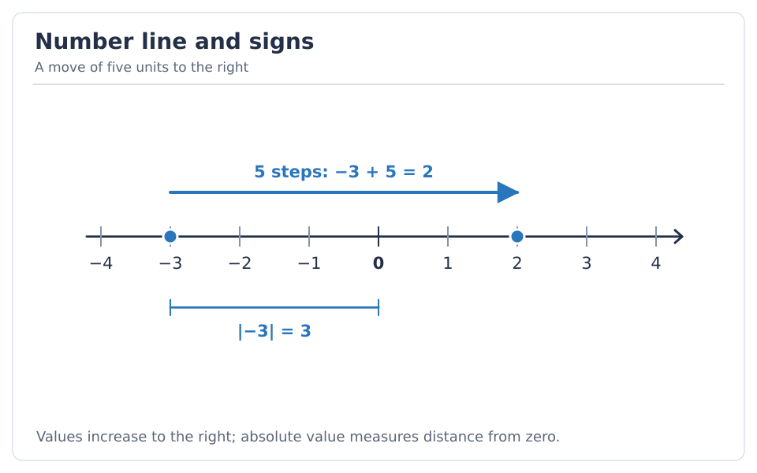

# M1-L1 – Types of numbers, negative numbers, variables and first equations {#L1}

**Course area:** M1 – Lower secondary education (Sekundarstufe I)

**Level:** Lower secondary education

**Prior knowledge:** No fixed prerequisites specified.

**Context:** Lower secondary education, roughly Year 7 of the German school system · Format: quick refresher

## What is this about? {#S1}

We use numbers to count things, compare quantities and describe changes. Positive whole numbers alone are not enough for fractions, debts or measurements. Another basic idea is to use placeholders instead of particular numbers. This gives us general statements and equations with which we can calculate unknown values.

## Types of numbers and their symbols {#S2}

The letters are shorthand for **sets** of numbers. Here a set is a collection of numbers with common properties.

| Symbol | Spoken name | Meaning | Examples / special features |
|---|---|---|---|
| $\mathbb N$ | natural numbers | Counting numbers | 1, 2, 3, …; 0 is included under some conventions |
| $\mathbb Z$ | integers | Positive and negative whole numbers and zero | …, −2, −1, 0, 1, 2, … |
| $\mathbb Q$ | rational numbers | Can be written as a fraction of two integers with a non-zero denominator | $\frac12,-\frac34,2.5$ |
| $\mathbb R$ | real numbers | Rational and irrational numbers together | $-2,0,\sqrt2,\pi$ |

These sets are contained within one another: every natural number is an integer, every integer is rational and every rational number is real. There are also real numbers that cannot be written as a fraction of two integers, for example $\sqrt2$ and $\pi$. The symbols √ and π will be explored further in later lessons: √ means square root, and π (‘pi’) is the circle constant.

## Negative numbers on the number line {#S3}

**0** is the reference point. Larger values lie to the right, smaller ones to the left. The sign **−** indicates a negative number; between two numbers it can mean subtraction.

{alt="Number line from minus four to four: five steps to the right from minus three give two; the absolute value of minus three is three."}

Number line: $-3+5=2$. The absolute value $|-3|$ is the distance from zero.

**Mini-example – formula:**

$-3+5=2$

**Read aloud:** ‘Minus three plus five equals two.’

Starting at $-3$, we move five steps to the right and arrive at 2. The same principle can describe a change in temperature or a bank account transaction, for example.

## Variables and equations {#S4}

A **variable** is a letter representing a value. The symbol $x$ (‘ex’) is not a special type of number: its meaning comes from the problem. The multiplication sign between a number and a variable can be left out; $2x$ means ‘two times x’.

**Formula:**

$2x+3=11$

**Read aloud:** ‘Two times x plus three equals eleven.’

We are looking for a value whose double, increased by three, is eleven. The solution is $x=4$, because $2\cdot4+3=11$. The symbol `·` is read as ‘times’, and `=` as ‘equals’.

## Guide to reading symbols {#S5}

| Symbol | Pronunciation | Meaning here | Other possible uses |
|---|---|---|---|
| $\mathbb N,\mathbb Z,\mathbb Q,\mathbb R$ | natural numbers, integers, rational numbers, real numbers | Sets of numbers | Sets defined in higher mathematics |
| $x$ | ex | Unknown numerical value | Coordinate, input quantity |
| − | minus | Negative or subtraction | Sign of an expression |
| \+ | plus | Addition | Also operations combining other mathematical objects |
| = | equals | Identical numerical value on both sides | Sometimes assignment in programming languages |
| $2x$ | two times x | Multiplication without `·` | Also common with other variables |

## What is it useful for? {#S6}

Types of numbers define what inputs a program can sensibly accept: the number of jobs completed is usually a non-negative integer, a position can be negative, and a measurement can be fractional. Variables and equations help us model costs, resources, running times or physical quantities in a general way.

## Assumptions and limitations {#S7}

The quantity sought must fit the situation: if $x$ is a number of items, $x=4.5$ would generally not be a sensible solution. In real software, theoretical number sets also differ from data types of limited size and floating-point numbers.

## Link to [M1-L2](M1-L2.md) {#S8}

Fractions and percentages turn simple counts into **proportions and relationships between quantities**.

## Sources (external) {#S9}

No external sources listed.
