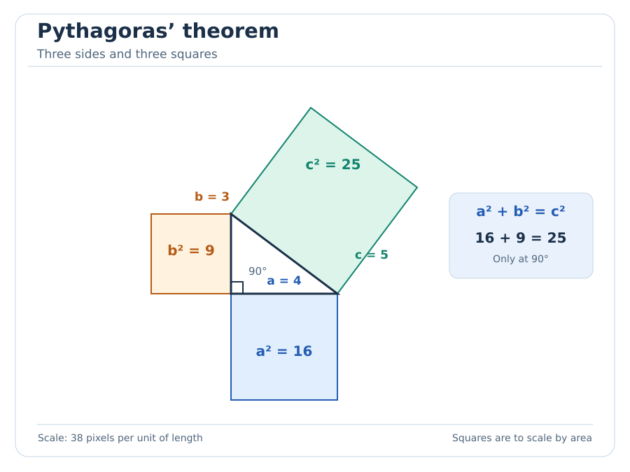

# M1-L10 – Pythagoras’ theorem, distances and lengths {#L10}

**Course section:** M1 – Lower secondary education (Sekundarstufe I)

**Level:** Lower secondary education

**Prior knowledge:** No fixed prerequisites specified.

**Classification:** Lower secondary education, approximately Year 8 of German schooling · Format: quick revision

## What is this about? {#S1}

How long is a diagonal line segment if we know only the horizontal and vertical distances? Pythagoras’ theorem answers exactly this question for right-angled triangles. It connects three side lengths without requiring us to measure the diagonal directly. The same idea later helps us calculate distances between coordinate points, screen diagonals and the paths of a robot.

## Basic idea and illustration {#S2}

Imagine a right-angled triangle: one side is horizontal, one is vertical and the third joins them diagonally. The angle between the first two sides is exactly 90 degrees, a right angle. The two sides at the right angle are the **shorter sides**; the longest side, opposite the right angle, is the **hypotenuse**. The squares on the shorter sides have the same combined area as the square on the hypotenuse. This leads to the famous formula for lengths.

{alt="Right-angled 3-4-5 triangle with square areas of 9, 16 and 25 on the three sides. The two squares on the shorter sides together equal the square on the hypotenuse."}

Original construction in the ratio 3-4-5: $3^2+4^2=5^2$, so $9+16=25$.

A plain-text sketch that works in any Markdown reader:

Formula, sketch or calculation scheme · Original notation

    C  *
       |\
     b | \ c   (sloping hypotenuse)
       |  \
       |___\
    A  * a * B

    Right angle at A; shorter sides a and b, hypotenuse c.

## New symbols before the first formula {#S3}

| Symbol | Pronunciation | Meaning here | Other possible uses |
|---|---|---|---|
| $a$, $b$ | a and b | Lengths of the two shorter sides | Any variables; $b$ was the intercept in [M1-L8](M1-L8.md) |
| $c$ | see | Length of the hypotenuse | Often any constant |
| `²` | to the power of two, squared | Multiplication of a length by itself | Units of area: square centimetres or square metres |
| `+` / `=` | plus / equals | Addition or equal areas | Arithmetic operations in general |
| `√` | square root | Non-negative number whose square gives the specified value | Roots of other orders are distinguished later |
| $d$ | dee | Distance to be found | Can also mean diameter or appear in differential notation |
| $\Delta x$, $\Delta y$ | delta x, delta y | Difference in the x- or y-coordinate respectively | Delta as change, already explained in [M1-L8](M1-L8.md) |
| $P$, $Q$ | pee and cue | Names of two points | $P$ also denotes probability from [M1-L12](M1-L12.md) onwards |
| `⊥` | is perpendicular to | Symbol for a right angle between lines or line segments | Perpendicular vectors in later lessons |

## Most important formula 1: Pythagoras’ theorem {#S4}

$$
a^2+b^2=c^2
$$

**Read aloud:** ‘a squared plus b squared equals c squared.’ This refers to the **squares of the side lengths**, not simply the three lengths themselves. $a$ and $b$ are the shorter sides; $c$ is the hypotenuse. The theorem applies to **right-angled triangles** in the ordinary Euclidean plane. **All three side lengths of a genuine triangle are strictly positive.** A length of zero describes only a degenerate limiting case, not an ordinary triangle; negative side lengths are excluded.

If the hypotenuse is unknown, we take the non-negative square root:

$$
c=\sqrt{a^2+b^2}
$$

**Read aloud:** ‘c is the square root of the sum of a squared and b squared.’ Calculate the expression inside the root first. The root gives the positive length, or zero in the limiting case, not an additional negative solution.

### Mini-example: a diagonal without a tape measure {#abschnitt-5}

A rectangular screen area has a width of 30 centimetres and a height of 40 centimetres. The diagonal is the hypotenuse of the right-angled triangle:

$$
\begin{aligned}
a&=30\,\mathrm{cm}\\b&=40\,\mathrm{cm}\\
c^2&={(30\,\mathrm{cm})}^2+{(40\,\mathrm{cm})}^2\\
&=900\,\mathrm{cm}^2+1600\,\mathrm{cm}^2=2500\,\mathrm{cm}^2\\
c&=\sqrt{2500\,\mathrm{cm}^2}=50\,\mathrm{cm}
\end{aligned}
$$

**Read aloud:** ‘Thirty centimetres squared plus forty centimetres squared equals two thousand five hundred square centimetres. Taking the square root gives fifty centimetres.’ The diagonal is therefore 50 centimetres long. **The units are squared as well:** ${(30\,\mathrm{cm})}^2$ means $900\,\mathrm{cm}^2$, not $900\,\mathrm{cm}$. After taking the square root we again obtain a length in centimetres.

### What is the idea behind the proof? {#abschnitt-6}

Four identical right-angled triangles can be placed in a large square in two different ways. The remaining area must be the same in both arrangements. In one case it is the square on the hypotenuse; in the other it is the sum of the squares on the shorter sides. This gives a visual reason why the formula works; a formal proof would need to describe the division of the area precisely.

## Most important formula 2: distance between two points {#S5}

A point has an ordered pair of coordinates as in M1-L4. $P(x_1;y_1)$ denotes a first point with coordinates ‘x one’ and ‘y one’, and $Q(x_2;y_2)$ a second point. The small lowered numbers **1 and 2** distinguish the two points; they are not exponents.

The horizontal coordinate difference is $\Delta x=x_2-x_1$, and the vertical difference is $\Delta y=y_2-y_1$. These two distances form the shorter sides of a right-angled triangle. The direct distance is therefore:

$$
d=\sqrt{{(x_2-x_1)}^2+{(y_2-y_1)}^2}
$$

**Read aloud:** ‘The distance d is the square root of: the difference between the second and first x-coordinates squared plus the difference between the second and first y-coordinates squared.’ Both differences are squared, so their possibly negative signs do not affect the distance. The coordinates must refer to the same unit and the same **orthogonal coordinate system with equal length scales**. If the axes have different units (for example, metres on one and seconds on the other), the distance shown cannot be interpreted directly as a physical length.

### Mini-example: two positions on a map {#abschnitt-8}

$$
\begin{aligned}
P(1;2),\quad Q(4;6)\\
\Delta x&=4-1=3\\
\Delta y&=6-2=4\\
d&=\sqrt{3^2+4^2}=\sqrt{9+16}=5
\end{aligned}
$$

**Read aloud:** ‘P is at one, two; Q is at four, six. The horizontal difference is three, the vertical difference four. The direct distance is five units of length.’ This is the familiar **3–4–5 configuration**.

The distance is the **straight-line distance** in the mathematical model. It is not automatically the route along roads, around obstacles or along prescribed robot tracks.

## Brief look ahead: three spatial directions {#S6}

In a three-dimensional coordinate system with perpendicular axes, there is an additional third axis, usually $z$ (‘zed’). For the coordinate differences $\Delta x$, $\Delta y$ and $\Delta z$, repeated application of the theorem gives:

$$
d=\sqrt{{(\Delta x)}^2+{(\Delta y)}^2+{(\Delta z)}^2}
$$

**Read aloud:** ‘Distance is the square root of delta x squared plus delta y squared plus delta z squared.’ Here the formula is only a preview of geometry to come; spatial coordinates are studied systematically in [M1-L21](M1-L21.md) and vectors in M2-L11.

## What is it useful for? {#S7}

In a graphics or CAD application, we use it to calculate diagonals and direct distances between pixels or geometric objects. In a simulation, an agent can determine how far apart two positions in a plane coordinate system are; in robotics, this later becomes a distance between positions in space. The underlying idea of **Euclidean length** also appears repeatedly in image processing and linear algebra.

## Assumptions and limitations {#S8}

- The basic rule $a^2+b^2=c^2$ applies only to a **right-angled** triangle. For other angles, we later need, for example, the cosine rule.
- Use the same units: do not combine centimetres and metres without conversion.
- The distance formula describes the **straight-line distance** in a Euclidean coordinate system. On a road map, along curved surfaces or with restricted directions of movement, another distance model may be appropriate.
- In software, squaring extremely large numbers can cause overflow. Suitable implementations exist for robust numerical methods, for example a hypot function.

## Link to [M1-L11](M1-L11.md) {#S9}

Pythagoras connects lengths in right-angled configurations. In **[M1-L11](M1-L11.md)** we compare geometric figures of the same shape at different sizes: **similarity, the intercept theorems and scale**.

## Sources (external) {#S10}

No external sources listed.
