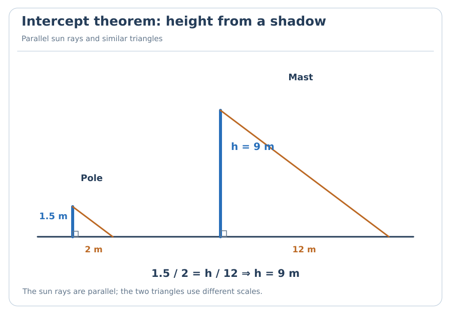

# M1-L11 – Similarity, the intercept theorems and scale {#L11}

**Course section:** M1 – Lower secondary education (Sekundarstufe I)

**Level:** Lower secondary education

**Prior knowledge:** No fixed prerequisites specified.

**Classification:** Lower secondary education, approximately Year 8 of German schooling · Format: quick revision

## What is this about? {#S1}

A photograph can be enlarged without the people in it suddenly having different proportions. Two triangles can differ in size yet have the same shape. In such situations we use the term **similarity**: corresponding angles are equal and corresponding sides are in the same ratio. The intercept theorems then help us find lengths that cannot be measured directly from lengths we know. Scale applies the same principle to maps, building plans and models.

## Basic idea and illustration {#S2}

Imagine enlarging a small triangle uniformly. Every side length increases by the same factor, and all the angles stay the same. If the factor is two, all the sides become twice as long. The shape is preserved. This is different from stretching only the width by an arbitrary amount: that could change the angles and ratios of side lengths.

For **triangles**, it is sufficient for two pairs of corresponding angles to be equal (the **angle-angle criterion**, or AA). The third angle is then also equal and all corresponding sides are in the same ratio. For arbitrary quadrilaterals, however, equal angles alone are not enough for similarity. A particularly easy case to visualise is a smaller triangle inside a larger one, with the corresponding cross-segments parallel.

## New symbols before the first formula {#S3}

| Symbol | Pronunciation | Meaning here | Other possible uses |
|---|---|---|---|
| $a$, $b$ | a, b | Side lengths of an original figure | Any variables |
| $a'$, $b'$ | a prime, b prime | Corresponding sides of a similar enlarged figure | In calculus, primes later also indicate derivatives of functions |
| $k$ | kay | Common positive enlargement or reduction factor | General constant of proportionality in [M1-L2](M1-L2.md) |
| `/` | over, divided by | Ratio of two lengths of the same kind | Division in general |
| `∼` | is similar to | Two figures have the same shape but may have different sizes | Similarity relations in other mathematical contexts |
| `∥` | is parallel to | Lines or line segments are parallel | In higher mathematics, double bars can also indicate norms |
| $S$, $A$, $B$ | ess, a, b | Labels for geometric points | Capital letters can also denote sets |
| $SA$ | segment S–A | Length of the segment between points S and A | Without context, sometimes the segment itself as an object |
| `:` | to | Scale ratio | Also division, as in [M1-L2](M1-L2.md) |

## Most important formula 1: common scale factor {#S4}

If two figures are similar, any two pairs of **corresponding** sides have the same ratio of lengths:

$$
\frac{a'}{a}=\frac{b'}{b}=k
$$

**Read aloud:** ‘a prime divided by a equals b prime divided by b and equals k.’ $a$ and $b$ denote sides of the original figure, and $a'$ and $b'$ their corresponding sides in the new figure. The positive factor $k$ describes how much the lengths are scaled. When $k=2$, all lengths are doubled; when $k=0.5$, they are halved. Original lengths must be greater than zero for the quotients shown to be defined.

### Mini-example: enlarging a triangle {#abschnitt-5}

A triangle has two sides of 3 and 4 centimetres. A geometrically similar copy is made using a scale factor of two. The corresponding sides are now 6 and 8 centimetres long. The ratios $\frac63$ and $\frac84$ both equal two; the angles remain unchanged. The third side can also be enlarged by the same factor without reconstructing every detail.

**Note on area:** Doubling the side lengths makes the area **four times** as large, not just twice as large. In general, an area increases by the square of the length factor; the volume of a similarly enlarged three-dimensional solid increases by its cube. This simple principle is important for technical estimates of size.

## Most important formula 2: the intercept theorem {#S5}

Two rays extend from a common starting point $S$. The first meets a nearby cross-segment at point $A$ and a more distant one at point $A'$. The second meets the same cross-segments at $B$ and $B'$. If cross-segments $AB$ and $A'B'$ are parallel and the named points lie on the respective rays in the specified order, two similar, non-degenerate triangles are formed. The common starting point $S$ is not on either cross-segment; all segment lengths in the following denominators are positive.

Formula, sketch or calculation scheme · Original notation

    Ray 1: S → A → A′
    Ray 2: S → B → B′

    A and B are the nearer points; A′ and B′ are further away.
    Cross-segments AB and A′B′ are parallel: AB ∥ A′B′.

For the corresponding segments:

$$
\frac{SA}{SA'}=\frac{SB}{SB'}=\frac{AB}{A'B'}
$$

**Read aloud:** ‘The distance from S to A divided by the distance from S to A prime equals the distance from S to B divided by the distance from S to B prime and equals the shorter cross-segment A–B divided by the longer cross-segment A prime–B prime.’ All three quotients compare the nearer segment with the corresponding more distant one; in the order described, the numerators represent shorter lengths than the denominators. We may also invert all the fractions at the same time, but not arbitrarily invert just one of them. **Rotating or reflecting similar figures changes neither their common ratio of lengths nor the sizes of their angles**; similar does not necessarily mean ‘oriented in the same way’.

### Mini-example: finding an unknown height from a shadow {#abschnitt-7}

A vertical rod 1.5 metres long casts a shadow 2 metres long in sunlight. At the same time, a vertical mast casts a shadow 12 metres long. Given approximately parallel sunlight and level ground, the two right-angled triangles formed are similar.

{alt="Similar right-angled triangles: a 1.5 m rod casts a 2 m shadow; a 12 m mast shadow gives a mast height of 9 m."}

Intercept theorems: equal height-to-shadow ratios give $h=9\,\mathrm m$.

$$
\begin{aligned}
\frac{\text{rod height}}{\text{rod shadow}}&=\frac{\text{mast height}}{\text{mast shadow}}\\
\frac{1.5\,\mathrm{m}}{2\,\mathrm{m}}&=\frac{\text{mast height}}{12\,\mathrm{m}}\\
\text{mast height}&=\frac{1.5}{2}\cdot12\,\mathrm{m}=9\,\mathrm{m}
\end{aligned}
$$

**Read aloud:** ‘The ratio of the rod's height to its shadow length equals the ratio of the mast's height to its shadow length.’ Under the stated assumptions, the mast is 9 metres high. The result depends in particular on observing shadows and objects at the same time and with comparable ground geometry.

## Scale: the same idea on plans {#S6}

A **scale** describes the ratio of a representation to the corresponding reality. $1:50\,000$ is read ‘one to fifty thousand’. This means that one unit of length on the map corresponds to fifty thousand of **the same** units in reality.

### Mini-example: distance on a map {#abschnitt-9}

At a scale of $1:50\,000$, one centimetre on the map corresponds to 50 000 centimetres, or 500 metres, in reality. Two centimetres therefore correspond to one kilometre. The conversion applies to lengths; this does not mean that two square centimetres on the map directly correspond to one square kilometre. For areas, the scale factor must be squared.

## Geometric construction as a basic idea {#S7}

Similar triangles can be constructed systematically, for example with a ruler and compasses. Draw an initial line segment, mark equal lengths along an auxiliary ray starting at one of its endpoints and draw appropriate parallel lines. This produces proportional segments without decimal calculations. The approach connects classical construction with the intercept theorem.

## What is it useful for? {#S8}

In CAD and graphics programs, scaling helps represent objects at different sizes without distorting their shape. When using maps and technical plans, we can estimate actual lengths from measured lengths on the image. In camera geometry and image processing, similar triangles are involved in simple perspective models; more complex real cameras, however, require additional calibration.

## Assumptions and limitations {#S9}

- **Corresponding sides** must be matched correctly. Comparing two arbitrary ratios of sides does not prove similarity.
- In the classical intercept theorems, the **parallelism of the cross-segments** is essential. Without it, the equality of ratios shown does not generally hold.
- The shadow method assumes, among other things, simultaneous measurements, approximately parallel light and appropriately vertical objects.
- A technical enlargement may scale lengths proportionally and still introduce deviations due to pixel rounding, perspective or distortion.

## Link to [M1-L12](M1-L12.md) {#S10}

In [M1-L11](M1-L11.md) we started from proportional lengths. In **[M1-L12](M1-L12.md)** we now consider the number of possible arrangements and ask how **likely** individual outcomes are.

## Sources {#S11}

No individual sources are listed separately for this lesson.
