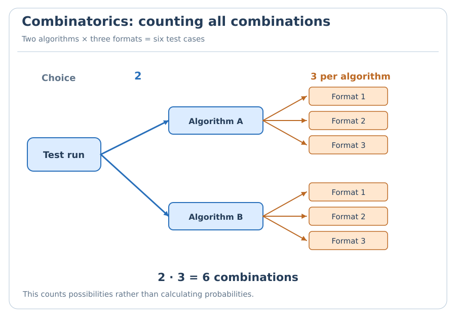

# M1-L12 – Combinatorics and simple probabilities {#L12}

**Course section:** M1 – Lower secondary education (Sekundarstufe I)

**Level:** Lower secondary education

**Prior knowledge:** No fixed prerequisites specified.

**Classification:** Lower secondary education, approximately Year 8 of German schooling · Format: quick revision

## What is this about? {#S1}

How many different possibilities arise when several decisions are made one after another? And how likely is a particular result? **Combinatorics** counts possible arrangements and selections. **Probability** assigns numbers between zero and one to possible outcomes. Both areas are useful for random experiments, but they are not the same: counting possibilities is sufficient to calculate probabilities only under certain conditions.

## Basic idea and illustration {#S2}

Imagine a test program that can choose between two options for its first setting and three options for its second setting. For each first option there are three second options. There are therefore six combinations in total. In a coin toss, however, the outcomes may be uncertain. We then also ask about the probability of a particular event, such as ‘both tosses land heads’.

An **outcome** is a single possible result of an experiment. An **event** groups one or more outcomes that we are interested in. For the calculation, we must be clear about which outcomes are possible and how their probabilities are determined.

## New symbols before the first formula {#S3}

  Symbol         Pronunciation                        Meaning here                                                                Other possible uses
  -------------- ------------------------------------ --------------------------------------------------------------------------- --------------------------------------------------------------------------------------------------
  $n$, $m$       en and em                            Numbers of possibilities in two successive decisions                        Freely chosen variables; $m$ was the gradient in [M1-L8](M1-L8.md)
  `·`            times                                Multiplication of counts or probabilities                                   Other products in higher mathematics
  `!`            factorial, e.g. three factorial      Product of all positive integers up to the stated number                    In many programming languages, `!` is logical negation
  $P(A)$         probability of A, ‘P of A’           Probability of event A                                                      $P$ was also a point label in [M1-L4](M1-L4.md)/M1-L10
  $A$            event A                              A set of outcomes of interest                                               In [M1-L5](M1-L5.md), $A$ also denotes an area
  $\Omega$       capital omega                        Set of all possible elementary outcomes                                     Other uses in physics and theoretical computer science
  $|\Omega|$     number of elements of omega          How many distinct outcomes are in $\Omega$                                  Vertical bars also denote absolute value for numbers; later, the absolute value of a determinant
  $0\le p\le1$   p is at least zero and at most one   Permitted range of values for a probability p                               Inequality notation in general
  $K$, $Z$       kay and zed                          Heads and tails respectively in a coin toss (German labels Kopf and Zahl)   Ordinary variable names in other contexts

The symbol `≤` means ‘less than or equal to’. The notation $0\le p\le1$ states that a probability is never negative and never greater than one. Multiplying it by one hundred gives a percentage.

## Main idea 1: multiplying numbers of possibilities {#S4}

If a first decision allows **n** possibilities and each of these allows **m** possibilities for a second decision, the **multiplication principle** applies:

$$
\text{number of complete combinations}=n\cdot m
$$

**Read aloud:** ‘The number of complete combinations is n times m.’ This assumes that the second stage actually offers the same number of possibilities for **every** first choice. If there are different numbers of ways to continue, we must count the possibilities on each branch and add them together.

### Mini-example: test configurations {#abschnitt-5}

A program can choose between two algorithms and three file formats. Either algorithm can be combined with any of the three formats. There are $2\cdot3=6$ test configurations.

{alt="Tree diagram with two algorithms and three file formats for each, making six combinations altogether."}

Combinatorics: two times three options give six configurations.

Formula, sketch or calculation scheme · Original notation

                      ┌─ Format 1
    Algorithm A ──────├─ Format 2
                      └─ Format 3
                      ┌─ Format 1
    Algorithm B ──────├─ Format 2
                      └─ Format 3

**Read aloud:** ‘Two algorithms times three formats give six possible pairs.’ In more complex programs the number of test cases grows rapidly with additional independent dimensions of settings – one reason to select tests carefully.

## Main idea 2: orderings without repetition {#S5}

If three **distinct** objects are all arranged in a row, there are three possibilities for the first position, then two left for the second position and only one for the third. The number is therefore $3\cdot2\cdot1=6$.

For the product of all positive integers from 1 to a positive integer $n$ we use the notation **n factorial**, or $n!$:

$$
3!=3\cdot2\cdot1=6
$$

**Read aloud:** ‘Three factorial is three times two times one, or six.’ The special convention $0!=1$ is also used in combinatorics. Here, factorials count **arrangements of distinguishable objects** when each occurs exactly once. If objects are identical or order does not matter, other counting rules apply; we study these in more detail later.

## Main idea 3: probability with equally likely outcomes {#S6}

The number of possible outcomes alone does not tell us how likely each is. For a **fair coin**, we assume that heads and tails are equally likely. Two independent tosses of such a coin produce four equally likely sequences:

Formula, sketch or calculation scheme · Original notation

    Start
    ├─ K (1/2)
    │  ├─ K (1/2)  → KK
    │  └─ Z (1/2)  → KZ
    └─ Z (1/2)
       ├─ K (1/2)  → ZK
       └─ Z (1/2)  → ZZ

The tree diagram is schematic: it shows the different paths. Each individual toss has probability $\frac12$ under the fairness assumption. A complete sequence therefore has probability $\frac12\cdot\frac12=\frac14$.

For a **finite, non-empty sample space** with **equally likely** elementary outcomes, we can calculate the probability of an event using Laplace's formula:

$$
P(A)=\frac{\text{favourable outcomes}}{\text{all possible outcomes}}
$$

**Read aloud:** ‘The probability of event A is the number of favourable outcomes divided by the total number of all possible outcomes.’ The word ‘favourable’ simply means ‘belonging to the event’, not ‘good’ or ‘desirable’. Mathematically, the denominator is $|\Omega|$, the total number of outcomes in the sample space omega; here $|\Omega|$ must be greater than zero. If outcomes are not equally likely, what matters instead is the sum of their individual probabilities.

### Mini-example: two heads {#abschnitt-8}

Event $A$ is ‘two coin tosses both land heads’. Of the four equally likely sequences `KK`, `KZ`, `ZK` and `ZZ`, only `KK` matches the event.

$$
P(A)=\frac14=0.25=25\,\%
$$

**Read aloud:** ‘The probability of two heads is one quarter, or zero point two five, or twenty-five per cent.’ This is a model probability, not a guarantee that two heads will actually occur once in every four trials.

## Tree diagram with changing probabilities {#S7}

A tree diagram can also represent **unequal** probabilities. A bag contains two red balls and one blue ball. If two balls are drawn one after the other **without replacement**, the first draw changes the composition of the bag before the second. The probability of drawing red first is $\frac23$. After drawing a red ball, only one of the two remaining balls is red. The probability of a second red ball **under this condition** is $\frac12$.

For the complete path ‘red, then red’, we therefore have:

$$
P(\text{red twice})=\frac23\cdot\frac12=\frac13
$$

**Read aloud:** ‘The probability of red twice is two thirds times one half, or one third.’ Here we multiply by a probability that explicitly depends on the first draw. The **multiplication rule along a path also applies to dependent draws**: first we use the probability of red, then the probability of red **given that** red was drawn before. The two draws without replacement are **not independent**. We will study the formal notation for conditional probabilities in M1-L22.

## What is it useful for? {#S8}

Combinatorics helps us estimate the number of possible system states, test configurations and possible sequences of actions by software agents. Probabilities appear in simulations, error analysis and later in machine learning. For AI, carefully defined random models are particularly important: a real process need not have the same probabilities as an idealised coin toss.

## Assumptions and limitations {#S9}

- The simple formula ‘favourable over all’ applies only if the elementary outcomes are **equally likely**. Otherwise, the number of possibilities alone is not enough.
- For decisions with unequal numbers of possible continuations, the multiplication principle in its simple form does not directly help; the individual cases must be counted separately.
- Drawing **with replacement** and **without replacement** produces different probability paths.
- Probabilities are statements about a model. A relative frequency from a few measurements is not automatically the true probability of a process.
- In technical simulations, the quality of the random number generator may matter; the mathematical model and its actual implementation must be distinguished.

## Link to [M1-L13](M1-L13.md) {#S10}

[M1-L12](M1-L12.md) concludes our revision of the foundations assigned approximately to Year 8 of German schooling. In **[M1-L13](M1-L13.md)** we begin **quadratic functions and equations**: parabolas, turning points and roots.

## Sources {#S11}

No individual sources are listed separately for this lesson.
