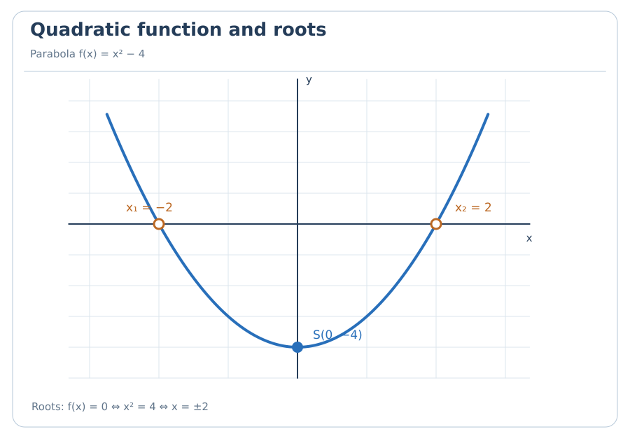

# M1-L13 – Quadratic functions and equations {#L13}

**Course section:** M1 – Lower secondary education (Sekundarstufe I)

**Level:** Lower secondary education

**Prior knowledge:** No fixed prerequisites specified.

**Classification:** Lower secondary education, approximately Year 9 of German schooling · Format: quick revision

## What is this about? {#S1}

So far we have studied relationships whose graphs are straight lines. However, some processes do not change with a constant gradient. When a quantity depends on a number multiplied by itself, a curved graph often results: a **parabola**. Quadratic functions describe, for example, projectile motion in simplified physical models, the area of a square or certain cost patterns. We use quadratic equations to find the inputs at which such a function reaches a required value.

## Basic idea and illustration {#S2}

For a linear function, equal steps in the input always increase the function value by the same amount. For a quadratic function, the increments themselves change: the curve becomes steeper or flatter. An upward-opening parabola has a lowest point; a downward-opening one has a highest point. This special point is called the **vertex**. The curve changes direction there – a first glimpse of optimisation in calculus.

{alt="Parabola y equals x squared minus 4, with vertex (0, −4) and roots −2 and 2."}

Example parabola: $f(x)=x^2-4$ with roots $x=-2$ and $x=2$.

Formula, sketch or calculation scheme · original notation

            y
            ↑      *       *
            |       *     *
            |        *   *
            |         * *
            |          S       S = vertex
            +----------------→ x

    Schematic upward-opening parabola; not to scale.

## New symbols before the first formula {#S3}

  Symbol         Pronunciation                        Meaning here                                                                      Other possible use
  -------------- ------------------------------------ --------------------------------------------------------------------------------- ---------------------------------------------------
  $f(x)$         “f of x”                             Result of a function for input x                                                  f is a freely chosen function name
  $x^2$          “x squared”                          x times x                                                                         Area calculation for side length x
  $a$, $b$, $c$  “a”, “b”, “c”                        Fixed numbers determining the shape of the parabola                               In [M1-L10](M1-L10.md), a, b and c were side lengths
  $a\ne0$        “a is not equal to zero”             Condition for a genuinely quadratic function                                      Inequality in general
  $S(x_s;y_s)$   “vertex S with x sub s and y sub s”  Coordinates of the vertex                                                         Subscripts also label measurements or list entries
  $x_1$, $x_2$   “x one”, “x two”                     Possible solutions to an equation                                                 Numbered measurements
  `±`            “plus or minus”                      Two cases: once plus, once minus                                                  Short notation for two sign cases
  `√`            “square root of”                     Non-negative square root of a non-negative number                                 Other root orders have their own notation
  $D$            “capital D”                          Here the discriminant: number under the square root in the formula for solutions  May denote another quantity in other chapters
  $p$, $q$       “p”, “q”                             Two freely chosen numbers in binomial identities                                  Other variables or probabilities in other chapters
  $|a|$          “absolute value of a”                Size of a without its sign                                                        Vertical bars can have other meanings
  `≥`            “greater than or equal to”           Comparison, for example D is at least zero                                        Inequality in general
  $\mathbb R$    “set of real numbers”                All permitted real inputs of a complete parabola                                  Also in [M1-L14](M1-L14.md) and university calculus

## Main idea 1: The general quadratic function {#S4}

A quadratic function has a term containing the square of the input:

$$
f(x)=a\cdot x^2+b\cdot x+c\qquad\text{with }a\neq0
$$

**Read aloud:** “f of x equals a times x squared plus b times x plus c, where a is not equal to zero.” The square $x^2$ is the crucial difference from the straight-line equation $f(x)=m\cdot x+b$ in M1-L8.

- **a** determines, among other things, the direction in which the parabola opens: upwards for positive a, downwards for negative a. A larger $|a|$ produces a narrower shape with the same axis scales.
- **b**, together with a, affects the horizontal position of the parabola.
- **c** is the function value at $x=0$, the intercept on the vertical axis.

A quadratic function is **not directly proportional**: even when $c=0$, the relationship is not generally linear.

### Mini-example: Values and the shape of a parabola {#abschnitt-5}

$$
\begin{aligned}
f(x)&=x^2\\
&\begin{array}{c|rrrrr}x&-2&-1&0&1&2\\f(x)&4&1&0&1&4\end{array}
\end{aligned}
$$

**Read aloud:** “f of x is x squared.” Both minus two and plus two give four, since the square of each number is four. Inputs equally far from zero have the same function value. This is why the parabola is symmetrical about the vertical axis.

## Main idea 2: Vertex and vertex form {#S5}

If the parabola opens upwards, the vertex gives the smallest function value. A particularly helpful way of writing the function is:

$$
f(x)=a\cdot{(x-x_s)}^2+y_s
$$

**Read aloud:** “f of x equals a times the bracket x minus x sub s squared, plus y sub s.” The pair $S(x_s;y_s)$ specifies the vertex. Since a square is never negative, when $a>0$ the **global minimum over all real inputs** occurs at $x=x_s$; when $a<0$, the global maximum occurs there. **Take care with models:** if only part of the number line is permitted as the domain (for example, times from zero onwards), the vertex may lie outside that domain. The permitted boundary values must then also be considered.

### Mini-example: Recognising the lowest point directly {#abschnitt-7}

$$
\begin{aligned}
f(x)&={(x-2)}^2-3\\
S(2;-3)
\end{aligned}
$$

**Read aloud:** “f of x equals x minus two in brackets, squared, minus three. The vertex is at x equals two and y equals minus three.” Substituting two for x makes the squared bracket zero. No function value below minus three is possible here.

## Main idea 3: Binomial identities and factorisation {#S6}

Binomial identities help us expand brackets containing two terms or recognise squared expressions as brackets. For any two real numbers p and q, for example:

$$
\begin{aligned}
{(p+q)}^2&=p^2+2\cdot p\cdot q+q^2\\
{(p-q)}^2&=p^2-2\cdot p\cdot q+q^2\\
(p+q)(p-q)&=p^2-q^2
\end{aligned}
$$

**Read aloud, with clear grouping:** “The **entire sum** of p and q is squared; this is p squared plus twice p times q plus q squared.” The **second formula** reads: “The **entire difference** of p and q is squared; this gives p squared minus twice p times q plus q squared.” The **third formula** reads: “The bracket p plus q times the bracket p minus q is p squared minus q squared.” It is called the *difference of two squares*: multiplying the sum and difference of the same two numbers gives the difference of their squares.

**Mini-example:** ${(x-3)}^2=x^2-6x+9$. The middle term comes from $-2\cdot x\cdot3$; it must not be forgotten when expanding the brackets. Read in reverse, $x^2-6x+9={(x-3)}^2$ gives a **factorisation**.

## Main idea 4: Roots and quadratic equations {#S7}

A **root** is an input at which the function value is zero. Graphically, roots are the intersections of the parabola with the horizontal axis.

$$
\begin{aligned}
x^2-5x+6&=0\\
(x-2)\cdot(x-3)&=0\\
x_1&=2\quad\text{or}\quad x_2=3
\end{aligned}
$$

**Read aloud:** “x squared minus five times x plus six is zero. This can be written as the product of x minus two and x minus three. A product is zero when at least one of its factors is zero. Therefore two and three are the solutions.”

The equation here has **two** real solutions. Depending on its shape, a parabola may also have exactly one real root (touching the axis) or no real root.

For the general case $a\cdot x^2+b\cdot x+c=0$, with $a\ne0$, we use the **quadratic formula**. The expression $D=b^2-4ac$ is called the discriminant.

$$
\begin{aligned}
D&=b^2-4ac\\
x_{1,2}&=\frac{-b\pm\sqrt D}{2a}
\end{aligned}
$$

**Read aloud:** “D is b squared minus four times a times c. For x one or x two, form **the entire numerator** minus b plus or minus the square root of D, and divide **this entire numerator** by twice a.” The grouping $\frac{-b\pm\sqrt D}{2\cdot a}$ is crucial: it is not just the square root that is divided by $2a$. The symbol `±` stands for **two separate calculations**. If D is positive, there are two distinct real roots; if D is zero, there is **one distinct real root** (algebraically a double root); if D is negative, there is no real root. We will deal with complex solutions later.

### Mini-example: Checking a solution {#abschnitt-10}

For $x^2-5x+6=0$, we have $a=1$, $b=-5$, $c=6$. The discriminant is $D=25-24=1$. The formula $\frac{5\pm1}{2}$ therefore gives exactly $3$ and $2$. To check: $2^2-5\cdot2+6=0$ and $3^2-5\cdot3+6=0$.

## What is it useful for? {#S8}

Quadratic models arise in areas, simplified trajectories and optimisation problems. In a graphics application, the shape of the parabola helps us understand curved motion; in a cost function, the vertex may indicate a minimum or maximum. In software development, finding roots is an example of solving non-linear equations and prepares us for numerical methods. For some algorithms, the number of calculation steps also grows quadratically with the input size; this is a **different application** of squaring, not a claim that every quadratic expression describes a physical path shaped like a parabola.

## Assumptions and limits {#S9}

Unless stated otherwise, the equations apply over the real numbers. The general quadratic function requires $a\ne0$; otherwise only a linear or constant function remains. The square root in the quadratic formula is defined for real solutions only when $D\ge0$. The statement about a global minimum or maximum at the vertex applies to the full parabola with domain $\mathbb R$; in a restricted practical model, permitted boundary points may be decisive. A real projectile is described by a quadratic height function of time only under certain assumptions, such as neglecting air resistance. Rounding errors can also arise in computer programs; with nearly equal values, direct use of the formula may be numerically inaccurate.

## Link to the next lesson {#S10}

With squares and square roots, we can now distinguish more precisely which numbers can be written as fractions and why computers can store many results only approximately. This is the topic of **[M1-L14](M1-L14.md) – irrational and real numbers, approximations**.

## Sources (external) {#S11}

No external sources listed.
