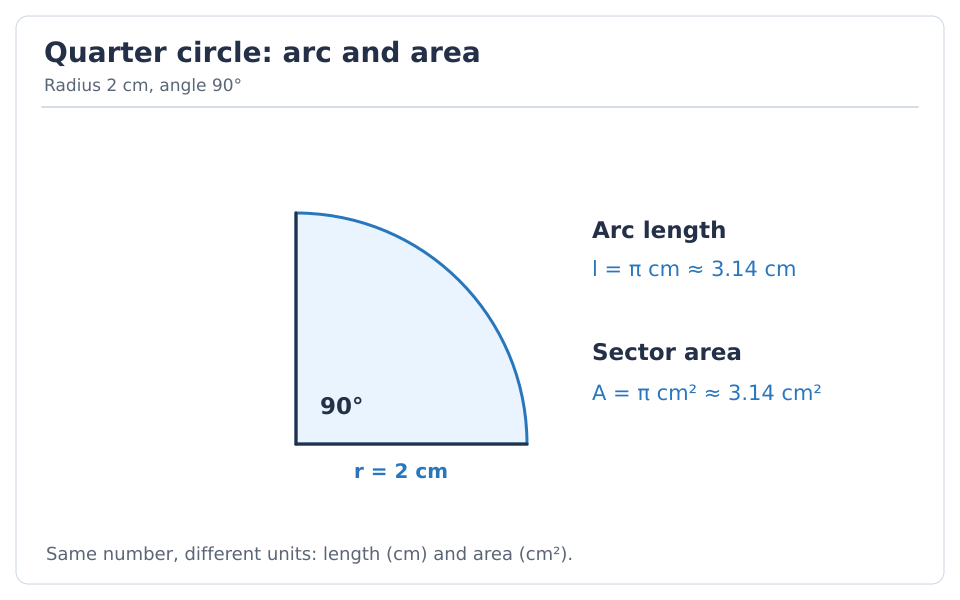

# M1-L15 – Circles, arcs and geometric solids {#L15}

**Course section:** M1 – Lower secondary education (Sekundarstufe I)

**Level:** Lower secondary education

**Prior knowledge:** No fixed prerequisites specified.

**Classification:** Lower secondary education, approximately Year 9 of German schooling · Format: quick revision

## What is this about? {#S1}

A **circle** consists of all the points in a plane which are exactly a radius away from the centre. The **disc** also contains all the points inside this boundary, whose distance from the centre is at most the radius. In this lesson, the area of a circle means the area of the disc, while the circumference measures only the length of the circular boundary. Once we know this distance, we can calculate the circumference and area. If we consider only part of the boundary, we obtain a **circular arc**; a part of the area of a circle is called a **sector**. In three dimensions, we encounter solids such as cylinders, cones and spheres. Here we need to distinguish between **surface area** and **volume**: the area enclosing the solid and the amount of space it contains.

## Basic idea and illustration {#S2}

The **radius** is the line segment from the centre to the edge of the circle. The **diameter** connects two opposite points on the edge through the centre and is twice as long as the radius. The ratio of circumference to diameter is the same for every circle: the number pi. Larger circles have a circumference proportional to the radius, but an **area proportional to the square** of the radius. Doubling the radius doubles the circumference, while the area becomes four times as large.

Formula, sketch or calculation scheme · Original notation

                 Circle from above
                     .----.
                 .-'   |    '-.
                /      | r     \
               |       M--------|  Edge
                \              /
                 '-.        .-'
                    '------'

    M = centre; r = radius. Schematic drawing.

## New symbols before the first formula {#S3}

  Symbol    Pronunciation                    Meaning here                                               Other possible uses
  --------- -------------------------------- ---------------------------------------------------------- ----------------------------------------------
  $r$       “r”                              Radius of a circle or circular base                        Any variable
  $d$       “d”                              Diameter, twice the radius                                 In [M1-L10](M1-L10.md), d stood for a distance
  $\pi$     “pi”                             Exact, irrational circle ratio, approximately 3.14159      Also in trigonometry and calculus
  $U$       “capital U”                      Perimeter of a plane figure                                Other quantities in other subjects
  $U_s$     “sector perimeter” or “U sub s”  Entire boundary of a circular sector: arc plus both radii  Subscript s denotes the sector here
  $A$       “capital A”                      Area, particularly the area of a circle                    In [M1-L12](M1-L12.md), A denoted an event
  $\alpha$  “alpha”                          Here the angle of an arc or sector in degrees              Often a freely chosen angle
  `°`       “degrees”                        Angular measure; full circle has 360 degrees               Also used for temperature
  $l$       “ell”                            Length of a circular arc                                   For example, a line segment in other formulae
  $h$       “h”                              Height of a right cylinder or cone                         Also the height of a triangle, see [M1-L5](M1-L5.md)
  $V$       “V”                              Volume                                                     Variable or another physical quantity
  $O$       “capital O”                      Total surface area of a solid                              Later also O notation in computer science

## Main idea 1: Circumference and area of a circle {#S4}

$$
\begin{aligned}
d&=2r\\
U&=2\pi r=\pi d\\
A&=\pi r^2
\end{aligned}
$$

**Read aloud:** “The diameter is twice the radius. The circumference is two times pi times the radius, or pi times the diameter. The area of the circle is pi times the radius squared.” The circumference has a **unit of length**, for example metres. The area has a **square unit**, such as square metres.

### Mini-example: A round table {#abschnitt-5}

A round table has radius $r=0.5\,\mathrm{m}$. Its diameter is $1\,\mathrm{m}$. Its circumference is exactly $\pi\,\mathrm{m}$, approximately $3.14\,\mathrm{m}$. Its area is $\pi\cdot{(0.5)}^2\,\mathrm{m}^2=0.25\pi\,\mathrm{m}^2$, approximately $0.785\,\mathrm{m}^2$.

Important: $0.25\pi$ is **exact** if the radius is exactly $0.5\,\mathrm{m}$. The written-out number $0.785$ is already **rounded**.

## Main idea 2: Circular arcs and sectors {#S5}

A **circular arc** is part of the boundary of a circle. A **circular sector** is the corresponding wedge-shaped area between two radii and the arc. With an angle $\alpha$ (alpha) of 90 degrees, we obtain a quarter of a full circle; with 180 degrees, a semicircle.

For a central angle between zero and 360 degrees:

$$
\begin{aligned}
\text{Arc length }l&=\frac{\alpha}{360^{\text{°}}}\,2\pi r\\
\text{Sector area}&=\frac{\alpha}{360^{\text{°}}}\,\pi r^2
\end{aligned}
$$

**Read aloud:** “The arc length ell is the fraction alpha over three hundred and sixty degrees of the full circumference. The sector area is the same angular fraction times the entire area of the circle.” Here **alpha and 360 degrees must use the same angular unit**; the quotient is then a pure number.

### Mini-example: A quarter circle {#abschnitt-7}

A circle has radius $2\,\mathrm{cm}$. We consider an angle of $90^{\text{°}}$, a quarter of the circle. The full circumference is $4\pi\,\mathrm{cm}$; the **arc length** is therefore $\pi\,\mathrm{cm}\approx3.14\,\mathrm{cm}$. The full area is $4\pi\,\mathrm{cm}^2$; the **sector area** is $\pi\,\mathrm{cm}^2\approx3.14\,\mathrm{cm}^2$.

{alt="Quarter-circle sector with a radius of 2 centimetres, a central angle of 90 degrees, an arc length of pi centimetres and an area of pi square centimetres."}

For $r=2\,\mathrm{cm}$ and $90^{\text{°}}$, the numerical values of the arc length and sector area are both $\pi$, but with different units.

The numerical values happen to be similar here, but the quantities are different: $\mathrm{cm}$ describes a length, $\mathrm{cm}^2$ an area. The **perimeter of the sector** is not just the arc: it also includes the two radii. For the quarter-circle sector described, with $r=2\,\mathrm{cm}$, it is therefore $U_s=\pi\,\mathrm{cm}+2\cdot2\,\mathrm{cm}=(\pi+4)\,\mathrm{cm}\approx7.14\,\mathrm{cm}$. Its unit is a unit of length, not area.

## Main idea 3: Cylinder – a right solid with two circular faces {#S6}

A **right circular cylinder** has congruent circles at the top and bottom, each of radius r. Its height h is perpendicular to these circular faces. Its volume is calculated by multiplying the base area by the height; its surface consists of two circular faces and a curved surface which forms a rectangle when unrolled.

$$
\begin{aligned}
V&=\pi r^2h\\
O&=2\pi r^2+2\pi rh
\end{aligned}
$$

**Read aloud:** “The volume V is pi times the radius squared times the height. The surface area, capital O, is twice pi times the radius squared plus twice pi times the radius times the height.” The second term is the **curved surface area**; it equals the circumference times the height.

### Mini-example: Cylindrical container {#abschnitt-9}

An ideal cylinder has $r=2\,\mathrm{cm}$ and $h=5\,\mathrm{cm}$. Its volume is $\pi\cdot4\cdot5=20\pi\,\mathrm{cm}^3$, approximately $62.83\,\mathrm{cm}^3$. Its closed surface area is $2\pi\cdot4+2\pi\cdot2\cdot5=28\pi\,\mathrm{cm}^2$, approximately $87.96\,\mathrm{cm}^2$. If the container is open at the top, the upper circular face is not included in the area of material required – the surface area formula then does not apply unchanged.

## Main idea 4: Cones and spheres {#S7}

A **right circular cone** has a circular base and tapers to a point. A **solid sphere** contains all points in space whose distance from the centre is at most r; its surface consists of the points at distance exactly r.

$$
\begin{aligned}
\text{Volume of a right circular cone: }V&=\frac13\pi r^2h\\
\text{Volume of a sphere: }V&=\frac43\pi r^3\\
\text{Surface area of a sphere: }O&=4\pi r^2
\end{aligned}
$$

**Read aloud:** “The volume of a cone is one third times pi times the radius squared times the height. The volume of a sphere is four thirds times pi times the radius cubed. The surface area of a sphere is four times pi times the radius squared.” For the same circular base and height, the cone has only **one third** of the volume of a right circular cylinder. For a sphere, the third power means that doubling the radius increases the volume eightfold.

### Mini-example: Changes in the size of spheres {#abschnitt-11}

A sphere with radius $1\,\mathrm{cm}$ has volume $\frac43\pi\,\mathrm{cm}^3\approx4.19\,\mathrm{cm}^3$. With a radius of $2\,\mathrm{cm}$, this becomes $\frac{32}{3}\pi\,\mathrm{cm}^3\approx33.51\,\mathrm{cm}^3$. The radius doubles and the volume becomes **eight times as large**. The surface area, by contrast, becomes only four times as large.

## What is it useful for? {#S8}

Circle formulae are needed in screen and vector graphics when drawing circles, arcs or measurement radii. Arc lengths are useful for wheels, turntables and the paths of robot joints; later, we often describe the same angles in **radians** instead of degrees. Volumes of solids help model containers, 3D objects, material requirements and geometrical collision models. In a software application, the units of inputs and outputs should be recorded explicitly.

## Assumptions and limits {#S9}

The formulae assume **idealised geometrical shapes**. For the non-degenerate circles and solids covered here, we assume $r>0$ and, for cylinders and cones, $h>0$. The circular boundary is distinguished from the interior of the disc; a surface area formula applies only to the specified closed idealised shape. Real objects may have wall thicknesses, curvature, deformations or openings. For cylinders, we specifically mean a **right circular cylinder**; for cones, a **right circular cone**. Other shapes require adapted models. Sector formulae using $\frac{\alpha}{360^{\text{°}}}$ assume that alpha is entered as an angle in degrees. Approximate values of pi give rounded results, while formulae with the symbol $\pi$ give exact values.

## Link to the next lesson {#S10}

Arc length calculations prepare us for describing angles in circles. Before that, in **[M1-L16](M1-L16.md)**, we consider sine, cosine and tangent in right-angled triangles – important tools for angles, directions and later robotics.

## Sources {#S11}

No individual sources are listed separately for this lesson.
