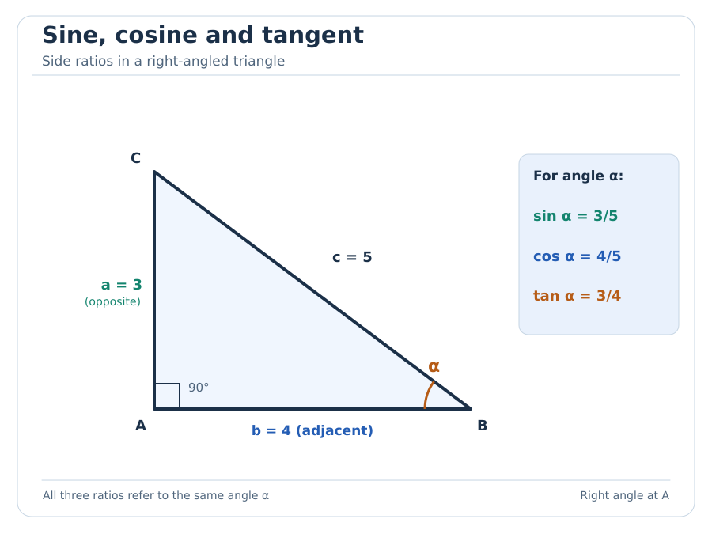

# M1-L16 – Basic trigonometry: sine, cosine and tangent {#L16}

**Course section:** M1 – Lower secondary education (Sekundarstufe I)

**Level:** Lower secondary education

**Prior knowledge:** No fixed prerequisites specified.

**Classification:** Lower secondary education, approximately Year 9 of German schooling · Format: quick revision

## What is this about? {#S1}

So far, Pythagoras' theorem has allowed us to find lengths in a right-angled triangle when two sides were already known. **Trigonometry** provides another approach: it links **angles** to **ratios of side lengths**. This is useful, for example, when a direction and a distance are known, but a height or horizontal distance is missing. The three basic functions are called **sine, cosine and tangent**. Initially, we consider them only in right-angled triangles; in [M1-L20](M1-L20.md), we extend them to other angles using the unit circle.

## Basic idea and illustration {#S2}

Every right-angled triangle has a side opposite the right angle: the **hypotenuse**. It is always the longest side. The two remaining sides are the legs. Relative to a chosen **acute angle**, one leg is called the **opposite side**, the other the **adjacent side**. Which leg has which name therefore depends on which of the two acute angles we consider.

In the constructed example for angle $\alpha$: $\sin(\alpha)=\frac35$; $\cos(\alpha)=\frac45$; $\tan(\alpha)=\frac34$.

Formula, sketch or calculation scheme · Original notation

           C
           |\
           | \
         a |  \ c
           |   \
           |    \
           A-----B
              b   α (at point B)

    Right angle at A.
    α (alpha) is the acute angle at point B.
    a = opposite side to α, b = adjacent side to α,
    c = hypotenuse (opposite the right angle).

All similar right-angled triangles with the same angle alpha have **the same side ratios**, even when their sizes differ greatly. These unchanging ratios are precisely the trigonometric functions.

## New symbols before the first formula {#S3}

  Symbol             Pronunciation                             Meaning here                                                       Other possible uses
  ------------------ ----------------------------------------- ------------------------------------------------------------------ ---------------------------------------------------------------
  $\alpha$           “alpha”                                   Chosen acute angle at B                                            General angle or parameter, already used for arcs in [M1-L15](M1-L15.md)
  $a$, $b$, $c$      “a”, “b”, “c”                             Opposite side, adjacent side, hypotenuse relative to alpha         Different side labels in other triangles; variables in general
  $\sin$             “sine”                                    Ratio of opposite side to hypotenuse                               Later the sine function for any real angle
  $\cos$             “cosine”                                  Ratio of adjacent side to hypotenuse                               Later the cosine function for any real angle
  $\tan$             “tangent”                                 Ratio of opposite side to adjacent side                            Later the tangent function; `tg` on some calculators
  `arctan`, `tan⁻¹`  “arctangent”, “inverse tangent function”  Gives the acute angle for a positive tangent value in degree mode  `tan⁻¹` is not a power of a numerical value here
  `/`                “divided by”                              Quotient of two lengths                                            Division in general, already in [M1-L2](M1-L2.md)
  `°`                “degrees”                                 Angular measure; a full circle has 360 degrees                     Temperatures, other degree scales
  `≈`                “is approximately equal to”               Rounded number rather than an exact ratio                          Approximations, already in [M1-L14](M1-L14.md)

## Main idea 1: Three side ratios {#S4}

For the triangle shown, with right angle at A and acute angle alpha at B, we have:

$$
\begin{aligned}
\sin(\alpha)&=\frac ac\\
\cos(\alpha)&=\frac bc\\
\tan(\alpha)&=\frac ab
\end{aligned}
$$

**Read aloud:** “The sine of alpha is the length of the opposite side divided by the length of the hypotenuse. The cosine of alpha is the length of the adjacent side divided by the length of the hypotenuse. The tangent of alpha is the length of the opposite side divided by the length of the adjacent side.”

**Individual symbols:** $\sin$, $\cos$ and $\tan$ denote functions; the brackets contain their input angle $\alpha$. The sign `=` means equality of values, and the slash `/` means division. The sides $a$, $b$ and $c$ are lengths in **the same unit**. The quotients therefore **have no unit of length**. For tangent, $b$ must not be zero; in a non-degenerate right-angled triangle with an **acute angle $0^{\text{°}}<\alpha<90^{\text{°}}$**, all three side lengths are positive and, in particular, $b>0$. These side ratios alone do not describe obtuse angles here; we explain their trigonometric values in M1-L20.

### Mini-example: The 3-4-5 triangle {#abschnitt-5}

A vertical side is $a=3\,\mathrm{m}$, a horizontal side is $b=4\,\mathrm{m}$ and the hypotenuse is $c=5\,\mathrm{m}$. [M1-L10](M1-L10.md) confirms that the right angle is possible: $3^2+4^2=5^2$, since $9+16=25$.

$$
\begin{aligned}
\sin(\alpha)&=\frac35=0.6\\
\cos(\alpha)&=\frac45=0.8\\
\tan(\alpha)&=\frac34=0.75
\end{aligned}
$$

**Read aloud:** “Sine alpha is three fifths equals zero point six; cosine alpha is four fifths equals zero point eight; tangent alpha is three quarters equals zero point seven five.” The angle at B is approximately **36.87 degrees**. This follows from the arctangent of $\frac34$ in degree mode; the two acute angles of the triangle add up to $90^{\text{°}}$. In a similar triangle twice as large, with sides of 6, 8 and 10 metres, all three ratios remain the same.

## Main idea 2: Finding a distance from an angle and a length {#S5}

If the **length of the hypotenuse** and an **acute angle** are known, we can calculate the corresponding legs. Geometrically, this means splitting a sloping line segment into vertical and horizontal components.

$$
\begin{aligned}
a&=c\sin(\alpha)\\
b&=c\cos(\alpha)
\end{aligned}
$$

**Read aloud:** “The opposite side a is the hypotenuse c times sine alpha. The adjacent side b is the hypotenuse c times cosine alpha.” The new formulae come from multiplying the ratio formulae above by $c$. The multiplication sign `·` was introduced in M1-L1.

### Mini-example: A sloping sensor arm {#abschnitt-7}

An arm is $10\,\mathrm{m}$ long and is at an angle of $30^{\text{°}}$ **above the horizontal**. It forms the hypotenuse. Since $\sin(30^{\text{°}})=0.5$, its vertical height component is $10\,\mathrm{m}\cdot0.5=5\,\mathrm{m}$. Its horizontal component is $10\,\mathrm{m}\cdot\cos(30^{\text{°}})$, approximately $8.66\,\mathrm{m}$, since $\cos(30^{\text{°}})\approx0.866$.

The values describe the **components of the arm's length**, not any additional height from an already raised attachment point. The starting height of that point would have to be added separately.

## Main idea 3: Finding an angle from side lengths {#S6}

Sometimes both legs are known and we want to find the angle. Calculators use the **inverse tangent function**, often labelled `arctan`, `atan` or `tan⁻¹`. The superscript `−1` indicates an **inverse function** here, not the reciprocal of a number; we discuss this principle in more detail in M1-L18.

$$
\alpha=\arctan\left(\frac ab\right)
$$

**Read aloud:** “Alpha is the arctangent of the quotient of opposite side a and adjacent side b.” The notation `arctan` means: “Which angle has this tangent value?” For the 3-4-5 triangle, this is $\arctan\left(\frac34\right)\approx36.87^{\text{°}}$.

**Angle mode:** If a calculator is set to **degrees**, it gives the angle in degrees. If it is set to **radians**, it gives a different numerical value for the same angle. By default, `arctan` returns its principal value; because $\frac ab$ is positive in our non-degenerate triangle, this lies uniquely between $0^{\text{°}}$ and $90^{\text{°}}$. We explain radians in M1-L20.

## What is it useful for? {#S7}

In 2D graphics programs, sine and cosine split a direction and distance into horizontal and vertical components of motion. In robotics, these components help estimate the end position of a rotating joint or tool arm. In surveying and simple sensor applications, a viewing angle and a known distance can be used to find heights or distances. Later, we use the same functions for circular motion, waves and rotating coordinate systems.

## Assumptions and limits {#S8}

The three initial quotients apply in this form to **right-angled triangles** and an **acute reference angle**. The side labels are not absolute: if the other acute angle is chosen, the opposite and adjacent sides swap roles. In real measurements, errors in angles and lengths cause corresponding errors in results; particularly near $90^{\text{°}}$, the tangent becomes very large and the calculation is sensitive. The side ratios must refer to **the same units of length**. The **sine and cosine values** of an acute angle lie between zero and one, whereas the tangent can also exceed one. Furthermore, $\tan(\alpha)$ is **not** the same as $\sin(\alpha)+\cos(\alpha)$.

## Link to the next lesson {#S9}

[M1-L17](M1-L17.md) describes **growth and decay**. While an angle here determines how lengths are split, a constant **factor per time step** there determines how a quantity changes repeatedly. We return to the trigonometric functions on the circle in M1-L20.

## Sources {#S10}

No individual sources are listed separately for this lesson.
