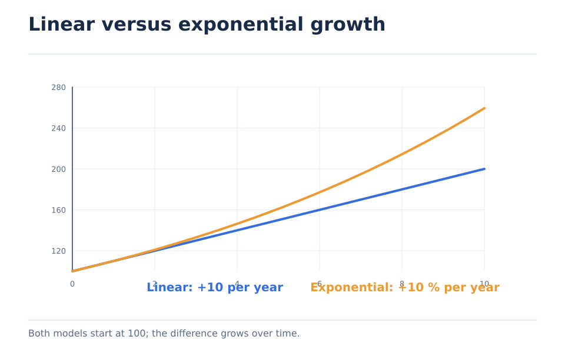

# M1-L17 – Growth, percentage models and compound interest {#L17}

**Course section:** M1 – Lower secondary education (Sekundarstufe I)

**Level:** Lower secondary education

**Prior knowledge:** No fixed prerequisites specified.

**Classification:** Lower secondary education, approximately Year 9 of German schooling · Format: quick revision

## What is this about? {#S1}

Some quantities change by a fixed **amount** in each time interval. Others change by a fixed **percentage of the current value before each change**. These two situations lead to different models. A consistently fixed percentage change results in **exponential growth** or **exponential decay**. The classic example is compound interest: interest already earned itself earns interest in the next period.

## Basic idea and illustration {#S2}

In a **linear model**, for example, ten new items are added at each step: 100, 110, 120, 130. In an **exponential model with ten per cent growth**, ten per cent of the **current** quantity is added each time: 100, 110, 121, 133.1. Initially, the sequences look similar. But the increases of 10, then 11, then 12.1 units become progressively larger in the exponential model. When a quantity decreases by a fixed percentage, however, it is reduced by the same *factor* at each step, not by the same absolute amount.

## New symbols before the first formula {#S3}

  Symbol         Pronunciation                                            Meaning here                                                                  Other possible uses
  -------------- -------------------------------------------------------- ----------------------------------------------------------------------------- -----------------------------------------------------------
  $S_0$          “S sub zero”                                             Initial quantity before the first step                                        Initial value of a measurement series or state
  $S_n$          “S sub n”                                                Quantity after $n$ steps                                                      General sequence term index
  $n$            “n”                                                      Number of equally long steps; initially a whole number from zero onwards      Sample size or running index
  $p$            “p”                                                      Percentage change as a **decimal**, e.g. 5% as 0.05                           General parameter; binomial variable in [M1-L13](M1-L13.md)
  $q$            “q”                                                      Factor per step: greater than one for growth, between zero and one for decay  General parameter
  `^n`, `ⁿ`      “to the power of n”                                      Repeated multiplication by the same factor                                    Any power, already in [M1-L7](M1-L7.md)
  `·`            “times”                                                  Multiplication                                                                Dot product in later vector calculations
  `%`            “per cent”                                               Fraction of a hundred, introduced in [M1-L2](M1-L2.md)                                    Often the remainder operator in programming languages
  `≈`            “approximately equal to”                                 Rounded monetary or measured values                                           Approximation notation
  `>`, `<`, `≥`  “greater than”, “less than”, “greater than or equal to”  Conditions for the quantity and growth factor                                 General comparisons, already familiar from earlier lessons

## Main idea 1: From percentage to factor {#S4}

If five per cent is added at each step, the entire existing quantity is retained (**100 per cent**) and another five per cent is added: a total of **105 per cent** of the previous value. The corresponding factor is $1.05$. After a ten per cent decrease, ninety per cent remains, giving a factor of $0.90$.

$$
\begin{aligned}
q&=1+p\\
S_n&=S_0q^n
\end{aligned}
$$

**Read aloud:** “The step factor q is one plus the percentage change p in decimal notation. The quantity S sub n is the initial quantity S sub zero times q to the power of n.” The sign `+` means addition; `=` means equality of values; the subscript zero identifies the **initial value**, not multiplication by zero. $q^n$ means multiplying the factor $q$ in a repeated product for integer $n$, with exactly $n$ factors. For $n=0$, we have $q^0=1$ provided $q$ is positive: before the first step, the quantity equals the initial quantity. In ordinary positive quantity models, $p>-1$, so that $q=1+p>0$. For a complete loss of 100% ($p=-1$, $q=0$), zero remains after the first step; we then treat the initial quantity explicitly as a special case rather than evaluating the indeterminate expression $0^0$.

### Mini-example: Five per cent annual compound interest {#abschnitt-5}

An account starts with $S_0=1\,000\,\mathrm{€}$, with interest of **5%** per year credited annually. Thus $p=0.05$ and $q=1.05$. After three **full years**:

$$
\begin{aligned}
S_3&=1\,000\,\mathrm{€}\cdot\left(1.05\right)^3\\
&=1\,157.625\,\mathrm{€}\\
&\approx1\,157.63\,\mathrm{€}
\end{aligned}
$$

**Read aloud:** “S sub three is one thousand euros times one point zero five to the power of three, giving one thousand one hundred and fifty-seven euros and sixty-two point five cents before rounding to cents.” Using the usual round-half-up rule **to whole cents at the end**, this gives $1\,157.63\,\mathrm{€}$. In a real bank statement, intermediate rounding, taxes, fees and the exact date on which interest is credited may change the result. The model illustrates the mathematical principle, not specific account conditions.

## Main idea 2: Exponential decay {#S5}

A decrease of **$10\,\%$** per step does not mean subtracting ten original units each time. After each step, **$90\,\%$ of the quantity currently present** remains. This is the same mechanism as growth, but with a factor smaller than one.

$$
S_n=S_0\cdot0.9^n
$$

**Read aloud:** “S sub n is the initial quantity times zero point nine to the power of n.” Here $0.9$ is the remaining fraction per step, the factor for a **ten per cent loss**. The exponent $n$ again counts the steps.

### Mini-example: Decreasing stored data {#abschnitt-7}

During each maintenance round, a quantity is reduced by ten per cent **of its current value**. From $100\,\mathrm{GB}$, $90\,\mathrm{GB}$ remains after round one. After round two, $90\,\mathrm{GB}\cdot0.9=81\,\mathrm{GB}$ remains. The total loss is therefore $19\,\mathrm{GB}$, or **19%** of the original value, not 20%. Simply subtracting ten per cent of the **initial quantity** twice would produce a different, linear model.

## Main idea 3: Linear or percentage growth? {#S6}

The crucial question when choosing the model is **what remains constant at each step**. A constant **difference** is a linear pattern; a constant **ratio of consecutive positive values** is an exponential pattern.

$$
\begin{aligned}
\text{Linear:}\quad S_n&=S_0+nd\\
\text{Exponential:}\quad S_n&=S_0q^n
\end{aligned}
$$

**Read aloud:** “In the linear model, the quantity after n steps equals the initial quantity plus n times d. In the exponential model, it equals the initial quantity times the factor q to the power of n.” The new symbol $d$ (pronounced “d”) stands for the **constant absolute change per step**; in [M1-L10](M1-L10.md), $d$ stood for a distance, and in [M1-L15](M1-L15.md) for a diameter. The same letter does **not** necessarily have the same meaning.

  Step $n$   Constant +10   Constant +10%
  ---------- -------------- --------------
  0          100            100
  1          110            110
  2          120            121
  3          130            $133.1$

The table illustrates the difference without further calculation. **A percentage increase of ten per cent of the initial value**, by contrast, would be linear: plus ten in each round, provided the initial value stays at 100.

## What is it useful for? {#S7}

Growth models help estimate an assumed increase in user numbers, data volumes or storage costs over several periods. In computer science, exponential growth also occurs in spaces of possible combinations, though the factor comes from a different situation than interest on an account. Decay models are useful for declining quantities, signal attenuation and simplified models of how long system states last. In AI infrastructure in particular, it is worth distinguishing between “100 additional requests each month” and “ten per cent more requests each month”.

## Assumptions and limits {#S8}

In this introduction, the factor $q$ is **constant per time interval**, and the intervals are equally long. For ordinary quantity models, we assume $S_0\ge0$ and $q>0$. If $S_0=0$, the modelled quantity remains zero; if $0<q<1$, there is exponential decay; if $q=1$, the sequence is constant; and if $q>1$, there is growth. A negative $q$ would not make sense for an ordinary quantity in this model. A real population, number of users or volume of data cannot grow indefinitely at a constant rate: capacity, saturation, seasonal variations and changing conditions alter the model. Measurements alone do not prove that a process is exponential. With percentages, the **reference quantity** must always be clear: five per cent growth followed by five per cent decline does not return to the initial value. The factor is $1.05\cdot0.95=0.9975$, so $99.75\,\%$ of the initial value remains – a net loss of $0.25\,\%$. This calculation assumes the second change relates to the **new** quantity.

## Link to the next lesson {#S9}

In [M1-L18](M1-L18.md), we examine **functions as a general concept**. This allows us to classify linear, quadratic and exponential relationships as different rules connecting input and output. [M1-L19](M1-L19.md) then explores exponential and logarithmic functions in more detail.

## Sources {#S10}

No individual sources are listed separately for this lesson.
