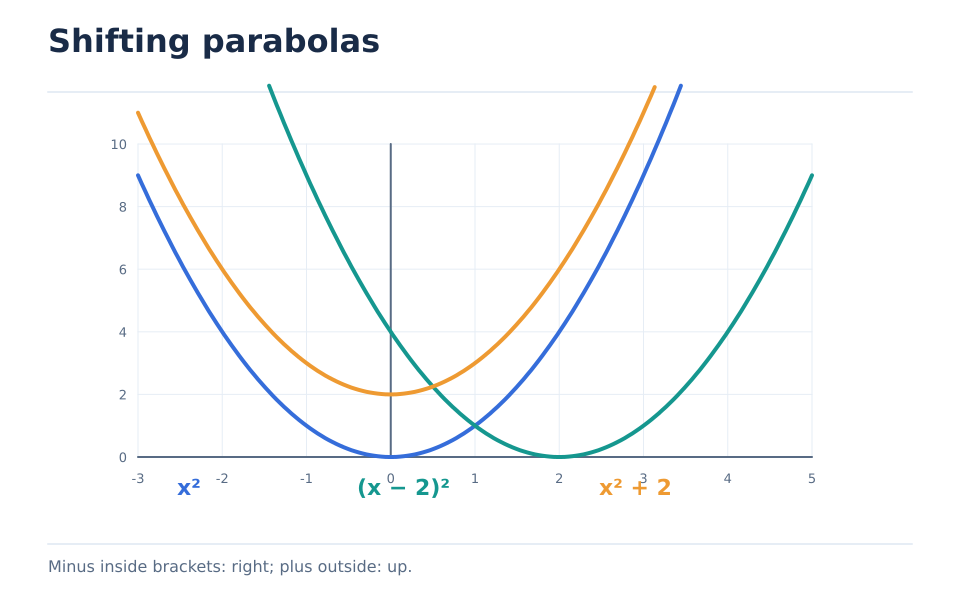

# M1-L18 – Functions: domain, transformations and inverses {#L18}

**Course section:** M1 – Lower secondary education (Sekundarstufe I)

**Level:** Lower secondary education

**Prior knowledge:** No fixed prerequisites specified.

**Classification:** Lower secondary education, preparation for upper secondary education / approximately Year 10 of German schooling · Format: quick revision

## What is this about? {#S1}

We have already encountered linear and quadratic functions and calculated with a growth model. Now we consider **what makes a function in general**: it assigns **exactly one** output value to each permitted input value. We must specify which inputs are allowed and which values can actually occur. Functions can be represented in diagrams, shifted, stretched or reflected. Some can even be **inverted**, allowing us to recover the original input from an output.

## Basic idea and illustration {#S2}

Imagine a function as a reliably deterministic software interface: it always returns the same output value for the same permitted input. Different inputs **may** have the same output, but a single input must not have several different results at once under the same function. A table of values shows only selected cases; a function rule can describe infinitely many inputs. The graph of a function makes it clear how inputs and outputs vary together.

## New symbols before the first formula {#S3}

  Symbol       Pronunciation                                    Meaning here                                           Other possible uses
  ------------ ------------------------------------------------ ------------------------------------------------------ --------------------------------------------------------------------------
  $f$, $g$     “f”, “g”                                         Names of two functions                                 Freely named quantities or mappings
  $f(x)$       “f of x”                                         Value of function $f$ for input $x$                    Not the product of the letters f and x
  $x$, $y$     “x”, “y”                                         Input, output                                          Coordinates or arbitrary variables
  $D$          “capital D”                                      **Domain**: set of permitted inputs                    Discriminant in [M1-L13](M1-L13.md), any variable
  $Z$          “zed”                                            **Codomain**: predetermined set of possible outputs    Other sets or variables
  $W$          “capital W”                                      **Range/image**: outputs actually attained             Other notation in other books
  `→`          “maps to”, “to”                                  Mapping from the input set to the codomain             Arrow in logic or limit notation
  `∈`          “is an element of”                               A value belongs to a set                               General set relationship
  $\mathbb R$  “set of real numbers”                            Entire real number line                                Introduced in [M1-L1](M1-L1.md)
  $h$, $k$     “h”, “k”                                         Shift in the x and y directions respectively           Arbitrary parameters in other formulae
  $f^{-1}$     “f to the power of minus one” or “inverse of f”  Inversion of an invertible function                    **Not** automatically the reciprocal of $f(x)$
  `⊆`          “is a subset of”                                 Every value actually attained belongs to the codomain  General set relationship; studied further in university mathematics [M1-L1](?course=university_mathematics&module=M1&lesson=L1&syslang=en&doclang=en&theme=light)

## Main idea 1: Domain and range {#S4}

A **domain** $D$ determines which inputs are permitted. The **codomain** $Z$ is the set in which possible outputs are intended to lie. The **image**, called $W$ here, includes only the outputs **actually attained** by the function. Hence $W\subseteq Z$: the image lies within the codomain but need not be identical to it. The symbol `⊆` is read as “is a subset of” and also allows the two sets to be equal. School textbooks sometimes use the terms “range” and “set of values” differently – here $W$ always means the image actually attained.

$$
\begin{aligned}
f&\colon D\to Z\\
x&\mapsto f(x)
\end{aligned}
$$

**Read aloud:** “The function f maps from the domain D to the codomain Z. Each permitted x is assigned the function value f of x.” The colon `:` follows the **function name** and introduces the specification of its sets; the arrow `→` denotes a mapping. These are **not** arithmetic operations. The individual symbols $D$ and $Z$ denote sets here, not particular numbers.

### Mini-example: The square of a number {#abschnitt-5}

The function $f(x)=x^2$ takes a real input value and multiplies it by itself. If all real numbers are permitted as inputs, then $D=\mathbb R$. We can also choose $Z=\mathbb R$ as the codomain. In fact, however, **only non-negative outputs** occur, because the square of a real number is never negative. The image $W$ therefore includes zero and all positive real numbers.

$$
\begin{aligned}
f(-2)&=4\\
f(2)&=4
\end{aligned}
$$

**Read aloud:** “f of minus two is four; f of two is also four.” Two different inputs have the **same** output here. This is perfectly permissible for a function. However, this property prevents an inverse function from being defined over the entire original real domain.

## Main idea 2: Shifting or stretching functions {#S5}

A **transformation** systematically changes the graph of a known function. We can increase all outputs, shift inputs or multiply outputs by a factor.

{alt="Basic parabola and shifts in the x and y directions"}

$$
g(x)=f(x-h)+k
$$

**Read aloud:** “g of x is f of x minus h, then plus k.” The new function $g$ is obtained from $f$ by shifting its graph **h units to the right for positive h** and **k units upwards for positive k**. The input $x$ is permitted precisely when $x-h$ belongs to the domain of $f$; a shift therefore shifts the domain as well. A minus sign before $h$ **inside** the function brackets thus means a shift to the **right** – a common stumbling block.

### Mini-example: A parabola moves {#abschnitt-7}

The basic function is $f(x)=x^2$. We set $h=2$ and $k=3$:

$$
g(x)={(x-2)}^2+3
$$

**Read aloud:** “g of x is the bracket x minus two, squared, plus three.” The vertex of the original parabola is at $(0;0)$ and moves to $(2;3)$. For $x=2$, the expression in brackets is zero, so $g(2)=3$. The parabola retains its shape and the direction in which it opens.

A **vertical stretch** has a different effect:

$$
g(x)=2\cdot f(x)
$$

**Read aloud:** “g of x is two times f of x.” Each function value is doubled while the inputs remain unchanged. If instead $g(x)=f(2x)$, the inputs are doubled before the function is applied; for the graph of a non-constant function, this means a **horizontal compression to half its width**. This distinction is particularly important when reading unfamiliar function formulae. For example, the square root function is defined over the real numbers only for $x\ge0$. Its graph shifted to the right, $g(x)=\sqrt{x-2}$, is therefore defined only for $x\ge2$; for $g(x)=f(2x)$, only values of $x$ for which $2x$ belongs to the original domain would be permitted.

## Main idea 3: Inverse functions {#S6}

An **inverse function** answers the reverse question: “Which input produced this output?” This is possible unambiguously only when different inputs in the domain considered produce **different outputs**. Such a function is called **injective**; this concept is studied formally in university mathematics [M1-L1](?course=university_mathematics&module=M1&lesson=L1&syslang=en&doclang=en&theme=light). An injective function can be inverted uniquely **on its actual image $W$**: its inverse takes values from $W$ as inputs and returns the corresponding original values from $D$. For an inverse defined on the **entire originally chosen codomain $Z$**, the function would also have to attain every value in $Z$, which is called being surjective. Only then is it bijective from $D$ to $Z$.

$$
\begin{aligned}
f(x)&=2x+3\\
f^{-1}(y)&=\frac{y-3}{2}
\end{aligned}
$$

**Read aloud:** “f of x is two times x plus three. The inverse of f takes an output y, subtracts three and divides the result by two.” Here $f$ was chosen for all real inputs and real outputs: $D=Z=W=\mathbb R$. The inverse therefore also has all real numbers as its domain. The superscript $-1$ immediately after the function name denotes **the inverse mapping**, not the power minus one of a function value. The slash means division. The grouping specifies that the **entire expression** $y-3$ is divided by two.

### Mini-example: Recovering an input value {#abschnitt-9}

For $x=4$, the original function gives $f(4)=2\cdot4+3=11$. The inverse takes $11$ and returns $\frac{11-3}{2}=4$. The input has been recovered. The principle corresponds to a measuring device that converts a raw value using a **uniquely invertible linear calibration** and allows the reverse calculation when needed.

**Why does this not work for every parabola?** For $f(x)=x^2$, both $-2$ and $2$ give the output $4$. The original input therefore cannot be determined uniquely from the output alone. If we restrict the domain, for example to the non-negative real numbers, we obtain an invertible function with the **square root** as its inverse. An inverse therefore also depends on the domain chosen.

## What is it useful for? {#S7}

In programming, functions are natural models for deterministic calculations, calibrations and data conversions. Domains help identify invalid inputs early and rule out special cases such as division by zero or square roots of negative real numbers. Transformations are useful in graphics software, image coordinates, signal processing and visualising functions. Inverse functions are needed when we want to determine the required input from a target value, for example when reversing a scaling calculation.

## Assumptions and limits {#S8}

A mathematical function is not identical to every **programming function** of the same name: such programs may contain randomness, hidden state or side effects and return different results for the same input. In a mathematical function rule, inputs, the codomain and the actual image must be distinguished. Not every function is invertible on its entire domain. Nor should the reciprocal function $\frac1{f(x)}$ **be confused** with the inverse function $f^{-1}(x)$; their results coincide only under particular circumstances. After a transformation, the permitted domain may change, for example with shifted root or fractional functions. **Injectivity is sufficient for inversion on the image**, but not automatically on a larger codomain: an inverse function requires exactly one original value for every permitted input of its own.

## Link to the next lesson {#S9}

In **[M1-L19](M1-L19.md)**, we learn about power, root, exponential and logarithmic functions as further classes of functions. The usefulness of the inversion just discussed becomes particularly clear there: the **logarithm** is the inverse of a suitable exponential function.

## Sources (external) {#S10}

No external sources listed.
