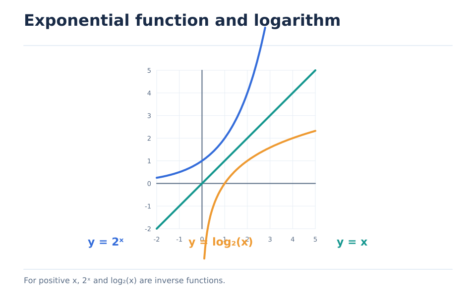

# M1-L19 – Power, root and exponential functions and logarithms {#L19}

**Course section:** M1 – Lower secondary education (Sekundarstufe I)

**Level:** Lower secondary education

**Prior knowledge:** No fixed prerequisites specified.

**Classification:** Lower secondary education, preparation for upper secondary education / approximately Year 10 of German schooling · Format: quick revision

## What is this about? {#S1}

In [M1-L17](M1-L17.md) we saw how a quantity can grow by the same percentage at each step. Now we distinguish different **families of functions**. A power function raises a variable number to a power; an exponential function, by contrast, has the variable **in the exponent**. Root functions reverse certain operations involving powers. Logarithms answer the question of **which exponent is needed** to reach a particular number. These ideas allow us to describe growth processes and solve equations for unknown times or factors.

## Basic idea and illustration {#S2}

Compare two questions: “What is the square of an arbitrary input?” and “How large is an initial value after an unknown number of doublings?” In the first case, $x$ is multiplied by itself: $x^2$. In the second case, $x$ is the number of doubling steps: $2^x$. These functions may give similar results for some inputs, but they follow fundamentally different rules. A root, for instance, finds the non-negative number whose square gives a specified value; a logarithm finds the required **exponent** instead.

## New symbols before the first formula {#S3}

  Symbol                 Pronunciation                                                                     Meaning here                                                      Other possible uses
  ---------------------- --------------------------------------------------------------------------------- ----------------------------------------------------------------- ------------------------------------------------------------------------------------
  $x$                    “x”                                                                               Input, sometimes an unknown exponent                              Coordinate, free variable
  $f(x)$                 “f of x”                                                                          Output of a function for input x                                  Introduced in [M1-L4](M1-L4.md)
  `xⁿ`, `x^n`            “x to the power of n”                                                             Power function: input x is raised to a fixed exponent n           `^` is often not a power operator in programming languages
  `aˣ`, `a^x`            “a to the power of x”                                                             Exponential function with fixed base a                            a can otherwise be any constant
  $\sqrt{x}$             “square root of x”                                                                Non-negative number whose square gives x                          A root of another order needs an index
  `logₐ(b)`, `log_a(b)`  “logarithm of b to base a”                                                        Exponent to which a must be raised to obtain b                    `log` without a base can mean different things depending on the subject or software
  $\ln(x)$               “natural logarithm of x”                                                          Logarithm to the base of Euler’s number e                         Often `log(x)` in programming languages
  $e$                    “Euler’s number”                                                                  Approximately 2.71828; a particularly important exponential base  Not the symbol for an arbitrary variable
  `<`, `>`, `≤`, `≥`     “less than”, “greater than”, “less than or equal to”, “greater than or equal to”  Inequalities and permitted values                                 Comparisons in logic and programming
  `⇔`                    “if and only if” or “is equivalent to”                                            Both statements hold under the same conditions                    Used in [M1-L3](M1-L3.md) when rearranging expressions
  $\infty$               “infinity”                                                                        Unbounded growth or limiting behaviour                            Not an ordinary real number

**Notation for offline readers:** Exponents in formulae are sometimes shown in Unicode (`x²`, `2ˣ`), and general powers as `x^n`. Both mean the same mathematical superscript. Plain-text notation works without internet access or a formula library.

## Power functions: Raising the input to a power {#S4}

A **power function** has a fixed exponent and a variable base. A simple example is the square $f(x)=x^2$: for $x=3$ we obtain 9; for $x=-3$ we also obtain 9. The even exponent hides the sign here. In $f(x)=x^3$, however, the sign remains visible because $-3$ cubed gives $-27$.

$$
f(x)=x^n
$$

**Read aloud:** “f of x equals x to the power of n.” $f$ is the function name; the brackets contain the input $x$; `=` connects the two sides; $x$ is the base; $n$ is a **fixed exponent**. For positive integers $n$, the power represents $n$ repeated factors. Negative **integer** exponents give reciprocals, provided that the base is not zero: $x^{-1}=\frac1x$ only for $x\ne0$. Fractional exponents need additional domain conditions: for example, $x^{1/2}=\sqrt{x}$ is defined over the reals only for $x\ge0$, whereas a cube root can also take a negative number as its argument. These cases cannot be replaced by a single general rule for powers.

### Mini-example: Areas grow quadratically {#abschnitt-5}

A square with sides 2 centimetres long has an area of 4 square centimetres. If the side length is doubled to 4 centimetres, the area increases to 16 square centimetres, or **four times** its original value. The area is a power function of the side length. This is not the same as exponential growth over time.

## Root functions: Reversing squaring {#S5}

The square root finds the non-negative original number for a given square. For example, $\sqrt{25}=5$. The simplest root function $f(x)=\sqrt{x}$ is therefore defined as a real-valued function only for inputs **from zero upwards**. It increases, but ever more slowly: to double the function value from 2 to 4, the input must be quadrupled from 4 to 16.

**Read aloud:** “f of x is the square root of x.” `√` denotes the **non-negative principal square root**; $x$ is the number under the root sign. It is important not to confuse two statements: $\sqrt9=3$ has only the non-negative value 3, but the equation $x^2=9$ has **two** solutions, $x=3$ and $x=-3$.

### Mini-example: Length from area {#abschnitt-7}

A square icon has an area of 49 square pixels. Its side length is $\sqrt{49}=7$ pixels. The root value is a length here and is therefore non-negative. With real image data, we must also establish whether the pixels can be modelled as square units of area.

## Exponential functions: The input is the exponent {#S6}

An exponential function has a **fixed positive base** and a **variable exponent**. For $f(x)=2^x$, inputs 0, 1, 2, 3 and 4 give outputs 1, 2, 4, 8 and 16. Each step from $x$ to $x+1$ multiplies the result by 2 again.

$$
f(x)=a^x\qquad(a>0,\ a\neq1)
$$

**Read aloud:** “f of x is a to the power of x; the base a is greater than zero and not equal to one.” $a$ is a **constant growth or decay factor**; $x$ is in the exponent. For $a>1$, the function increases with $x$. If $a$ lies between 0 and 1, it decreases as $x$ increases. Choosing $a=1$ would give only the constant function 1, so this value is excluded in the usual definition of a non-trivial exponential function. For every real input $x$ and every permitted base, $a^x>0$; the exponential function reaches **neither zero nor negative values**. Only then can its real inverse function be explained for positive inputs.

### Mini-example: Repeated doubling {#abschnitt-9}

A simulated amount of data starts at one unit and doubles at each step. After five steps there are $2^5=32$ units. After ten steps there are $2^{10}=1024$ units. Unlike $x^2$, here it is the number of **multiplication steps** that increases. The model applies only as long as the factor 2 really remains constant and no capacity limits intervene.

## Logarithms: Finding the missing exponent {#S7}

A logarithm is the inverse of an exponential function **with the same base**. It answers the question: “How many times must I use a as a factor to obtain b?” An unknown exponent thus becomes an ordinary unknown number.

{alt="Graphical reflection relationship between the exponential function and the logarithm"}

$$
\begin{aligned}
\log_a(b)=x&\iff a^x=b\\
&\quad(a>0,\ a\neq1,\ b>0)
\end{aligned}
$$

**Read aloud:** “The logarithm of b to base a is x if and only if a to the power of x equals b.” `log` denotes the logarithm function; the subscript $a$ gives its **base**; the argument $b$ is the positive target number; $x$ is the unknown exponent. `⇔` means that the two statements are mathematically equivalent. The conditions in brackets ensure that the usual real logarithm function is defined.

### Mini-example: How many doublings? {#abschnitt-11}

Find the number of doublings from 1 to 32. Since $2^5=32$, we have $\log_2(32)=5$. Read aloud: “The logarithm of thirty-two to base two is five.” In another notation we can write `log_2(32) = 5`. For 64 the result is 6 because there is one more doubling. With a composite logarithm, **the whole argument must be positive**: $\log_2(x-3)$ is defined only for $x>3$. The logarithm laws $\log_a(u\cdot v)=\log_a(u)+\log_a(v)$ and $\log_a\left(\frac uv\right)=\log_a(u)-\log_a(v)$ apply here for $u>0$, $v>0$, $a>0$ and $a\ne1$. **Read aloud:** “The logarithm of a product is the sum of the logarithms” and “the logarithm of a quotient is their difference”, respectively. There is, however, **no** general law $\log_a(u+v)=\log_a(u)+\log_a(v)$. For example, $\log_2(2+8)=\log_2(10)$ is approximately 3.322, but $\log_2(2)+\log_2(8)=1+3=4$.

Two common special cases are $\log_{10}(x)$ (base-ten logarithm) and $\ln(x)$ (natural logarithm to base $e$). With `log(x)` **without a base**, the context must be established: textbooks, calculators and programming languages do not always use the same convention.

## Reading equations and inequalities correctly {#S8}

In equations we seek values for which the two sides are equal. For example, $2^x=32$ has exactly one solution, $x=5$. An **inequality**, by contrast, concerns a whole range of values: $2^x\ge32$ holds for all real $x\ge5$, because $2^x$ is strictly increasing.

Multiplying or dividing an inequality by a **negative number** reverses the comparison sign. This is not a special feature of power functions, but a general algebraic rule. A logarithm with a base between zero and one is a **decreasing** function. Applying such a function to both sides of an inequality also reverses the order, **provided that both sides are positive, permitted arguments**. For example, $4<8$, but $\log_{1/2}(4)=-2>-3=\log_{1/2}(8)$. The subscript expression $\frac12$ denotes the logarithm base one half; the value decreases as the positive argument increases. Also, logarithms in the real domain may be applied only to positive arguments.

### Mini-example: A technical threshold {#abschnitt-13}

An idealised system starts with one unit and doubles at each step. A capacity of 32 units is reached after five steps. For $x>5$, the modelled volume is above that threshold. If only **whole** processing steps are permitted, the first step *above* the threshold is therefore step 6; intermediate values are possible on a continuous time scale.

## What is it useful for? {#S9}

Power functions describe, for example, area and volume scaling, polynomial models or quadratic error terms. Exponential models appear in growth, decay and some continuous processes; logarithms help determine the number of steps needed and orders of magnitude, for instance when analysing search algorithms. In AI, natural logarithms are used in loss functions and probability models, among other things. The precise formula depends on the assumptions of each model.

## Assumptions and limitations {#S10}

The distinction between $x^2$ and $2^x$ is crucial: one is a power function, the other an exponential function. $\sqrt{x}$ is permitted in the real numbers only for $x\ge0$; $\log_a(x)$ only for $x>0$ with $a>0$ and $a\ne1$. Negative numbers can be treated differently in **complex mathematics**, but that is not yet the subject of this lesson. Unbounded exponential growth in real systems is usually only an approximation over a limited time.

## Connection to the next lesson {#S11}

In [M1-L20](M1-L20.md) we will use familiar trigonometric ratios not just for triangles but for **positions on a circle and periodic processes**. We will meet functions again, but with quite different behaviour: recurring rather than continually increasing.

## Further study (optional) {#S12}

Later, in calculus, we will investigate how quickly power, exponential and logarithmic functions grow and what their derivatives look like. In computer science, the relationship between logarithms, binary trees and algorithmic complexity can also be explored further.

## Sources (external) {#S13}

No external sources listed.
