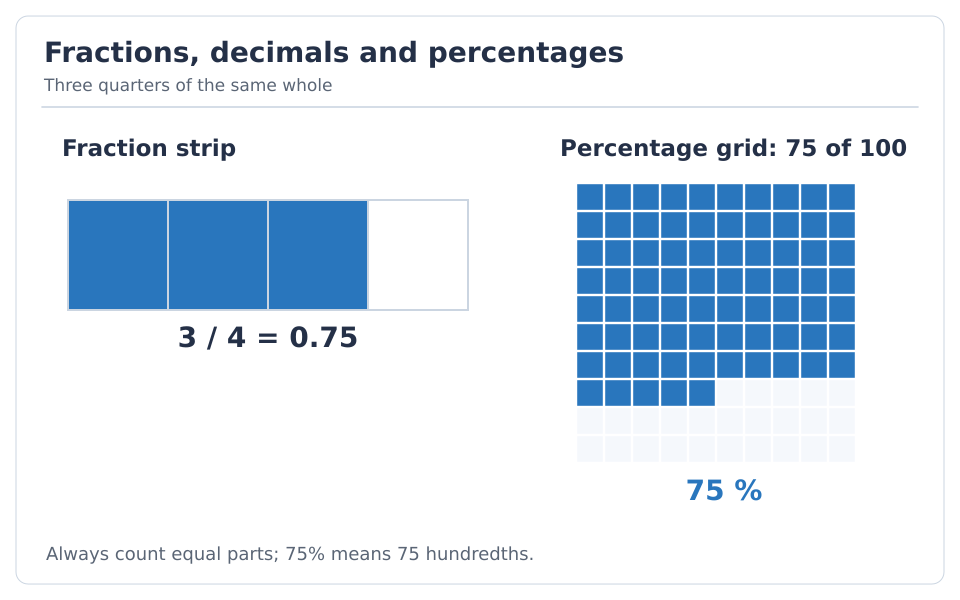

# M1-L2 – Fractions, percentages, ratios and proportionality {#L2}

**Course area:** M1 – Lower secondary education (Sekundarstufe I)

**Level:** Lower secondary education

**Prior knowledge:** No fixed prerequisites specified.

**Context:** Lower secondary education, roughly Year 7 of the German school system · Format: quick refresher

## What is this about? {#S1}

Fractions describe proportions and can represent division. Percentages express a proportion on a scale of one hundred. Ratios compare two quantities. Proportionality describes a special case: when one quantity changes by a factor, the other changes in an exactly predictable way. Such models are common in data analysis and computer science, but in practice they apply only under suitable assumptions.

## Fractions and decimals {#S2}

A **fraction** consists of a **numerator** above a **denominator**. In general, $\frac ab$ is the quotient ‘a divided by b’, where $b\ne0$ must hold. When a fraction represents part of a whole, such as $\frac34$, the numerator indicates the equal parts being considered, and the positive denominator indicates how many equal parts the whole is divided into. **Not every fraction represents a proportion between zero and one**: $\frac54$ is greater than one whole, and $-\frac12$ is negative.

{alt="A fraction strip shows three out of four parts, beside a hundred-square grid with 75 coloured cells. Three quarters equals 0.75 or 75 per cent."}

Three quarters, $0.75$ and $75\,\%$ are different ways of writing the same proportion.

**Formula:** $\frac34=0.75$

**Read aloud:** ‘Three quarters equals zero point seven five.’ The general notation $\frac ab$ is read as ‘a divided by b’; $b\ne0$ means ‘b is not equal to zero’.

Think of four equal pieces, of which three are present. A denominator must **not be zero**, because division by zero is undefined.

## Percentages {#S3}

The symbol `%` is pronounced ‘per cent’ and means **out of one hundred**.

**Formula:** $20\,\%=\frac{20}{100}=0.2$

**Read aloud:** ‘Twenty per cent equals twenty hundredths, or zero point two.’

**Mini-example:** Of 80 files, $20\,\%$ are complete. $80\cdot0.2=16$ files are complete. The symbol `·` is read as ‘times’.

**Percentage points are not the same as percentage change:** If a rate rises from $20\,\%$ to $25\,\%$, it has risen by **5 percentage points**. Compared with the original value of $20\,\%$, however, the relative increase is **$25\,\%$**.

## Ratios and the rule of three {#S4}

A ratio $2:3$ (‘two to three’) compares two quantities. If agent A completes two tasks and agent B completes three, their results are in the ratio 2 to 3. Out of the five tasks in total, A has completed **$\frac25$** and B **$\frac35$**; $2:3$ therefore does not mean ‘two thirds of the whole’.

The **rule of three** scales a known value up or down to find an unknown value. Example: two identical programs together process 100 independent files in the same period of time. Under ideal conditions, four identical programs would process 200 files. Whether this really happens depends on bottlenecks.

## Direct proportionality {#S5}

A **constant of proportionality** is a fixed number $k$ (‘kay’) by which an input value is multiplied. $x$ is the input and $y$ the result.

**Formula:** $y=k\cdot x$

**Read aloud:** ‘Y equals k times x.’

**Mini-example:** A program processes five files per hour: $k=5$ files/hour. After $x=4$ hours, $y=20$ files are complete.

| Hours $x$ | Files processed $y$ |
|---|---|
| 1 | 5 |
| 2 | 10 |
| 4 | 20 |
| 8 | 40 |

Direct proportionality produces a straight line through the origin in a suitable coordinate system.

**Inverse proportionality:** If the total work is fixed and can be shared perfectly, doubling the number of equally fast workers halves the time needed. Here the **product** of the number of workers and time remains constant, not the quotient. In real programs, communication, locks and I/O bottlenecks interfere with this ideal assumption.

## Guide to reading symbols {#S6}

| Symbol | Pronunciation | Meaning here | Other possible uses |
|---|---|---|---|
| $\frac ab$ | a divided by b | Fraction or division | Quotient of other quantities |
| \% | per cent | Proportion out of 100 | Also the modulo operator in programming languages |
| : | to or divided by | Ratio | Division |
| $x,y$ | ex, why | Input and result | Coordinates, unknowns |
| $k$ | kay | Constant factor | General parameter |
| · | times | Multiplication | Scalar product of vectors |

## What is it useful for? {#S7}

Fractions and percentages are used for probabilities, progress indicators and capacity utilisation. Ratios help allocate resources. Proportional models provide first estimates of running time and costs; their assumptions must be checked.

## Assumptions and limitations {#S8}

Doubling memory use, the number of users or the number of processes does **not automatically** double computing time or performance. Direct proportionality requires a constant factor and a suitable range of validity.

## Link to [M1-L3](M1-L3.md) {#S9}

With the laws of arithmetic, we can simplify such relationships and **rearrange equations deliberately**.

## Sources {#S10}

No individual sources are listed separately for this lesson.
