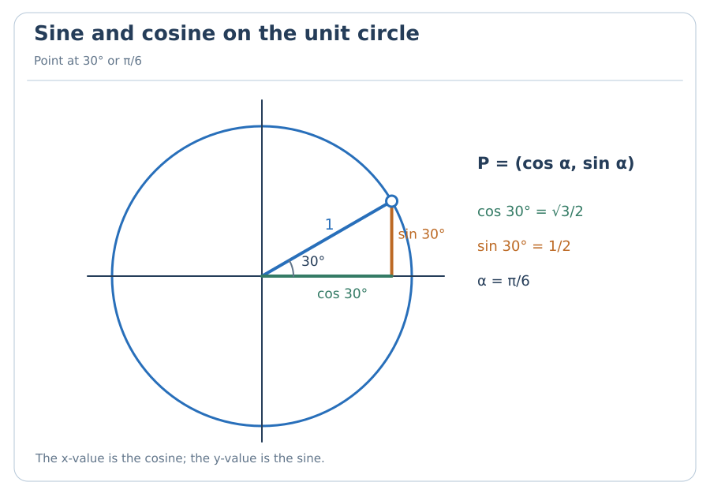

# M1-L20 – Trigonometry on the unit circle and periodic processes {#L20}

**Course section:** M1 – Lower secondary education (Sekundarstufe I)

**Level:** Lower secondary education

**Prior knowledge:** No fixed prerequisites specified.

**Classification:** Lower secondary education, preparation for upper secondary education / approximately Year 10 of German schooling · Format: quick revision

## What is this about? {#S1}

In [M1-L16](M1-L16.md) we met sine, cosine and tangent in right-angled triangles. On the **unit circle**, these ratios become functions that we can also use for angles outside a right-angled triangle. After a complete revolution the same values recur: this leads to **periodic functions**. Such functions describe circular motion, waves, oscillations and regularly recurring processes. An important new notation is **radian measure**, which describes angles using the length of a circular arc.

## Basic idea and illustration {#S2}

Imagine a pointer rotating around a fixed centre. Its tip moves around a circle of radius one. As the pointer rotates, the tip moves to the right, up, left and down in turn. The **cosine** describes the horizontal coordinate and the **sine** the vertical coordinate. If we plot only the height of the tip against time, we obtain the typical wave-shaped sine curve. In this way, the same circular motion can be understood as a recurring change in height.

For $\alpha=30^{\text{°}}$: $\cos(\alpha)=\frac{\sqrt3}{2}$ and $\sin(\alpha)=\frac12$.

## New symbols before the first formula {#S3}

  Symbol          Pronunciation           Meaning here                                                         Other possible uses
  --------------- ----------------------- -------------------------------------------------------------------- ----------------------------------------------
  $\theta$        “theta”                 Angle through which the pointer rotates                              General angle or model parameter
  $\alpha$        “alpha”                 Another possible angle symbol, familiar from [M1-L15](M1-L15.md)/M1-L16           Angle or parameter
  $\sin(\theta)$  “sine of theta”         Vertical coordinate on the unit circle                               Ratio opposite/hypotenuse in [M1-L16](M1-L16.md)
  $\cos(\theta)$  “cosine of theta”       Horizontal coordinate on the unit circle                             Ratio adjacent/hypotenuse in [M1-L16](M1-L16.md)
  $\tan(\theta)$  “tangent of theta”      Ratio of sine to cosine, provided cosine is not zero                 Also gradient of a straight line with angle θ
  $\pi$           “pi”                    Circle constant, approximately 3.14159                               Already used for the circumference
  $\mathrm{rad}$  “radian”, “in radians”  Unit of angle; ratio of two lengths and therefore dimensionless      Also the name of an angle mode in software
  `°`             “degree”                Traditional angle measure; full circle = 360°                        Also used for degrees of temperature
  $T$             “capital T”             Period: time for one repetition                                      Otherwise any time or temperature
  $f$             “f”                     Frequency here: repetitions per second                               Also the name of a function, such as $f(x)$
  $\omega$        “lower-case omega”      Angular frequency / angular velocity for a uniformly changing phase  Angular velocity of a rotating object
  $t$             “t”                     Time variable                                                        Arbitrary parameter
  $A$             “capital A”             Amplitude: maximum displacement from the mean value                  Area in [M1-L5](M1-L5.md), event name in [M1-L12](M1-L12.md)
  $\varphi$       “phi”                   Initial phase: horizontal phase shift expressed as an angle          Other angular quantities
  $c$             “c”                     Vertical shift / mean-value line                                     A line segment in geometry
  $\mathrm{Hz}$   “hertz”                 Unit of frequency: one repetition per second                         Not a unit of angle

**Note on presentation:** Here too, the formulae are shown as Unicode/plain-text expressions. Neither MathJax nor internet access is needed to read the offline archive.

## Unit circle: Angles become coordinates {#S4}

A **unit circle** is a circle centred at the origin with radius exactly one. The angle is usually measured from the positive horizontal axis: anticlockwise is the positive direction of rotation. The position of the pointer tip can be given by two coordinates.

$$
P(\theta)=(\cos(\theta);\,\sin(\theta))
$$

**Read aloud:** “The first coordinate of point P for angle theta is cosine of theta, and the second is sine of theta.” $P$ denotes a point; `( … ; … )` is an ordered pair of coordinates; the first entry is the x-coordinate and the second the y-coordinate. $\cos$ and $\sin$ are the names of the two trigonometric functions; $\theta$ is the angle.

### Mini-example: A quarter turn {#abschnitt-5}

If the pointer initially points to the right, at $\theta=0^{\text{°}}$ its coordinates are $(1;0)$. After a positive quarter turn through 90°, it points upwards. Then $\cos(90^{\text{°}})=0$ and $\sin(90^{\text{°}})=1$, and the point is at $(0;1)$. After 180° the pointer points left and is at $(-1;0)$; after 360° it is back at $(1;0)$.

This also explains negative sine and cosine values: in the left half of the circle the horizontal coordinate is negative, and in the lower half the vertical coordinate is negative. The functions are therefore **not** restricted to positive ratios of side lengths in right-angled triangles.

On the circle, tangent is described by $\tan(\theta)=\frac{\sin(\theta)}{\cos(\theta)}$. **Read aloud:** “Tangent of theta is sine of theta divided by cosine of theta.” The symbol `/` means division. At 90° and 270° the cosine is zero; the tangent is **undefined** at these points.

## Radian measure: Angles as part of the circumference {#S5}

A full circle corresponds to 360 degrees. Expressed in **radians**, the same full circle has angle $2\pi\,\mathrm{rad}$; a semicircle has angle $\pi\,\mathrm{rad}$; a quarter turn has angle $\frac{\pi}{2}\,\mathrm{rad}$. This follows because the circumference of a circle of radius one is $2\pi$. The radian measure of an angle is the length of its subtended circular arc **divided by the radius**.

$$
\begin{aligned}
180^{\text{°}}&=\pi\,\mathrm{rad}\\
360^{\text{°}}&=2\pi\,\mathrm{rad}
\end{aligned}
$$

**Read aloud:** “One hundred and eighty degrees corresponds to pi radians; three hundred and sixty degrees corresponds to two pi radians.” `°` stands for degrees; $\pi$ is the circle constant; $\mathrm{rad}$ makes it clear that the angle is expressed in radians. Here the equals sign means **the same angle in different units**, not the same numerical value without units.

### Mini-example: Converting 90 degrees {#abschnitt-7}

A quarter turn is 90°, or $\frac{\pi}{2}\,\mathrm{rad}$, approximately 1.5708 radians. An angle of rotation of $2\pi\,\mathrm{rad}$ describes a full revolution. Programming functions such as $\sin$ and $\cos$ expect **radians** rather than degrees in many languages. Anyone who accidentally enters $\sin(90)$ instead of $\sin\left(\frac{\pi}{2}\right)$ will therefore usually not obtain the expected value 1.

The conversion rule in words is: **multiply the value in degrees by pi, then divide by 180**. Conversely, multiply a radian value by 180 and divide by pi.

## Periodic functions: The pattern starts again after one revolution {#S6}

Sine and cosine repeat after every full revolution. Two angles differing by $2\pi$ radians give the same coordinates on the circle. In the following period formulae, $\theta$ is explicitly expressed **in radians**. Sine and cosine have smallest positive period $2\pi$, whereas tangent, wherever defined, repeats its values after just $\pi$.

$$
\begin{aligned}
\sin(\theta+2\pi)&=\sin(\theta)\\
\cos(\theta+2\pi)&=\cos(\theta)
\end{aligned}
$$

**Read aloud:** “Sine of theta plus two pi equals sine of theta; cosine of theta plus two pi equals cosine of theta.” The brackets indicate that the entire angle $\theta+2\pi$ is considered as the input first. Repetition takes place after a **full revolution**. The fact that the function values repeat does not mean that the pointer and time have remained unchanged throughout.

A periodic motion has a **period** $T$: the number of seconds until the same phase recurs. The **frequency** $f=\frac1T$ states how many repetitions occur per second. $\frac1T$ is read as “one divided by T”; $T$ must be positive. With a period of two seconds, the frequency is 0.5 hertz. This description assumes $T>0$ and a **genuinely non-constant periodic motion**. If the displacement is constant, no unique fundamental period can be read from the signal.

## A wave as a mathematical function {#S7}

A simple sinusoidal oscillation can vary around a mean value, have a certain height and oscillate more quickly or slowly.

$$
\begin{aligned}
y(t)&=A\sin(\omega t+\varphi)+c\\
\omega&=\frac{2\pi}{T}=2\pi f
\end{aligned}
$$

**Read aloud, first line:** “y of t equals amplitude A times sine of omega times t plus phi, then plus c.” $y(t)$ denotes the value of the oscillation at time $t$; $A$ is its amplitude; `·` means multiplication; $\omega t+\varphi$ is the current angle, or **phase**, in radians; $\varphi$ specifies the initial phase as an **angle in radians**; $c$ shifts the entire oscillation vertically. We choose the amplitude $A$ to be positive; $A$ and $c$ have the same unit as the output $y$, whereas the sine value is dimensionless. The entire argument $\omega t+\varphi$ must give a dimensionless angle in radians.

**Read aloud, second line:** “Omega equals two pi divided by the period T, which equals two pi times frequency f.” Here $\omega$ is the **positive** angular frequency in radians per second, $T>0$ is the period in seconds and $f>0$ is the ordinary frequency in hertz. The equations given assume $\omega>0$ and $A>0$. With negative $\omega$ the direction of phase progression reverses, and the ordinary frequency would be $\frac{|\omega|}{2\pi}$; with $A=0$ the signal would be constant and would have no distinguished fundamental period. The symbol $|\omega|$ means the non-negative absolute value of omega. Here the symbol $f$ is **not** used as a function name: the same symbol can have a different role depending on context.

### Mini-example: An oscillation with a period of two seconds {#abschnitt-10}

We choose amplitude $A=1$, initial phase $\varphi=0$, midline $c=0$ and period $T=2\,\mathrm{s}$. Thus $\omega=\pi\,\mathrm{rad}/\mathrm{s}$. As a **numerical-value formula**, when $t$ is entered in seconds, the rule simplifies to $y(t)=\sin(\pi t)$; read aloud, “y of t is sine of pi times t”. **With units**, the argument of sine is $(\pi\,\mathrm{rad}/\mathrm{s})\cdot t$ (plus the initial phase set to zero here), i.e. an angle and not a time in seconds. A physical time cannot be used directly as the argument of sine without the appropriate factor. At time $t=0\,\mathrm{s}$ the value is 0. After $t=0.5\,\mathrm{s}$ the phase is $\frac{\pi}{2}$ and the value is 1. At $t=1\,\mathrm{s}$ the value is back to 0. At $t=2\,\mathrm{s}$ the cycle starts again.

The sinusoidal oscillation is a **model for ideally regular processes**. Not every real signal is this smooth or consists of only one frequency; noisy or composite signals are investigated later in Fourier analysis.

## What is it useful for? {#S8}

The unit circle and radian measure are the basis for calculating rotations in 2D graphics, 3D engines and robotics. Sine functions model regular sensor data, alternating voltages, oscillations or simple periodic control movements. Frequency and phase are central quantities in audio processing and the temporal synchronisation of systems. When analysing real data we must also consider the sampling rate, noise and possible overlapping frequencies.

## Assumptions and limitations {#S9}

The angle convention (starting axis and direction of rotation) must be established for each application. Many programming languages expect radians; values in degrees must be converted before evaluation. A periodic model assumes that the process repeats sufficiently regularly. $\tan(\theta)$ is undefined when $\cos(\theta)=0$. An angular frequency in radians per second is **not** the same as a frequency in hertz, even though both are related to repetition over time.

## Connection to the next lesson {#S10}

In [M1-L21](M1-L21.md) we move from positions on a circle in a plane to **points, directions and distances in three dimensions**. This language later forms the basis for vector calculations, linear algebra and robot control.

## Further study (optional) {#S11}

Later we can use complex numbers as an elegant tool for representing rotations and periodic signals. Differentiation will also show why sine and cosine alternate when differentiated.

## Sources {#S12}

No individual sources are listed separately for this lesson.
