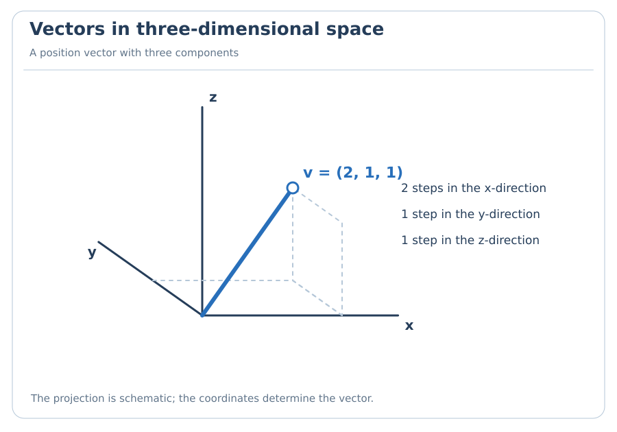

# M1-L21 – Three-dimensional geometry, coordinates and first vectors {#L21}

**Course section:** M1 – Lower secondary education (Sekundarstufe I)

**Level:** Lower secondary education

**Prior knowledge:** No fixed prerequisites specified.

**Classification:** Lower secondary education, preparation for upper secondary education / approximately Year 10 of German schooling · Format: quick revision

## What is this about? {#S1}

So far we have mainly described points in a plane: a horizontal and a vertical coordinate are sufficient. In space we need a **third coordinate**, for example for height, depth or distance from an image plane. For movements, it is also important to distinguish between a **position** and a **displacement**. It is precisely these displacements that **vectors** describe. They connect school geometry with later analytical geometry, linear algebra and robotics.

## Basic idea and illustration {#S2}

Imagine a small robot in space. A point tells us **where** the tip of its gripper is. A displacement tells us **how far and in which direction** it should move from there. The two pieces of information are written in similar ways, but they are conceptually different: a point is a position in a specified coordinate system; a vector is a directed change that can, in principle, be applied from different starting points. Three coordinates allow us to describe movement right/left, forwards/backwards and up/down.

{alt="Schematic three-dimensional coordinate system with vector v = (2, 1, 1)."}

The three vector components determine a position in space.

## New symbols before the first formula {#S3}

  Symbol                     Pronunciation                               Meaning here                                                            Other possible uses
  -------------------------- ------------------------------------------- ----------------------------------------------------------------------- ----------------------------------------------------------------------------------
  $x$, $y$, $z$              “x”, “y”, “zed”                             Three coordinate axes                                                   Arbitrary variables, function values
  $P$, $Q$                   “P”, “Q”                                    Two points in space                                                     $P(A)$ denotes a probability in [M1-L12](M1-L12.md)
  $P(1;2;3)$                 “Point P with coordinates one, two, three”  Position with three ordered numbers                                     Brackets can also contain function arguments
  `v⃗` or $v$                “Vector v”                                  Directed displacement                                                   Without a distinguishing mark, $v$ can be an ordinary number
  $u$                        “Vector u”                                  Name of another vector                                                  The same letter can be an ordinary variable
  `overrightarrow{PQ}`       “Vector from P to Q”                        Usual mathematical notation: an arrow appears **above** the letters PQ  The ordinary arrow `→` on its own also denotes a mapping
  $v_x$, $v_y$, $v_z$        “v subscript x / y / z”                     Three components of a vector                                            Subscripts can also identify numbered measurements
  $(a;b;c)$                  “Ordered triple a, b, c”                    Three components, ordered by axis                                       Can also denote a point instead of a vector
  $k\cdot v$                 “k times vector v”                          Multiplication of a vector by a numerical factor                        $k$ was a constant of proportionality in [M1-L2](M1-L2.md)
  $|v|$ or $\lVert v\rVert$  “Length of vector v”, “norm of v”           Magnitude or length of a vector                                         Vertical bars also denote absolute value; double bars later denote a general norm
  `√`                        “Square root”                               Non-negative length from squared components                             Introduced in [M1-L7](M1-L7.md) and [M1-L10](M1-L10.md)
  $\Delta$                   “Delta”                                     Difference between initial and final values                             Used in [M1-L8](M1-L8.md) for gradients
  $\vec{0}$                  “Zero vector”                               Displacement by zero along each axis                                    The number zero without an arrow is not a vector

**Notation convention:** Depending on the textbook, vectors are shown in bold (`**v**`), with an arrow (`v⃗`) or as a column. The plain-text notation $(3;4;0)$ is an ordered triple of components here; the context makes it clear whether a point or a displacement is meant. The semicolons avoid confusion with German decimal commas.

## Three axes describe a point {#S4}

In a plane, x- and y-coordinates are sufficient. A point in space also has a z-coordinate. We specify, for example, that $x$ describes right/left, $y$ forwards/backwards and $z$ up/down. The axes should be perpendicular to one another and use the same unit of length; this gives a **Cartesian coordinate system**.

$$
P=(1;\,2;\,3)
$$

**Read aloud:** “Point P is at one along the x-axis, two along the y-axis and three along the z-axis.” $P$ is a point name; `=` assigns the coordinates to it; the brackets group the three **ordered** entries. If we swap the order, we generally obtain a different position.

### Mini-example: The position of a tool {#abschnitt-5}

The tip of a robot's gripper is at $(1;2;3)$ metres relative to the specified origin. This means one unit in the x-direction, two in the y-direction and three in the z-direction. Without specifying the origin, the axis directions and the unit, the three numbers alone do not yet give a complete spatial description.

## Vectors describe displacements {#S5}

In this context a **vector** consists of several components which together specify a direction and a length. If we have two points $P$ and $Q$, the difference “end point minus starting point” gives the vector from P to Q. The notation $Q-P$ means the **component-wise difference between the coordinates of two points in the same reference frame**, not an arbitrary arithmetic operation with positions. If sensors or cameras use different coordinate systems, a common frame of reference must first be established.

$$
\begin{aligned}
P&=(1;2;3)\\
Q&=(4;6;3)\\
\overrightarrow{PQ}&=Q-P=(4-1;6-2;3-3)=(3;4;0)
\end{aligned}
$$

**Read aloud:** “The vector from P to Q equals end point Q minus starting point P. It has the three components three, four and zero.” The arrow described in `\overrightarrow{PQ}` as plain-text LaTeX appears **above PQ** in ordinary mathematical typesetting and identifies the **vector joining the points**, not a function arrow. In the offline reader, this typesetting instruction is explicitly shown as text. The minus sign means that corresponding coordinates are subtracted. The vector $v=(3;4;0)$ describes a displacement of three units in the x-direction, four units in the y-direction and zero units in the z-direction.

### Mini-example: The same displacement from a different position {#abschnitt-7}

If we apply the vector $(3;4;0)$ not to $P$ but to the origin $(0;0;0)$, we arrive at $(3;4;0)$. The direction and length of the displacement remain the same, even though the starting position is different. This is one reason why vectors are useful mathematical objects in their own right.

## Adding and scaling vectors {#S6}

Vectors are added **component by component**: x to x, y to y and z to z. Successive displacements can thus be combined into one overall movement. When multiplying by a number, each component is multiplied by the same factor.

$$
\begin{aligned}
u&=(1;2;0),\quad v=(3;4;0)\\
u+v&=(4;6;0)\\
2v&=(6;8;0)
\end{aligned}
$$

**Read aloud:** “Vector u plus vector v is the vector with components four, six and zero. Twice vector v is the vector six, eight, zero.” Here $u$ and $v$ are vector names, `+` denotes the sum of two vectors, $2$ is the **scalar** (an ordinary number) and `·` means multiplication of every vector entry by this scalar.

A negative scalar also reverses the vector's direction. The zero vector $(0;0;0)$ describes no displacement and has no unique direction.

## The length of a vector using Pythagoras' theorem {#S7}

From [M1-L10](M1-L10.md) we know how to determine the diagonal of a right-angled triangle. The same idea works with three mutually perpendicular components: we square each component, add the squares and take the non-negative square root.

$$
\begin{aligned}
v&=(v_x;v_y;v_z)\\
|v|&=\sqrt{v_x^2+v_y^2+v_z^2}
\end{aligned}
$$

**Read aloud:** “The length of vector v is the square root of the sum of the squares of its x-, y- and z-components.” Here $|v|$ denotes the **length** of the vector; `√` takes the non-negative square root; the superscript two means squaring; `+` adds the three squared contributions.

### Mini-example: Straight-line distance in space {#abschnitt-10}

Our connecting vector $(3;4;0)$ has length $\sqrt{3^2+4^2+0^2}=\sqrt{25}=5$. The distance between $P=(1;2;3)$ and $Q=(4;6;3)$ is therefore five units of length. If the point coordinates are given in metres, each component of the connecting vector has the unit metre, and the formula explicitly gives $5\,\mathrm{m}$: under the square root we add ${(3\,\mathrm{m})}^2+{(4\,\mathrm{m})}^2+{(0\,\mathrm{m})}^2=25\,\mathrm{m}^2$; hence $\sqrt{25\,\mathrm{m}^2}=5\,\mathrm{m}$. Incompatible lengths and times must not be added there. The third coordinate stays the same; the result here therefore corresponds to the familiar 3-4-5 triangle from M1-L10.

This length is the **straight-line Euclidean distance**. If a robot has to travel around an obstacle, the actual route needed may be considerably longer.

## Do not confuse points, vectors and movement {#S8}

A point represents a position; a vector represents a directed displacement. In a specified coordinate system we can take a point $P$ and add a displacement vector $v$ to it and obtain a new point $Q$: $Q=P+v$. **Read aloud:** “Point Q is point P plus displacement vector v.” For $P=(1;2;3)$ and $v=(3;4;0)$, we have $Q=(4;6;3)$; all components refer to **the same Cartesian coordinate system and the same unit of length**. Two points can be subtracted to describe their connection as a vector. But adding two positions is **not**, without a further explicitly specified interpretation, the same as adding movements.

This matters in programming too: a data structure with three numbers can look identical in form, but may represent `Position3D`, `Direction3D` or `Velocity3D` depending on its meaning. Failing to distinguish these types can easily cause errors in simulations, camera control or robotics.

## What is it useful for? {#S9}

Vectors describe positions and directions of movement in 3D graphics, computer games, CAD systems and robotics. In autonomous systems, waypoints, displacements and sensor data can be represented in common coordinate systems. In AI methods, data features and so-called embeddings are later also modelled as vectors; their dimensions often represent abstract features rather than spatial directions. The basic calculation ideas remain similar, but their interpretation changes.

## Assumptions and limitations {#S10}

Our length formula applies in an **orthonormal Cartesian coordinate system**, i.e. with mutually perpendicular axes and equally scaled units of length. In differently scaled or curved coordinate spaces, simply squaring the coordinates is not always sufficient. The direction “up” or “forwards” depends on the specified axis convention. Whether a vector represents a length, a velocity or another quantity also depends on its **units**. A velocity vector, for example, has components in $\mathrm{m}/\mathrm{s}$, a displacement vector in $\mathrm{m}$. Their pairs of numbers may look similar, but must be interpreted according to the correct quantities and reference frames.

## Connection to the next lesson {#S11}

In [M1-L22](M1-L22.md) we connect simple probability models with **conditional events and independence**. [M1-L23](M1-L23.md) then offers an extra geometry lesson on regular polygons and the five Platonic solids – completing the map of lower secondary mathematics.

## Further study (optional) {#S12}

In upper secondary education, vectors are treated as mathematical objects with scalar products, straight lines and planes. University-level linear algebra finally extends the idea to vectors with any number of components and to linear transformations using matrices.

## Sources {#S13}

No individual sources are listed separately for this lesson.
