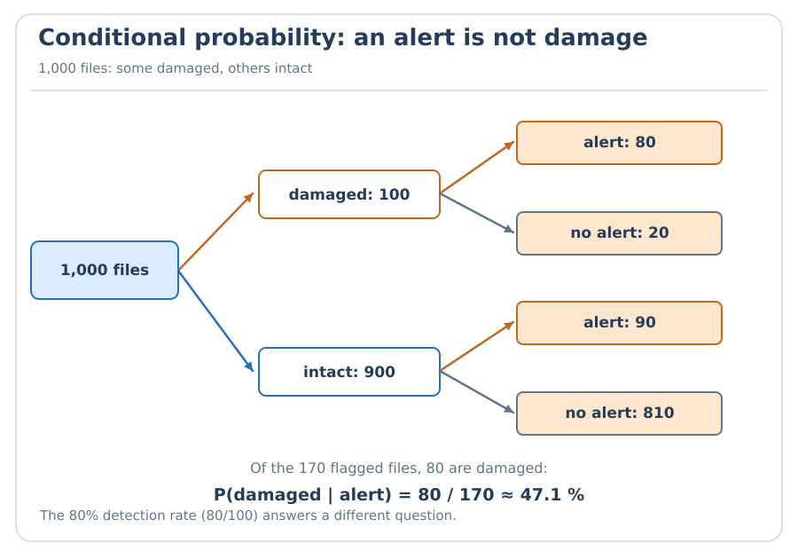

# M1-L22 – Conditional probability, independence and evaluating models {#L22}

**Course section:** M1 – Lower secondary education (Sekundarstufe I)

**Level:** Lower secondary education

**Prior knowledge:** No fixed prerequisites specified.

**Classification:** Lower secondary education, preparation for upper secondary education / approximately Year 10 of German schooling · Format: quick revision

## What is this about? {#S1}

Sometimes we want to know not how often an event occurs overall, but how likely it is **under an additional condition**. If a filter flags a file as suspicious, for instance, the question is: how often is a file actually faulty *among the flagged files*? That is a different question from the filter's detection rate *among the faulty files*. This difference is central to tests, diagnostic systems, classifiers and AI applications.

## Basic idea and illustration {#S2}

A probability always describes a **model of possibilities**, not an inherent property of a single future outcome. With conditional probability we narrow the population under consideration: we count only the cases in which the stated condition is met. From this subgroup we then determine the proportion in which the event of interest also occurs.

For example, only a few of all the files in an archive may be damaged. Among the files that a checking program identifies as suspicious, the proportion of damaged files may be considerably higher. Whether this proportion really is high, however, depends **also on the original frequency of faults** and the program's false alarms.

## New symbols before the first formula {#S3}

  Symbol        Pronunciation                             Meaning here                            Other possible uses
  ------------- ----------------------------------------- --------------------------------------- ---------------------------------------------------------------
  $A$, $B$      “Event A”, “event B”                      Sets of possible outcomes               Also points in geometry, otherwise general variables
  $P(A)$        “P of A” / “probability of A”             Probability of an event A               $P$ can denote a point in [M1-L21](M1-L21.md)
  $A\cap B$     “A intersection B”                        Both events occur                       `∩` also generally denotes the intersection of two sets
  $P(A\mid B)$  “Probability of A given B”                Proportion of A **within** all B cases  The vertical bar `|` can also mean absolute value or “divides”
  `≠`           “Not equal to”                            One quantity is not equal to another    General comparison symbol
  $0<P(B)$      “Zero is less than the probability of B”  Condition B has positive probability    `<` generally means “less than”
  `·`           “Times”                                   Multiplication of probabilities         Already familiar from [M1-L2](M1-L2.md)/M1-L3
  `≈`           “Approximately equal to”                  Rounded value                           Already familiar from earlier lessons

## Conditional probability: The denominator determines the question {#S4}

We consider two events: $A$ means “the file is faulty”; $B$ means “the file has been flagged by the checker”. We write the question “How likely is A **given that B is already known**?” as follows:

$$
P(A\mid B)=\frac{P(A\cap B)}{P(B)}\qquad\text{with }P(B)>0
$$

**Read aloud:** “The probability of A given B equals the probability that A and B both occur, divided by the probability of B.” The bar between $A$ and $B$ is **not** read as division but as “given”. The slash `/` on the right represents division. `∩` denotes the intersection, i.e. the cases in common. $P(B)>0$ is a requirement: without possible B cases this quotient cannot be formed.

Its counterpart $P(B\mid A)$ asks a **different question**: “How often does the checker flag a file that really is damaged?” These two probabilities are generally **not equal**.

## Mini-example: A file checker raises an alarm {#S5}

Assume a collection of **1,000 files**. Of these, **100 are actually damaged** and **900 are intact**. The checker detects **80** of the 100 damaged files and also produces a false alarm for **90** intact files. For the following probabilities, we select **one of the 1,000 files at random, with equal probability for each file**. Only under this explicit selection assumption do the following fractions directly represent the model probabilities.

{alt="File check for 1,000 cases: 80 damaged and 90 intact files flagged; of 170 alarms, 80 files are actually damaged."}

Conditional probability: 80 of the 170 flagged files are damaged, i.e. about $47.1\,\%$.

  Actual condition  Flagged as suspicious  Not flagged  Total
  ----------------- ---------------------- ------------ ----------
  Damaged           80                     20           100
  Intact            90                     810          900
  **Total**         **170**                **830**      **1,000**

From the checker's perspective, the detection rate is $\frac{80}{100}=80\,\%$. But for a case **already flagged**, we consider only the 170 flagged files, of which 80 are actually damaged:

$$
P(\text{damaged}\mid\text{flagged})=\frac{80}{170}\approx0.4706\approx47.1\,\%
$$

**Read aloud:** “The probability of damaged given flagged is eighty divided by one hundred and seventy; that is approximately forty-seven point one per cent.” The first number counts the **correct alarms**. The denominator counts **all alarms**, including false alarms.

The **detection rate** is $P(\text{flagged}\mid\text{damaged})=\frac{80}{100}=80\,\%$, whereas the **false alarm rate among intact files** is $P(\text{flagged}\mid\text{intact})=\frac{90}{900}=10\,\%$. The **base rate** of damaged files is $\frac{100}{1\,000}=10\,\%$. These three values help explain the proportion of genuinely damaged files among the alarms; the detection rate must not be equated with the reliability of a positive alarm.

It follows that a system can detect 80 per cent of actual faults and yet **fewer than 50 per cent of its alarms identify genuine faults**. The reason is the greater frequency of intact files and the false alarms. The exact numbers apply only to this explicitly assumed model.

## Independence: Information does not change the chance {#S6}

Two events are **independent** if knowledge of one does not change the probability of the other. When $P(B)>0$, this property can be expressed as follows:

$$
P(A\mid B)=P(A)
$$

**Read aloud:** “The probability of A given B is the same as the probability of A without this condition.” $A$ and $B$ are events; $P$ gives the probability in each case; the vertical bar represents the additional information.

An equivalent definition, which can also be used for events with probability zero, is:

$$
P(A\cap B)=P(A)\cdot P(B)
$$

**Read aloud:** “The probability that A and B occur together equals the product of their individual probabilities.” This product rule must **not** be applied to arbitrary events without checking. In the file example, damage and flagging are **not independent**: $P(A\cap B)=\frac{80}{1\,000}=0.08$, but $P(A)\cdot P(B)=\left(\frac{100}{1\,000}\right)\cdot\left(\frac{170}{1\,000}\right)=0.017$. The values are different.

An example of possible independence is two fair, independently generated coin tosses. The first result tells us nothing about the second. When drawing objects **without replacement** from a small urn, by contrast, the composition changes and therefore usually so do the chances on the second draw.

## Evaluating models: Four particularly common errors {#S7}

1.  **Reversing the condition.** $P(A\mid B)$ is not automatically $P(B\mid A)$ – this is the central trap in classification systems.
2.  **Assuming equal probabilities.** Simply dividing the number of favourable cases by the total number of cases gives the probability only if the outcomes under consideration really are equally likely.
3.  **Assuming independence.** Several successive events or measurements may have common causes. Simple product calculations are then incorrect.
4.  **Confusing the model with reality.** A risk of faults derived from historical files may differ with new hardware, different users or changed checking rules.

**Cross-check:** In our example, 170 files are flagged, i.e. $17\,\%$ of all the files. The 80 genuine faults among 170 flagged files therefore give around $47.1\,\%$, not $80\,\%$. The denominator answers the particular question.

## What is it useful for? {#S8}

For **spam filters, malware scanners and AI classifiers**, we must distinguish how many relevant objects are found from how reliable an individual positive result is. In **agent systems**, an alarm can trigger a further check, but the alarm alone provides no certainty. In **A/B testing** and data analysis, we must check whether the observed groups are comparable in the first place.

## Assumptions and limitations {#S9}

The calculations apply within a clearly specified probability model. Counts from a sample provide **empirical proportions**; they do not automatically become an exact, permanently valid probability for every future file. The mathematical term “independent” also means a particular probability relationship, not merely “technically separate” or “seemingly without influence”.

## Connection to the next lesson {#S10}

With [M1-L23](M1-L23.md) we finish lower secondary education with an extra geometry lesson on regular polygons, three-dimensional solids and symmetries. Upper secondary calculus follows.

## Sources {#S11}

No individual sources are listed separately for this lesson.
