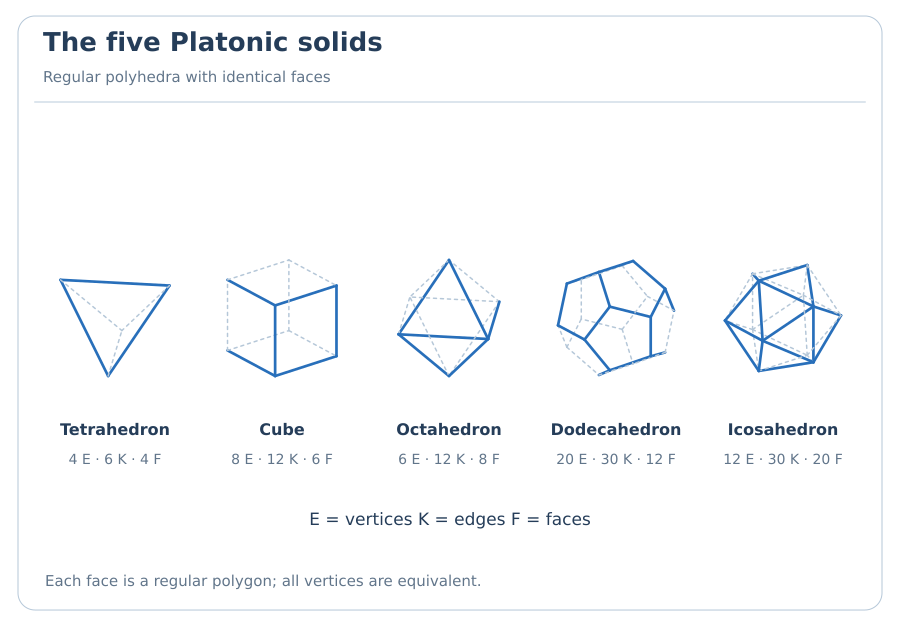

# M1-L23 – Regular polygons and the five Platonic solids {#L23}

**Course section:** M1 – Lower secondary education (Sekundarstufe I)

**Level:** Lower secondary education

**Prior knowledge:** No fixed prerequisites specified.

**Classification:** Lower secondary education, optional extra geometry / preparation for upper secondary education · Format: illustrated revision

## What is this about? {#S1}

A polygon is a **plane** shape with straight sides, for example a triangle or a pentagon. A polyhedron, however, is a **three-dimensional** solid whose surface consists of plane polygons. Some polygons and solids are particularly symmetrical. In the so-called **Platonic solids**, all faces are congruent regular polygons, and the same number of faces meet in the same arrangement at each vertex. Surprisingly, there are exactly **five** convex types in three-dimensional Euclidean space.

## Basic idea and illustration {#S2}

A square sheet of paper is two-dimensional; a cube, by contrast, has six square faces enclosing a three-dimensional shape. The key is **how the faces are joined together**: different three-dimensional solids can be formed from identical faces. If every vertex looks the same and all the faces have exactly the same shape, this is a very strong symmetry condition. We encounter these shapes in 3D graphics, geometry software, nets and modelling.

{alt="The five Platonic solids, tetrahedron, cube, octahedron, dodecahedron and icosahedron, as wireframe models with numbers of vertices, edges and faces."}

Regular solids: each has vertices of the same kind and congruent regular polygons as faces.

## New symbols before the first formula {#S3}

  Symbol    Pronunciation                Meaning here                                           Other possible uses
  --------- ---------------------------- ------------------------------------------------------ --------------------------------------------------------
  $n$       “n”                          Number of vertices in a plane polygon                  Generally an integer count, for example of measurements
  `°`       “Degree”                     Angle measure                                          Angles may also be given in radians ([M1-L20](M1-L20.md))
  $\alpha$  “Alpha”                      Interior angle of a regular polygon                    Greek letter, may identify other quantities
  $V$       “V” or “number of vertices”  Number of vertices of the polyhedron, from *vertices*  $V$ often also denotes volume or volts in technology
  $E$       “E” or “number of edges”     Number of edges of the polyhedron, from *edges*        Later $E[X]$ can mean an expected value
  $F$       “F” or “number of faces”     Number of faces of the polyhedron, from *faces*        $F$ can also denote a function or a force
  `−`       “Minus”                      Subtraction                                            Also a negative sign on numbers
  `=`       “Equals”                     Identical numerical values                             Sometimes assignment in programs

## Regular polygons: All sides and angles are equal {#S4}

A **regular** polygon has sides of equal length and interior angles of equal size. Three examples are the equilateral triangle (3 sides), the square (4 sides) and the regular hexagon (6 sides). The sum of the interior angles of a simple, non-self-intersecting n-sided polygon is $(n-2)\cdot180^{\text{°}}$. Here $n$ is an **integer of at least three**. The formula shown for an individual angle also assumes that the polygon is regular; self-intersecting star polygons are not included.

$$
\alpha=\frac{(n-2)\cdot180^{\text{°}}}{n}\qquad\text{for }n\geq3
$$

**Read aloud:** “Alpha equals n minus two, times one hundred and eighty degrees, divided by n.” $\alpha$ is the **individual** interior angle; $n$ is the number of vertices; `≥` means “greater than or equal to”. The formula works for a simple regular polygon because its interior angle sum is evenly distributed among all n vertices.

### Mini-example: The regular hexagon {#abschnitt-5}

Setting $n=6$ gives an interior angle sum of $(6-2)\cdot180^{\text{°}}=720^{\text{°}}$. Each interior angle is then $\frac{720^{\text{°}}}{6}=120^{\text{°}}$. A hexagon thus has six equal interior angles of 120 degrees each. This is a typical building block of geometric tilings, for example honeycomb patterns.

## Plane or space? Distinguishing the terms {#S5}

  Term                  Dimension                   What does it mean?                    Example
  --------------------- --------------------------- ------------------------------------- -----------------------------------
  Polygon               2D                          Plane shape bounded by line segments  Square
  Polyhedron            3D                          Solid with flat polygonal faces       Cube
  Face of a polyhedron  2D as part of a 3D surface  Individual polygon on the solid       A square face of a cube
  Net of a polyhedron   2D representation           Faces can be folded into a solid      Cube net consisting of six squares

The word **regular** alone is not enough to describe arbitrary three-dimensional solids as Platonic. In a Platonic solid, the **vertices must also be of the same kind** and the solid must be **convex** – it has no parts pushed inwards.

## The five Platonic solids {#S6}

  Name                   Shape of faces         Faces F  Edges E  Vertices V  Faces at each vertex
  ---------------------- ---------------------- -------- -------- ----------- ---------------------
  **Tetrahedron**        Equilateral triangles  4        6        4           3
  **Hexahedron / cube**  Squares                6        12       8           3
  **Octahedron**         Equilateral triangles  8        12       6           4
  **Dodecahedron**       Regular pentagons      12       30       20          3
  **Icosahedron**        Equilateral triangles  20       30       12          5

The names refer to the **number of faces**: “tetra” four, “hexa” six, “octa” eight, “dodeca” twelve, “icosa” twenty.

### Why are there only five? {#abschnitt-8}

At each convex vertex the sum of the **face angles** meeting there must be less than 360 degrees. With equilateral triangles (60 degrees), three, four or five can meet; six would form a flat surface. Only three squares (90 degrees) can fit, and likewise only three regular pentagons (108 degrees). With regular hexagons, three times 120 degrees is already 360 degrees. Polygons with even more sides have larger interior angles and cannot fit at such a vertex either. This leaves **at most five** combinations of face shape and number of faces at a vertex. Since all five combinations can actually be realised as the convex solids named in the table, there are **exactly five**. The angle sum condition alone would not yet prove existence.

## An important checking formula: Euler's relation {#S7}

For a **convex polyhedron**:

$$
V-E+F=2
$$

**Read aloud:** “The number of vertices minus the number of edges plus the number of faces equals two.” $V$ counts the vertices of the polyhedron, $E$ the edges and $F$ the faces. These letters denote **whole-number counts** here, not lengths or areas.

### Mini-example: Cube {#abschnitt-10}

A cube has eight vertices, twelve edges and six faces. Hence $8-12+6=2$. For a tetrahedron we also have $4-6+4=2$, and for an icosahedron $12-30+20=2$. The same can be checked for the two remaining Platonic solids. The relation does not apply without adjustment to every arbitrary surface, for instance to solids with holes passing through them.

## Symmetry, duality and computational geometry {#S8}

If we mentally interchange the **face centres and vertices** of certain regular solids, we obtain a **dual** solid. The cube and octahedron are dual to each other, as are the dodecahedron and icosahedron; the tetrahedron is dual to another tetrahedron. This reveals a deep pattern of spatial symmetry.

A geometric mesh in 3D software usually stores **points (vertices)** and **faces**, often triangles. The regular solids provide convenient test models for this. An icosahedron can be turned into a finer approximation of a sphere by repeated triangular subdivisions. Such meshes appear in computer graphics, simulations and spatial calculations, among other applications.

## What is it useful for? {#S9}

In **3D graphics and CAD**, regular solids serve as basic geometric shapes and test cases for edge and face algorithms. In **robotics** and with spatial sensors, symmetry and ordered sets of points help us consider orientations and distances systematically. Euler's relation also provides a quick plausibility check for certain closed polygon meshes.

## Assumptions and limitations {#S10}

The statement “exactly five” applies to **convex regular polyhedra in ordinary three-dimensional Euclidean space**. Non-convex star polyhedra, curved surfaces or other spaces follow different classifications. Euler's formula is a topological relationship concerning structure and does not replace a complete check of whether a mesh is geometrically correct or free of errors.

## Connection to the next lesson {#S11}

This optional extension completes the foundations module M1. In [M2-L1](M2-L1.md), upper secondary calculus starts with the systematic distinction between different families of functions.

## Sources {#S12}

No individual sources are listed separately for this lesson.
