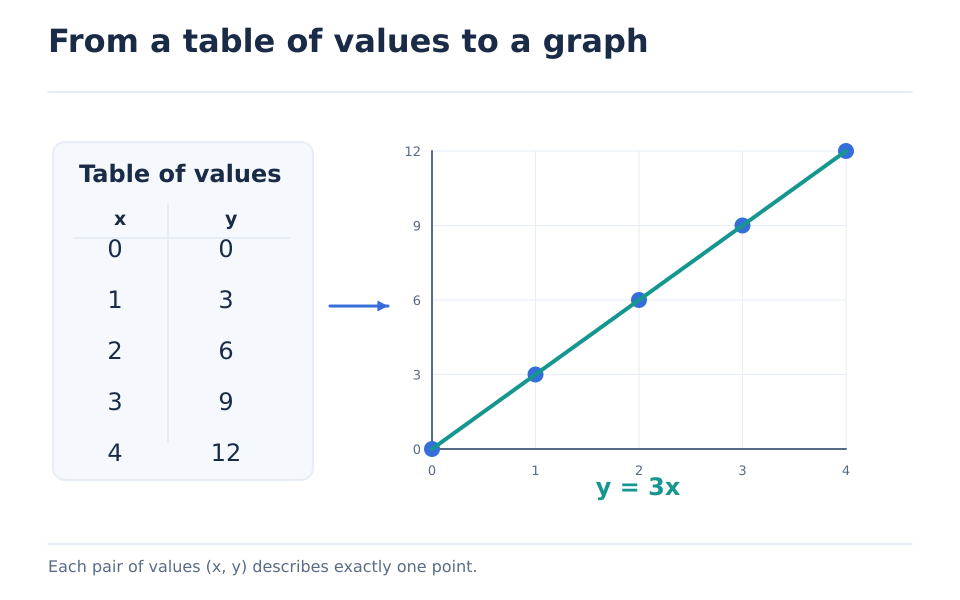

# M1-L4 – Coordinate systems, mappings, tables and diagrams {#L4}

**Course area:** M1 – Lower secondary education (Sekundarstufe I)

**Level:** Lower secondary education

**Prior knowledge:** No fixed prerequisites specified.

**Context:** Lower secondary education, roughly Year 7 of the German school system · Format: quick refresher

## What is this about? {#S1}

A numerical value can represent a time, temperature or position, for example. Often the interesting part is the **relationship between two quantities**: how many files have been processed after a certain time? How does the temperature change? Tables organise measurements, diagrams reveal patterns, and coordinate systems describe positions unambiguously. Functions turn these relationships into a precise language for dependencies.

## Basic idea: a point needs two pieces of information {#S2}

A **Cartesian coordinate system** has two axes. The horizontal one is called the **x-axis** (‘ex-axis’), and the vertical one is the **y-axis** (‘why-axis’). The axes meet at the **origin**, where both axes read zero. Normally x increases to the right and y upwards. Other orientations are possible and must be stated explicitly in technical systems.

A point is described by an ordered pair of numbers, such as $P(2\mid3)$. This is read as ‘point P with x-coordinate two and y-coordinate three’. The first value belongs to the horizontal axis, the second to the vertical axis. The vertical bar `|` is used **here only to separate coordinates**. It has other meanings elsewhere in mathematics.

**Text sketch – position of point P(2\|3):**

Formula, sketch or calculation scheme · original notation

        y
      4 |
      3 |       P · (2|3)
      2 |
      1 |
      0 +---+---+---+---→ x
          0   1   2   3

The sketch is schematic. A real plot drawn to scale would place the point exactly above $x=2$ and at height $y=3$.

**Symbols before the first formula:** $x$ is the input coordinate or horizontal quantity; $y$ is the vertical output quantity. $P$ is simply the freely chosen **name of a point**, not an operation symbol. An ordered pair is also written as $(2;3)$; for point names in this course, we will use $P(2\mid3)$ for now.

## From a table to a relationship {#S3}

An example program processes **three files per minute** at a steady rate. The table contains the corresponding pairs of values:

{alt="Table of values and the corresponding points in the coordinate system"}

| Time $x$ (minutes) | Files processed $y$ |
|---|---|
| 0 | 0 |
| 1 | 3 |
| 2 | 6 |
| 3 | 9 |
| 4 | 12 |

Reading these pairs as points gives, among others, $(0\mid0)$, $(1\mid3)$ and $(2\mid6)$. The table shows that whenever the time increases by one minute, three more files are added.

Before writing this relationship as a formula, we need another symbol: $f$ (‘eff’) is the name of a **function**. $f(x)$ is read as ‘f of x’ and means the **output value corresponding to x**. Here the brackets indicate a *function argument*, not multiplication. The number $3$ in $3x$ is the constant processing factor; the multiplication sign between the number and variable is omitted.

**Formula 1:**

$f(x)=3x$

**Read aloud:** ‘f of x equals three times x.’ The function takes the time $x$ in minutes and gives the number of files processed in that time. For example, $f(4)=12$: ‘f of four equals twelve.’ Only **non-negative times** make sense in this model. **The difference between a throughput model and an actual count is important:** at $x=0.5$, for example, the ideal straight line would give $f(0.5)=1.5$. In reality, the number of **fully completed files** can only be a whole number. For precise observed completion counts, a step function or table restricted to whole time points is therefore often more suitable; the line describes average or idealised throughput.

## What makes a mapping a function? {#S4}

A **mapping** connects inputs with outputs. A **function** assigns **exactly one** output value to each permissible input. Different inputs may give the same output.

- **Function:** Assign the number of files processed so far to a particular minute (assuming a specified processing run).
- **Not a function in this direction:** Assign *all* the languages a person speaks to that person. One person can have several output values. Instead, we could choose the **number** of languages they speak as a unique function value, for example.

A mathematical function does not have to run on a computer. It may represent an observed relationship in nature, a geometric rule or an idealised description.

## Linear relationships and diagrams {#S5}

In the processing example just described, the output increases by the same amount for every extra minute. The points therefore lie on a straight line in the diagram; in the idealised model, it runs through the origin. This is the **direct proportionality** from M1-L2.

However, a program may already mark two files as complete at the start, for example by reusing previous results. We then need a fixed initial quantity. The plus sign adds this initial value:

**Formula 2:**

$y=3x+2$

**Read aloud:** ‘Y equals three times x plus two.’ The graph is again a straight line, but at $x=0$ it starts at $y=2$. This relationship is **not directly proportional**, even though it has a constant gradient. In school mathematics this form is often also called ‘linear’; strictly speaking, it is often called an **affine function**. The distinction is explained in more detail in M1-L8.

### Which representation is useful for which purpose? {#abschnitt-6}

| Representation | Particularly useful for | What to look out for |
|---|---|---|
| Table | Exact individual values and times | State the unit and missing values |
| Scatter plot | Individual measurement pairs, spread | A connecting line is not always justified |
| Line graph | Change over time in a meaningfully connected quantity | Intermediate values may be unknown |
| Bar chart | Comparing separate categories | Do not automatically infer a continuous trend |

## Fully explained mini-example {#S6}

A log contains six completed files after two minutes. Plot **2 minutes** on the horizontal axis and **6 files** on the vertical axis. We could call this measurement point $P(2\mid6)$. The table contains the same pair of values. Using $f(x)=3x$ gives $f(2)=3\cdot2=6$. This agreement shows only that the measurement point fits the simple model, not that the process runs at the same speed under all conditions.

## Guide to reading symbols {#S7}

| Symbol | Name and pronunciation | Meaning here | Possible uses elsewhere |
|---|---|---|---|
| x-axis | ex-axis | Horizontal coordinate direction | x can be any input quantity |
| y-axis | why-axis | Vertical coordinate direction | y can be any output quantity |
| $P$ | ‘point pee’ | Name of a point, e.g. P with $x=2$ and $y=3$ | P can also denote a probability |
| $f(x)$ | ‘eff of ex’ | Value of function f at input x | f can be named freely |
| $3x$ | ‘three times ex’ | Factor three times input x | x can also be a geometric coordinate |
| `→` | ‘arrow to the right’ | Positive axis direction in the sketch | Later also a mapping or a limit |

## What is it useful for? {#S8}

A coordinate system can represent mouse positions, image pixels, map locations or measurement data. In software, functions describe the connection between inputs and results, for example in models of costs, speed or resources. With AI systems, tables allow us to compare running time, memory requirements and throughput. The choice of representation helps determine whether trends and outliers can be seen at all.

## Assumptions and limitations {#S9}

A straight line is a sensible model only if the increase is actually roughly constant in the range considered. Individual measurement points on a line do not prove that the process is continuous between them; especially in discrete counting processes, connecting the points with a continuous line is a modelling assumption. Start-up costs, waiting times, parallel processing and overload may change the real trend. **Axis scaling** and truncated axes can be visually very misleading. Time values and file counts also have different units; without labels, the diagram would be ambiguous.

## Link to [M1-L5](M1-L5.md) {#S10}

Coordinates show positions and relationships. Next, we look at the geometric shapes themselves, their dimensions and the appropriate units of measurement.

## Sources (external) {#S11}

No external sources listed.
