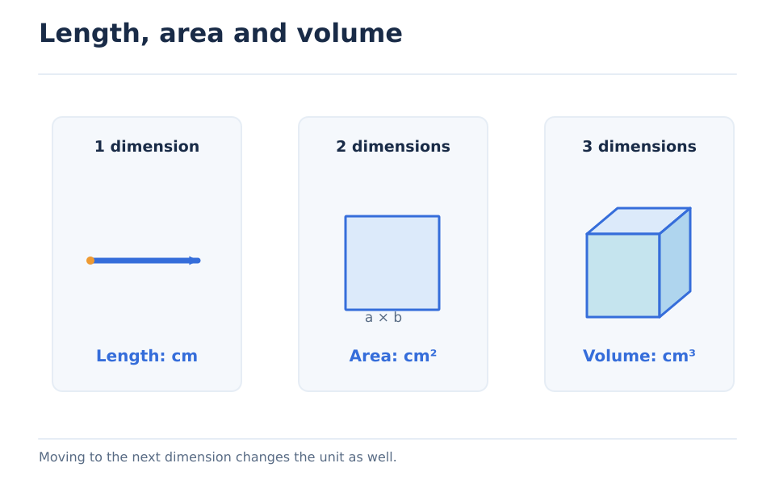

# M1-L5 – Basic geometric shapes and measurements {#L5}

**Course area:** M1 – Lower secondary education (Sekundarstufe I)

**Level:** Lower secondary education

**Prior knowledge:** No fixed prerequisites specified.

**Context:** Lower secondary education, roughly Year 7 of the German school system · Format: quick refresher

## What is this about? {#S1}

Geometry deals with shapes, positions, distances and dimensions. A line on a screen is one-dimensional, a surface is two-dimensional and a solid is three-dimensional. With a few terms we can describe how a shape is constructed, how long its boundary is or how much space it occupies. These quantities must be distinguished carefully, especially in computer graphics, spatial data and, later, robotics.

## Basic idea: line, surface and solid {#S2}

- **Point:** Describes a position without any size of its own. In drawings a point has a visible marker, but mathematically it has no size.
- **Line segment:** A finite straight section between two points. A **straight line**, by contrast, extends indefinitely in both directions.
- **Angle:** Describes the relative directions of two rays starting at the same point. Its size can be measured in **degrees**: $90^{\text{°}}$ is read as ‘ninety degrees’ and is called a right angle.
- **Triangle:** A plane shape with three straight sides. In ordinary flat, Euclidean space, the sum of its interior angles is $180^{\text{°}}$ (‘one hundred and eighty degrees’).
- **Quadrilateral:** A plane shape with four straight sides. Rectangles have four right angles; in a square all four sides also have equal length.
- **Circle:** The set of all points in a plane at the same distance from a centre. This distance is the **radius**, and twice the radius is the **diameter**. The filled region inside the circle is called a **disc**.
- **Solid:** A three-dimensional shape, such as a cube, cuboid, cylinder or sphere. A cube has six square faces; a cuboid has six rectangular faces.

A picture or drawing can give only a **two-dimensional view** of a three-dimensional solid. This is important when interpreting technical drawings.

## Units of measurement: length, area and volume {#S3}

The **length** of a line segment is measured in metres ($\mathrm m$), for example. The **perimeter** is the total length of the boundary of a plane shape and also has a unit of length. **Area** measures the two-dimensional interior, for example in square metres ($\mathrm m^2$, read as ‘square metres’). **Volume** measures three-dimensional space, for example in cubic metres ($\mathrm m^3$, read as ‘cubic metres’).

{alt="Line, surface and solid with the appropriate units of measurement"}

| Quantity | Example | Meaning |
|---|---|---|
| Length | $3\,\mathrm m$ | Three metres in one direction |
| Area | $6\,\mathrm m^2$ | Six square metres of area |
| Volume | $12\,\mathrm m^3$ | Twelve cubic metres of space |

**Take care when converting units:** $1\,\mathrm m=100\,\mathrm{cm}$ does **not** imply $1\,\mathrm m^2=100\,\mathrm{cm}^2$, but rather $1\,\mathrm m^2=10\,000\,\mathrm{cm}^2$. For volume, $1\,\mathrm m^3=1\,000\,000\,\mathrm{cm}^3$. The conversion factor is applied again for each spatial dimension.

## Three key formulas for area and volume {#S4}

Before we introduce the formulas, we define their letters:

- $A$ (‘capital A’) means **area** in this lesson.
- $V$ (‘vee’) means **volume**.
- $a$, $b$ and $c$ (‘ay’, ‘bee’, ‘see’) stand for **side lengths** or edge lengths; which side is meant depends on the sketch. In the actual rectangles and cuboids described here, these lengths are **positive**.
- $g$ (‘jee’) is the **base** of a triangle and $h$ (‘aitch’) is its **corresponding height**, the perpendicular distance from the opposite vertex to the line containing the base.
- The dot `·` means ‘times’, and the slash `/` means ‘divided by’. The superscripts `²` and `³` in unit names mean ‘squared’ and ‘cubed’ respectively.

### Area of a rectangle {#abschnitt-5}

$A=a\cdot b$

**Read aloud:** ‘The area A equals side length a times side length b.’ A rectangle two metres wide and three metres long has an area of $2\,\mathrm m\cdot3\,\mathrm m=6\,\mathrm m^2$. The units of length are multiplied too: metres times metres gives square metres. In a square both sides have the same length.

### Area of a triangle {#abschnitt-6}

$A=\frac{g\cdot h}{2}$

**Read aloud:** ‘The area A equals base g times corresponding height h, then divided by two.’ A triangle with a base of four centimetres and a corresponding height of three centimetres has an area of $\frac{4\,\mathrm{cm}\cdot3\,\mathrm{cm}}2=6\,\mathrm{cm}^2$. The height must correspond to the chosen base and be **perpendicular** to it; it may lie outside the triangle in an obtuse-angled triangle.

### Volume of a cuboid {#abschnitt-7}

$V=a\cdot b\cdot c$

**Read aloud:** ‘The volume V equals length a times width b times height c.’ A cuboid with edge lengths of two, three and four metres contains $2\,\mathrm m\cdot3\,\mathrm m\cdot4\,\mathrm m=24\,\mathrm m^3$ of space. The formula applies to a cuboid with mutually perpendicular edges.

## Symmetry: a shape stays the same under a transformation {#S5}

A shape has **reflection symmetry** if it appears unchanged when reflected in a particular line. A square has four such lines of symmetry. With **rotational symmetry**, the shape remains unchanged after a suitable rotation about a centre; a square, for example, after a quarter turn.

We generalise this idea later: symmetries can be described as mathematical **transformations**. In graphics software, these allow us to reflect, rotate and align objects.

## Fully explained mini-example {#S6}

A rectangular screen is modelled as having a width of $0.6\,\mathrm m$ and a height of $0.4\,\mathrm m$. For the front surface we use the formula for a rectangle: $A=0.6\,\mathrm m\cdot0.4\,\mathrm m=0.24\,\mathrm m^2$. This calculates the **area** of the front, not the volume of the device. For volume we would need a third dimension and a suitable assumption about the solid's shape.

## Guide to reading symbols {#S7}

| Symbol | Pronunciation | Meaning here | Possible uses elsewhere |
|---|---|---|---|
| `°` | degrees | Unit of an angle | Also degrees of temperature in °C |
| $\mathrm m$, $\mathrm{cm}$ | metres, centimetres | Units of length | Letters can represent variables elsewhere |
| $\mathrm m^2$, $\mathrm{cm}^2$ | square metres, square centimetres | Units of area | Superscript 2 also indicates a power of a number |
| $\mathrm m^3$, $\mathrm{cm}^3$ | cubic metres, cubic centimetres | Units of volume | Superscript 3 also indicates a power of a number |
| $A$ | capital A | Area | Later also an event, matrix or set |
| $V$ | vee | Volume | Later also vector space or voltage |
| $g$, $h$ | jee, aitch | Base and perpendicular height | Context-dependent variables |
| `·`, `/` | times, divided by | Arithmetic operations | `/` also separates path components in software |

## What is it useful for? {#S8}

Area calculations help with screen and print layouts, texture sizes and material requirements. Volume models help estimate space requirements, packaging or three-dimensional scenes. Angles and symmetries play a central role in computer games, CAD and later in robotics and 3D transformations.

## Assumptions and limitations {#S9}

The formulas apply to the **ideal geometric shapes** described in each case. An irregular space is not automatically a cuboid, and a perspective view on a screen does not give undistorted lengths. The triangle angle rule used here applies to flat Euclidean geometry; on curved surfaces different relationships may occur. Real measurements also involve measurement uncertainty.

## Link to [M1-L6](M1-L6.md) {#S10}

Having described and calculated quantities, we next consider several measurements together: frequencies, averages and the question of what a statistic really tells us.

## Sources (external) {#S11}

No external sources listed.
