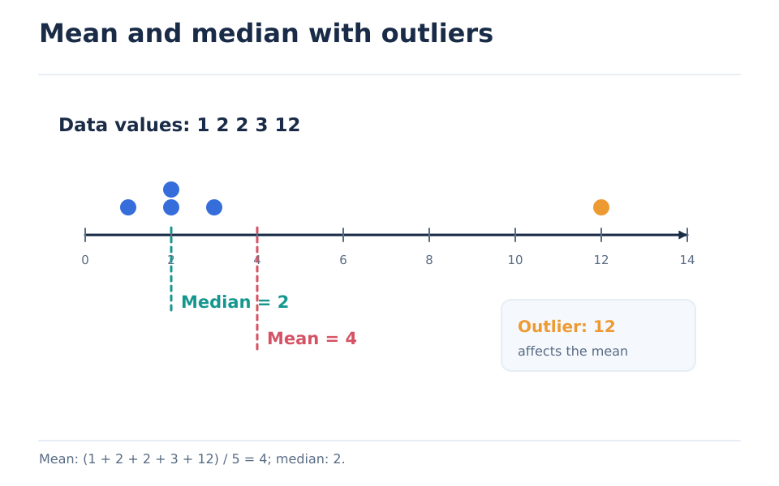

# M1-L6 – Statistics: frequency, mean, median and spread {#L6}

**Course area:** M1 – Lower secondary education (Sekundarstufe I)

**Level:** Lower secondary education

**Prior knowledge:** No fixed prerequisites specified.

**Context:** Lower secondary education, roughly Year 7 of the German school system · Format: quick refresher

## What is this about? {#S1}

Statistics helps us turn many individual observations into a clear description. Rather than listing each measurement separately, we can identify typical values, frequencies and differences. It is particularly useful to distinguish an average from a value that is representative of most observations. A single very unusual value can distort an entire summary.

## Basic idea: five measurements, several viewpoints {#S2}

A program takes the following times in **seconds** for five operations carried out one after another:

$1,2,2,3,12$

We have already sorted the numbers in ascending order. One of the five operations takes a particularly long time. This small data set helps explain several statistical terms.

### Absolute and relative frequency {#abschnitt-3}

The **absolute frequency** tells us how often a particular value occurs. The time $2\,\text{seconds}$ occurs **twice**.

The **relative frequency** gives the proportion of all observations. We call this proportion $h$ (pronounced ‘aitch’); in other contexts the letter can indicate a geometric height, for example. The slash `/` means ‘divided by’, and `%` means ‘per cent’ or ‘out of one hundred’.

**Formula 1:**

$h=\frac25=0.4=40\,\%$

**Read aloud:** ‘The relative frequency h equals two divided by five, which is zero point four or forty per cent.’ **Two out of five** operations take exactly two seconds. The denominator here is the number of all five observations, not the sum of their times.

## Mean: every observation counts {#S3}

The **arithmetic mean** is the sum of all the values divided by the number of values. Here we use $M$ (‘capital M’) as shorthand. The plus sign indicates addition, and brackets group the sum.

**Formula 2:**

$M=\frac{1+2+2+3+12}{5}=4$

**Read aloud:** ‘The mean M equals the sum of one, two, two, three and twelve, divided by five; that gives four.’ The mean duration is therefore **four seconds**. However, **none** of the operations in the list takes exactly four seconds. A mean need not itself occur as a measurement.

## Median and mode: what lies in the middle or occurs frequently? {#S4}

The **median** is the middle value in the **sorted** list. With five values it is in the third position: **2 seconds**. With an even number of numerical values, we usually take the arithmetic mean of the middle two numbers. Example: for $1,2,3,12$ the middle values are two and three; the median is $\frac{2+3}{2}=2.5\,\text{seconds}$. So it need not itself be an observed measurement.

{alt="Data set with an outlier, comparing the mean and median"}

The **mode** (or modal value) is the most frequently occurring value. In our example this is also **2 seconds**, because only this value occurs twice. There may be several modes with equal frequencies.

**Context:** The mean of four seconds is noticeably greater than the median of two seconds. The main cause is the operation that takes twelve seconds. The median is **more robust** against individual extreme values, but it does not tell the whole story.

## Spread: how different are the values? {#S5}

Two sets of measurements may have the same mean and still be very different: in one the values are close together, while in the other they vary greatly.

A very simple measure of spread is the **range**: the largest value minus the smallest. In our example this is $12-1=11\,\text{seconds}$. The symbol `−` means ‘minus’ and indicates subtraction here. The range depends only on two extreme observations; it tells us nothing about how the remaining values are distributed.

Later we consider more precise measures of spread, such as **variance** and **standard deviation**. For these, we need the idea of considering the distances of all the values from a typical central value.

## Which diagram shows what? {#S6}

| Type of diagram | What question does it answer? | Typical error |
|---|---|---|
| Vertical or horizontal bar chart | How often does each value or category occur? | A compressed or truncated axis gives a false impression of differences in size |
| Line graph | How does a value change over time? | Presenting intermediate points as measured when they were not |
| Histogram | How are many numerical values distributed over intervals? | With unequal class widths, interpreting bar heights rather than areas as frequencies |

In a **histogram with unequal class widths**, the **area** of each bar is the relevant quantity for comparison. The height then shows the frequency density (frequency divided by class width), not the frequency directly. For our small data set, a **frequency table** is sufficient for now:

| Running time | Frequency |
|---|---|
| 1 second | 1 |
| 2 seconds | 2 |
| 3 seconds | 1 |
| 12 seconds | 1 |

This is not the same as a record of changes over time: without the **original order** of the measurements, we do not know whether the particularly slow operation occurred at the beginning or the end.

## Fully explained mini-example {#S7}

We want to describe the typical duration of a software operation. The mean is four seconds, the median two seconds, and the mode also two seconds. A statement such as ‘The typical operation takes four seconds’ could therefore give a misleading impression. A more informative statement is: ‘The median is two seconds; a notably slow operation raises the mean to four seconds.’ To make a reliable statement about the system, we would need more measurements and information about the test conditions.

## Guide to reading symbols {#S8}

| Symbol | Pronunciation | Meaning here | Possible uses elsewhere |
|---|---|---|---|
| $h$ | aitch | Relative frequency of a value | Height of a shape in [M1-L5](M1-L5.md) |
| $M$ | capital M | Arithmetic mean in this chapter | Other formulas may use different letters |
| `/` | over, divided by | Proportion or division to find the mean | File or path separator in code |
| `%` | per cent | Proportion out of one hundred | Remainder operator in some programming languages |
| `−` | minus | Difference, here maximum minus minimum | Negative sign |

## What is it useful for? {#S9}

In programs, statistics can describe typical response times, memory use and error frequencies. In data analysis it helps reveal whether an average is distorted by outliers. For AI systems, for example, we consider the distribution of inference times rather than just one average. The quality of a model should not be judged solely on an unexplained mean either.

## Assumptions and limitations {#S10}

Our data set contains only five measurements and is **not evidence** of the program's general performance. A statistic depends on *what* was measured, *which* cases were selected and whether all the units are the same. An unusual value may be a measurement error or a real, technically important problem; we must not delete it without justification. An observed correlation does not establish a cause-and-effect relationship either.

## Link to [M1-L7](M1-L7.md) {#S11}

In [M1-L7](M1-L7.md) we revise powers, powers of ten and roots. They simplify very large or very small numbers and prepare us, among other things, for the statistical measures of spread used later.

## Sources {#S12}

No individual sources are listed separately for this lesson.
