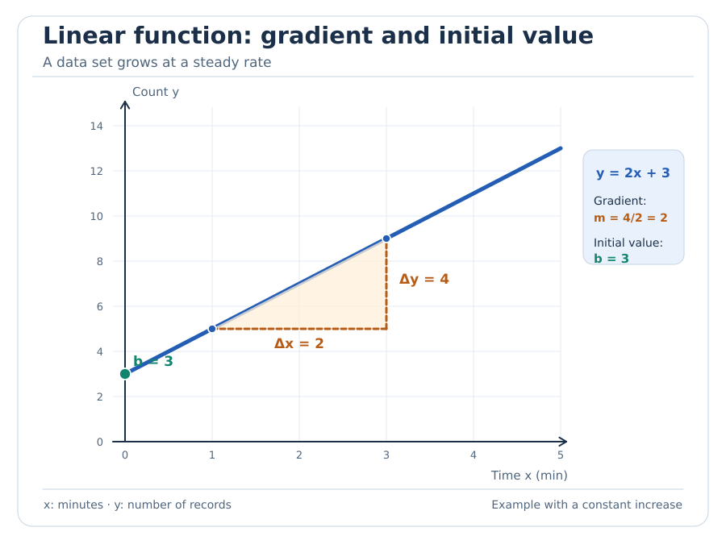

# M1-L8 – Linear functions: gradient and intercept {#L8}

**Course section:** M1 – Lower secondary education (Sekundarstufe I)

**Level:** Lower secondary education

**Prior knowledge:** No fixed prerequisites specified.

**Classification:** Lower secondary education, approximately Year 8 of German schooling · Format: quick revision

## What is this about? {#S1}

A function assigns exactly one output value to each input. In **linear functions**, equal steps in the input make the output increase or decrease by a constant amount, or remain unchanged. The complete graph of such a function defined on all real numbers is a straight line; when restricted to a smaller input domain, we see only the corresponding part of the line. Linear functions are therefore a particularly useful first model for costs, quantities, distances and technical measurements.

## Basic idea and illustration {#S2}

Imagine a service that starts with a fixed stock of three completed records and then creates two new records per minute. Exactly two more are added every minute. There is therefore an **initial value** and a **constant rate of change**. A straight line can represent both pieces of information in full.

Original model drawing: initial stock 3, increase of 2 records per minute; $\frac{\Delta y}{\Delta x}=\frac42=2$.

The school-level **straight-line function** with constant gradient and a possible initial value is called an **affine function** in higher mathematics – even when the initial value is zero. In linear algebra a **linear map** has a narrower meaning: in particular, it must map the origin to the origin, so it cannot have an additional initial value. For now, we retain the school term ‘linear function’. The symbols for the formulae are introduced next.

## New symbols before the first formula {#S3}

| Symbol | Pronunciation | Meaning here | Other possible uses |
|---|---|---|---|
| $f$ | eff | Name of a function | Any function name |
| $f(x)$ | f of x | Output of the function for input x | Function notation in general |
| $x$ | ex | Input; here, minutes elapsed | Horizontal coordinate, any variable |
| $y$ | why | Output value, which can also be written $f(x)$ | Vertical coordinate |
| $m$ | em | **Gradient**: change in output per unit of input | Mass, metres or a parameter |
| $b$ | bee | **Intercept**: output value when x equals zero | Any constant |
| $\Delta$ | capital delta | **Change** or difference between two values | In other fields, for example, a special operator |
| $\frac{\Delta y}{\Delta x}$ | delta y over delta x | Change in output divided by change in input | Average rate of change in general |
| $x_1$, $x_2$ and $y_1$, $y_2$ | x one, x two; y one, y two | Input and output values of two points; the small lowered numbers are **subscripts** | Numbering measurements in data series |
| $(x;y)$ | point with coordinates x and y | Ordered pair of coordinates (German notation uses a semicolon) | Brackets can also indicate grouping |
| `≥` | greater than or equal to | $x\ge0$ means that time is not negative | General comparison of quantities |

## Most important formulae {#S4}

**Formula 1 – Equation of a straight line:** $f(x)=m\cdot x+b$.

**Read aloud:** ‘f of x equals m times x plus b.’ The function is called $f$. The input value is $x$. The **gradient m** tells us how much the output increases or decreases for each extra unit of $x$. The **intercept b** is the value when $x=0$, where the line meets the vertical axis. Writing $mx$ without the multiplication sign means the same as $m\cdot x$.

**Formula 2 – Gradient from two points:** $m=\frac{\Delta y}{\Delta x}=\frac{y_2-y_1}{x_2-x_1}$.

**Read aloud:** ‘The gradient m is the change in y divided by the change in x; that is, y two minus y one divided by x two minus x one.’ Both points lie on the **same** straight line. The denominator must not be zero. If two **different** points have the same x-coordinate, the line joining them is vertical and is not the graph of a function $y=f(x)$. If the two points are **identical**, they alone cannot determine a unique line and hence a gradient.

## Fully explained mini-example {#S5}

For our example service, three records are present at the start, after which two new records are created per minute.

$f(x)=2x+3$.

**Read aloud:** ‘f of x equals two times x plus three.’ Here $m=2$ means exactly **two records per minute**; $b=3$ means **three records at the starting time**. After four minutes, the modelled value is $f(4)=2\cdot4+3=11$ records.

This gives a small table of values:

| Time $x$ (minutes) | Output value $f(x)$ (records) | Point in the coordinate system |
|---|---|---|
| 0 | 3 | $(0;3)$ |
| 1 | 5 | $(1;5)$ |
| 2 | 7 | $(2;7)$ |
| 4 | 11 | $(4;11)$ |

The points lie on the same straight line. At $x=0$ the **graph relevant to the model** begins at height three, and for every step to the right it rises two units. If $x$ represents the time elapsed since the start, a suitable domain for the situation is $x\ge0$; only the part of the line extending to the right is then considered. The number of records is an idealised continuous quantity in the model, even though real records are counted in whole numbers.

We can calculate the gradient from the points $(1;5)$ and $(4;11)$ as a check: $\Delta y=11-5=6$, $\Delta x=4-1=3$; hence $m=\frac63=2$ records per minute. The **unit of gradient** is always the unit of output **per** unit of input.

## Important special cases and interpretations {#S6}

- **Positive gradient:** When $m>0$, the line rises to the right. The symbol `>` is read ‘greater than’.
- **Negative gradient:** When $m<0$, the line falls to the right. The symbol `<` means ‘less than’.
- **Zero gradient:** When $m=0$, the output value is constant; the graph is horizontal.
- **Direct proportion ([M1-L2](M1-L2.md)):** When $b=0$, the line passes through the origin. The function $f(x)=m\cdot x$ then represents direct proportion. With a non-zero initial value, it is still a straight line, but does not represent direct proportion.

The horizontal axis is usually called the **x-axis**, and the vertical axis the **y-axis**. A line also represents intermediate values. In our example, however, only **whole** records can actually exist, and the records may not be created at a uniform rate within each minute. The continuous straight-line model is therefore a useful idealisation.

## What is it useful for? {#S7}

Linear functions serve as simple cost models, such as ‘monthly basic charge plus price per use’. They are also suitable for sensor calibration, conversions between units and rough predictions of running times. In data analysis, we can fit a line to measurements; later we call this **linear regression**. The mathematical idea is always the same: initial value plus constant change.

## Assumptions and limitations {#S8}

The straight line assumes a constant gradient. Actual computing times, network loads and production rates can fluctuate, reach thresholds or change suddenly. Two points are sufficient to define **one** straight line, but not to demonstrate that a real system always behaves linearly. A straight line estimated from data is a **model**, not a law of nature; predictions outside the observed range may be unreliable.

## Link to [M1-L9](M1-L9.md) {#S9}

So far we have considered **one** linear relationship at a time. In [M1-L9](M1-L9.md) we set up two such relationships at once and determine which values satisfy **both**.

## Sources {#S10}

No individual sources are listed separately for this lesson.
