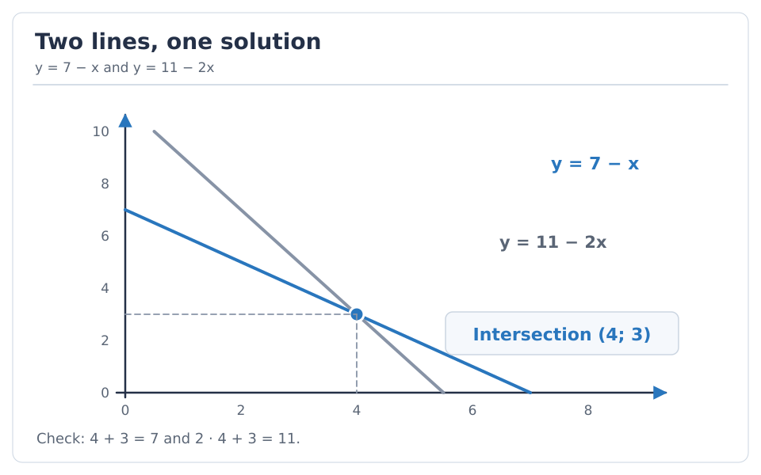

# M1-L9 – Simultaneous linear equations and solution methods {#L9}

**Course section:** M1 – Lower secondary education (Sekundarstufe I)

**Level:** Lower secondary education

**Prior knowledge:** No fixed prerequisites specified.

**Classification:** Lower secondary education, approximately Year 8 of German schooling · Format: quick revision

## What is this about? {#S1}

Sometimes we know two conditions but two values are unknown. A single equation is then usually not sufficient to determine both values uniquely. A **system of simultaneous equations** consists of several equations that must be satisfied **at the same time**. We can determine the unknowns by rearranging the equations carefully or view the problem as the intersection of two straight lines.

## Basic idea and illustration {#S2}

Think of two different billing rules for the same quantities. If both rules are to hold in the same case, we must find values that satisfy **both** statements at once. Mathematically, we look for the common solutions of the equations. For two linear equations in two unknowns with **real-valued solutions**, there can be exactly one pair of values, no pair of values or infinitely many pairs. If we additionally require integer or non-negative values only, the number of admissible solutions may change.

## New symbols before the first formula {#S3}

| Symbol | Pronunciation | Meaning here | Other possible uses |
|---|---|---|---|
| $x$, $y$ | x and y | Two numbers to be found | Coordinates on two axes, input/output of a function |
| $2x$ | two times x | Twice x, with the multiplication sign omitted | Algebraic notation in general |
| `=` | equals | Equality that must hold | Possibly assignment in program code |
| `{` (before two equations) | curly bracket, ‘belong together’ | Marks a system of equations that hold simultaneously | Bracket for a set in set theory |
| `⇔` | is equivalent to | Two steps have the same solution set | In logic, ‘if and only if’ |
| $(x;y)$ | pair of values x and y | Common solution of both equations | More generally, a point with coordinates |
| `−` | minus | Subtraction to eliminate one unknown | Negative sign |

## Main representation {#S4}

We consider the two conditions:

$$
\begin{aligned}
\begin{cases}x+y=7\\2x+y=11\end{cases}
\end{aligned}
$$

**Read aloud:** ‘We are looking for two numbers, x and y. Their sum is seven; at the same time, twice x plus y equals eleven.’ The left curly bracket simply shows that **both lines apply together**. The numbers 7 and 11 are known values; $x$ and $y$ are unknown. In the first line, $x$ has a factor of one, and in the second it has a factor of two.

### Method 1: Elimination by addition or subtraction {#abschnitt-5}

In this method, we add or subtract equations so that one variable disappears. In the example, $y$ appears in both equations with the same factor of one. If we **subtract the first equation from the second**, we subtract the corresponding left-hand **and** right-hand sides; then $y-y$ cancels out. Such transformations preserve the common solution set.

$$
\begin{aligned}
2x+y &= 11\\
x+y &= 7\\
(2x+y)-(x+y) &= 11-7\\
x &= 4
\end{aligned}
$$

**Read aloud:** ‘Two x plus y minus the sum of x and y equals eleven minus seven; this leaves x equals four.’ Now we substitute the value we have found into $x+y=7$. This gives $4+y=7$, so $y=3$.

**Result:** $(x;y)=(4;3)$.

Read aloud: ‘The common pair of values consists of x equals four and y equals three.’ The **check** confirms it: $4+3=7$ and $2\cdot4+3=11$. The values really do satisfy both original equations.

### Method 2: Substitution {#abschnitt-6}

Here we first rearrange one equation to make one unknown the subject. The first equation becomes $y=7-x$. We substitute this expression into the second condition:

$2x+(7-x)=11$.

**Read aloud:** ‘Two times x plus seven minus x equals eleven.’ Collecting like terms gives $x+7=11$, so $x=4$. Again, it follows that $y=3$. The method is called *substitution* because an equivalent expression is substituted for a variable.

### Method 3: Equating expressions {#abschnitt-7}

We rearrange **both** equations to make the same unknown the subject:

$y=7-x$ and $y=11-2x$.

**Read aloud:** ‘y is seven minus x; at the same time, y is eleven minus two times x.’ Since both right-hand sides describe the same value $y$, we set them equal: $7-x=11-2x$. Adding $2x$ and subtracting seven gives $x=4$, followed by $y=3$.

**Three methods, the same answer:** the methods differ only in how they eliminate one unknown. For a particular problem, we choose whichever method seems least cumbersome.

## Geometric meaning: intersection of two straight lines {#S5}

Each of the two equations can be viewed as a straight line in the coordinate system. They give $y=7-x$ and $y=11-2x$. Both lines meet at the point $(4;3)$. This is therefore the common solution of the system.

The common solution of the equations lies at the intersection (4; 3).

There are three fundamentally different cases:

| Case | Geometric situation | Number of common solutions |
|---|---|---|
| Unique solution | Two straight lines intersect at one point | Exactly one |
| No solution | Distinct parallel lines | None |
| Infinitely many solutions | Both equations describe the same line | Infinitely many |

Example with **no** solution: $x+y=4$ and $x+y=7$ can never hold simultaneously for the same pair of values. Subtraction gives the contradiction $0=3$. Example with **infinitely many** real solutions: $x+y=5$ and $2x+2y=10$ describe the same relationship, just written differently; the second equation is twice the first. This gives $0=0$, so there is **no new restriction**. For example, $(x;y)=(0;5)$, $(1;4)$ and $(-1;6)$ all satisfy both equations. An unrestricted solution set is not automatically admissible if a practical problem allows only integer, positive or otherwise restricted values.

## What is it useful for? {#S6}

Simultaneous linear equations are used to allocate limited resources, combine several measurement conditions and calculate technical parameters. For instance, a mixture or cost problem can be formulated when two unknown quantities are determined by two independent conditions. Graphics programs calculate intersections; large data problems involve solving extensive systems of linear equations. At university this topic leads directly to **matrices** and numerical linear algebra.

## Assumptions and limitations {#S7}

More equations do not automatically mean a unique solution: what matters is whether the conditions are independent and compatible with one another. The examples here are **linear**; products such as $x\cdot y$ or powers such as $x^2$ can lead to non-linear problems. With real measurement data, equations often do not fit together exactly, for example because of rounding or measurement errors. Later we will need approximate methods such as least-squares fitting, rather than a supposedly exact solution.

## Link to [M1-L10](M1-L10.md) {#S8}

The next lessons connect algebra more closely with space. In [M1-L10](M1-L10.md) we consider Pythagoras’ theorem and learn to calculate **lengths and distances** using equations.

## Sources {#S9}

No individual sources are listed separately for this lesson.
