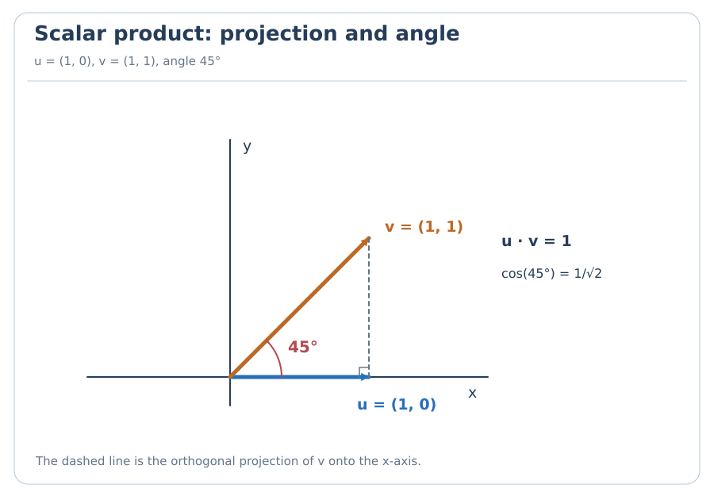

# M2-L11 – Vectors, scalar product and angles {#L11}

**Course area:** M2 – Upper secondary education / Abitur

**Level:** Upper secondary education / Abitur

**Prior knowledge:** No fixed prerequisites specified.

**Context:** Upper secondary education (Gymnasium) · analytical geometry

## What is this about? {#S1}

A point describes a location, whereas a vector describes a displacement or direction with a particular length. Vectors allow us to deal precisely with motion, forces and distances in space, independently of a drawing. Unlike a single number, a vector has several components, for example for the three spatial directions. The **scalar product** combines two vectors to produce a single number, allowing us to make statements about their angle and orientation.

## Basic idea and visual intuition {#S2}

Imagine a robot in three-dimensional space: a position is a location, while the instruction 'two metres to the right, one metre forwards, three metres upwards' is a displacement. Several displacements can be added; we can calculate their lengths and their directions relative to one another. The crucial distinction is between **location (point)**, **displacement (vector)** and **number (scalar)**.

## New symbols before the first formula {#S3}

| Symbol | How to read it | Meaning here | Other possible uses |
|---|---|---|---|
| $P(1;2;3)$ | 'P with coordinates one, two, three' | Point with x-, y- and z-coordinates | P can denote a probability in probability theory |
| `vec v` or $\vec{v}$ | 'vector v' | Directed displacement | Also written in bold as **v** in texts |
| $(2;-1;3)$ | 'vector with components two, minus one, three' | A vector in three dimensions; semicolons separate the components | Read as a point only in the appropriate context |
| `overrightarrow{AB}` | 'vector from A to B' | Displacement from point A to point B | An arrow above letters can also indicate direction in general |
| $\lambda$ | 'lambda' | Arbitrary real multiplier | Later often a parameter or eigenvalue |
| `lVert v⃗rVert` or $\lVert\vec{v}\rVert$ | 'norm of v', 'length of vector v' | Non-negative vector length | Other norms are possible at university level |
| $\vec{v}\cdot\vec{w}$ | 'v dot w' | A number obtained from two vectors | The same centred dot often denotes ordinary multiplication elsewhere |
| $\theta$ | 'theta' | Angle between two vectors | Arbitrary angle variable or model parameter |
| $\cos(\theta)$ | 'cosine of theta' | Cosine of the included angle | Also a general periodic function |
| `perp` or $\perp$ | 'is perpendicular to' | Vectors at right angles | Orthogonality of objects in general |

The notation with enclosing brackets and semicolons is a compact **text representation**. In school textbooks, the three components are often written one below another in a column. Both forms mean the same thing here. The arrows above the letters are not part of the numbers; they indicate the type of mathematical object.

## From a point to a vector {#S4}

Two points define a displacement. For example, $A(1;2;0)$ and $B(4;6;0)$ are points in space. To get from A to B, we take the coordinate difference **destination minus start**.

$$
\overrightarrow{AB}=B-A=(4-1;\,6-2;\,0-0)=(3;4;0)
$$

**Read in full:** 'The vector from A to B is point B minus point A, giving the vector three, four, zero.' Strictly speaking, $B-A$ is shorthand for subtracting the respective position coordinates. The components give the displacement: three units in the x-direction, four in the y-direction and none in the z-direction.

**Important distinction:** A point $A(1;2;0)$ is not automatically the same object as the vector $(1;2;0)$. In a fixed coordinate system, we can form the **position vector from the origin to A** with these components. This relationship is useful, but does not replace the conceptual distinction.

## Adding and scaling vectors {#S5}

When adding vectors, we add the components in each corresponding direction. When **scaling** a vector, we multiply every component by the same number.

$$
\begin{aligned}
\vec{u}&=(2;-1;3),\quad\vec{v}=(1;4;-2)\\
\vec{u}+\vec{v}&=(3;3;1)\\
2\vec{u}&=(4;-2;6)
\end{aligned}
$$

**Read aloud:** 'Vector u plus vector v is the vector three, three, one; twice vector u is the vector four, minus two, six.' The first line gives two input vectors. The result $(3;3;1)$ comes from the three sums $2+1$, $-1+4$ and $3-2$. Multiplying by two doubles the length of vector u and preserves its direction, provided u is not the zero vector.

If a non-zero vector is instead multiplied by a **negative** number, its direction is reversed. The factor $-2$ therefore doubles the length and reverses the direction. In general, for every real number $\lambda$:

$$
\lVert\lambda\vec{u}\rVert=\lvert\lambda\rvert\,\lVert\vec{u}\rVert
$$

**Read aloud:** 'The length of lambda times u is the absolute value of lambda times the length of u.' The **absolute value** $|\lambda|$ is never negative. A factor of zero produces the **zero vector**, all of whose components are zero. It has length zero, but no unique direction.

## Length and distance {#S6}

The length of a vector extends Pythagoras' theorem to several dimensions. In a Cartesian coordinate system with perpendicular axes, the following applies to three components:

$$
\lVert\vec{v}\rVert=\sqrt{v_1^2+v_2^2+v_3^2}
$$

**Read aloud:** 'The length of vector v is the square root of the square of its first component plus the square of its second component plus the square of its third component.' The subscript numbers `₁`, `₂`, `₃` are **component indices**, not powers; `²`, on the other hand, denotes the square.

For our connecting vector $(3;4;0)$, the length is $\sqrt{9+16+0}=5$. The distance between points A and B is therefore five units of length. The length is always non-negative and is zero only for the zero vector.

**Limitation:** This simple formula assumes coordinate axes with equal scales that are perpendicular to one another. Other coordinate systems or other notions of distance require adapted formulas.

## The scalar product: how similar are two directions? {#S7}

The word **scalar** here means a single number. The scalar product of two vectors therefore yields **not a third vector**, but a number. In Cartesian coordinates, we multiply the corresponding components and add the products:

$$
\vec{u}\cdot\vec{v}=u_1v_1+u_2v_2+u_3v_3
$$

**Read aloud:** 'Vector u dot vector v is u one times v one plus u two times v two plus u three times v three.' Each index identifies the corresponding spatial direction. For two **non-zero vectors**, a positive result means an acute angle, a negative result means an obtuse angle and a result of zero means a right angle. If at least one of the vectors is zero, its scalar product with any vector is zero, but an angle is then **undefined**.

Example:

$$
\begin{aligned}
\vec{u}&=(3;4;0),\quad\vec{v}=(-4;3;0)\\
\vec{u}\cdot\vec{v}&=3(-4)+4\cdot3+0\cdot0=0
\end{aligned}
$$

**Read aloud:** 'Three times minus four plus four times three plus zero times zero equals zero.' Because both vectors are non-zero, the angle between them is exactly 90 degrees: they are **orthogonal**, meaning perpendicular to each other.

## Calculating the angle using the scalar product {#S8}

The scalar product can also be described geometrically using the two lengths and the included angle. For **two non-zero vectors**:

{alt="Vector u points right to (1,0), vector v diagonally to (1,1), with a right angle at the foot of the projection and an included angle of 45 degrees."}

Scalar product: the angle between $u=(1,0)$ and $v=(1,1)$ is $45^{\text{°}}$.

$$
\cos(\theta)=\frac{\vec{u}\cdot\vec{v}}{\lVert\vec{u}\rVert\,\lVert\vec{v}\rVert}
$$

**Read aloud:** 'The cosine of theta is the scalar product of u and v divided by the product of the length of u and the length of v.' Here $\theta$ is the angle between the vectors, between zero and 180 degrees. The denominator is non-zero only if neither vector is the zero vector.

**Fully explained mini-example:**

$$
\begin{aligned}
\vec{u}&=(1;0;0),\quad\vec{v}=(1;1;0)\\
\vec{u}\cdot\vec{v}&=1\\
\lVert\vec{u}\rVert&=1,\quad\lVert\vec{v}\rVert=\sqrt2\\
\cos(\theta)&=\frac1{\sqrt2},\quad\theta=45^{\text{°}}
\end{aligned}
$$

Read aloud: 'The cosine of the angle is one divided by the square root of two; the angle is 45 degrees.' The inverse cosine (familiar from [M1-L16](M1-L16.md); often written `arccos`) gives the angle from the cosine value. To obtain this result, a calculator must be set to **degrees** rather than radians, if it is not already working in degrees.

**Checking the limiting cases:** For $\vec{u}=(1;0;0)$ and $\vec{w}=(-2;0;0)$, we have $\vec{u}\cdot\vec{w}=-2$ and $\lVert\vec{u}\rVert\cdot\lVert\vec{w}\rVert=2$, so $\cos(\theta)=-1$ and $\theta=180^{\text{°}}$. For non-zero vectors pointing in the same direction, the cosine is $+1$; for perpendicular vectors, it is $0$. The quotient is therefore mathematically between **−1 and +1**. In software, rounding can produce a result slightly outside this range. Only after checking the condition on the denominator can such a rounded result be restricted to $[-1;1]$ before applying `arccos`.

## What is it useful for? – Software and robotics {#S9}

In a 3D engine, vectors determine viewing directions, camera movements and lighting calculations. A scalar product shows, for example, whether a surface tends to face the light source and how closely its orientation matches the direction of the light. In AI embeddings, the version divided by **both vector lengths**, called **cosine similarity**, measures directional similarity for non-zero data vectors; vectors pointing in the same direction receive a value of one, and vectors pointing in opposite directions receive minus one. However, this does not automatically imply semantic equivalence or factual truth.

For robots, a vector might describe a desired movement target relative to the current position. For physical forces and velocities, we must also pay attention to compatible units and the frame of reference used.

## Assumptions and limitations {#S10}

- The formulas used here apply to ordinary Euclidean vectors in an orthonormal Cartesian coordinate system.
- **A point and a vector are not the same**; we must not treat a position coordinate as a displacement without further consideration.
- The length of a zero vector is zero. The formula above cannot determine an angle between the zero vector and another vector.
- The scalar product can give negative values. It is neither a distance nor a probability.
- In numerical software practice, rounding errors can occur: a theoretically perpendicular pair may yield a very small value instead of exactly zero. For comparisons, a tolerance appropriate to the scale of the quantities is useful.
- Vectors with different physical units (e.g. metres and seconds) must not be added as though they represented the same kind of displacement.

## Connection to the next lesson {#S11}

**[M2-L12](M2-L12.md) – Parametric equations of lines and planes** uses a starting point and one or more direction vectors to describe infinitely many points in space compactly.

## Sources {#S12}

No individual sources are listed separately for this lesson.
