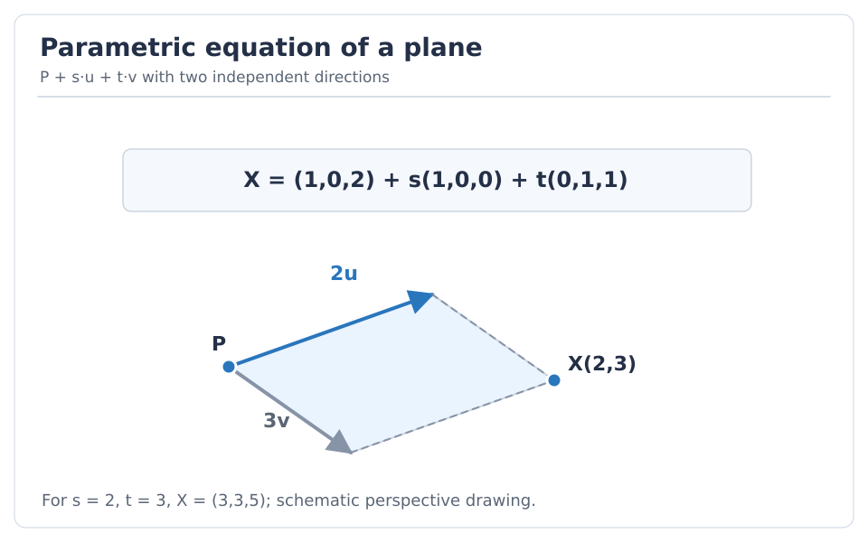

# M2-L12 – Parametric equations of lines and planes {#L12}

**Course area:** M2 – Upper secondary education / Abitur

**Level:** Upper secondary education / Abitur

**Prior knowledge:** No fixed prerequisites specified.

**Context:** Upper secondary education (Gymnasium) · analytical geometry

## What is this about? {#S1}

A straight line is an infinitely long line with no thickness. A plane is an infinitely extended flat surface with no thickness. In three-dimensional space, we can describe both using vectors. Instead of listing each point individually, we use a known point and one or two directions. Varying the associated **parameters** gives us all the points on the line or plane.

## Basic idea and visual intuition {#S2}

A straight line can be understood as a **starting point plus any amount of movement in exactly one direction**. A plane needs **two linearly independent directions**: neither may be a multiple of the other; in particular, neither direction vector may be zero. Think of a straight rail in space or an idealised, infinitely extended tabletop. A parametric equation is a compact mathematical instruction that can also serve as a generator of points on such objects.

## New symbols before the first formula {#S3}

| Symbol | How to read it | Meaning here | Other possible uses |
|---|---|---|---|
| $g$, $E$ | 'line g', 'plane E' | Names for a line and a plane | The letters can be chosen freely |
| $X$ | 'point X' | Variable point on a line or plane | x can otherwise be a number or coordinate |
| $\vec{p}$ | 'vector p' | Position vector of a known reference point | p can stand for probability |
| $\vec{u}$, $\vec{v}$ | 'vector u', 'vector v' | Direction vectors | General displacements, velocities |
| $t$, $s$ | 't', 's' | Freely chosen parameters | Time variables in models of motion |
| `∈` | 'is an element of' | Membership of a set of numbers | Also used for points and other sets |
| $\mathbb{R}$ | 'real numbers' | Parameters may take any real value | Already familiar from [M1-L1](M1-L1.md) |
| $t\in\mathbb{R}$ | 't is an element of the real numbers' | Unrestricted parameter range | For a line segment the range would be restricted |
| $\vec{n}$ | 'normal vector n' | Vector perpendicular to a plane | n can otherwise be a count or an index |
| $\vec{n}\cdot\vec{u}=0$ | 'n dot u is zero' | Perpendicular directions as in [M2-L11](M2-L11.md) | A scalar product of zero alone is not sufficient to define an angle involving zero vectors |

A **position vector** is the vector from the coordinate origin to a point. A **reference point** is a known point through which our line or plane passes. The parameter names have no fixed meaning: we can use other letters instead of $s$ and $t$ as long as their roles are clear.

## The line as a point generator {#S4}

The parametric equation of a line in space in text notation is:

$$
g:\ X=\vec{p}+t\vec{u}\qquad(t\in\mathbb{R},\ \vec{u}\neq\vec{0})
$$

**Read in full:** 'Line g consists of points X with position vector p plus t times u. Parameter t may be any real number; u is not the zero vector.' $\vec{p}$ points to the starting point; $\vec{u}$ determines the direction. For $t=0$ we obtain the reference point; for positive or negative values we move along the line in either direction.

**Mini-example – a rail in three-dimensional space:**

$$
\begin{aligned}
\vec p&=(1;2;0),\quad\vec u=(2;-1;3)\\
X(t)&=(1;2;0)+t\cdot(2;-1;3)
\end{aligned}
$$

**Read aloud:** 'Point X of t is one, two, zero plus t times the vector two, minus one, three.' Substituting $t=2$, we obtain, component by component:

$$
X(2)=(1+2\cdot2;\,2+2\cdot(-1);\,0+2\cdot3)=(5;0;6)
$$

The point $(5;0;6)$ therefore lies on the line. For $t=-1$ we would instead obtain the point $(-1;3;-3)$. Because all real parameter values are permitted, this equation describes a **line**, not a segment bounded by two endpoints.

## When does a point lie on a line? {#S5}

To check whether point $Q(3;1;3)$ lies on our example line, we look for a **single common parameter value** that satisfies all three coordinate conditions.

$$
\begin{aligned}
1+2t&=3\\
2-t&=1\\
3t&=3
\end{aligned}
$$

**Read aloud:** 'One plus twice t must be three, two minus t must be one, and three times t must be three.' All equations give $t=1$. The point Q therefore lies on the line.

Another point may satisfy two of the three equations but fail to satisfy the third; in that case it does **not** lie on the line. This shows why we must not choose parameter values separately for each component.

## A plane needs two independent directions {#S6}

For a plane, we use two direction vectors in addition to the reference point. The two parameters can vary independently of each other:

{alt="Schematic parametric representation of a plane through a reference point P with two linearly independent directions u and v. The destination point is P plus 2u plus 3v."}

Two independent parameters generate points on a plane; the diagram is a projection.

$$
E:\ X=\vec{p}+s\vec{u}+t\vec{v}\qquad(s,t\in\mathbb{R})
$$

**Read aloud:** 'Plane E consists of all points X with position vector p plus s times u plus t times v; s and t may be any real numbers.' Unlike the line, there are now **two degrees of freedom**. The direction vectors must be **linearly independent**. Here this means that neither is a scalar multiple of the other; in particular, neither may be zero. Otherwise, at most a line or a single point is produced instead of a plane.

**Mini-example – a sloping plane:**

$$
\begin{aligned}
\vec p&=(1;0;2),\quad\vec u=(1;0;0),\quad\vec v=(0;1;1)\\
E:\quad X(s,t)&=(1;0;2)+s\cdot(1;0;0)+t\cdot(0;1;1)
\end{aligned}
$$

For $s=2$ and $t=3$, addition component by component gives the point:

$$
X(2,3)=(1+2;\,0+3;\,2+3)=(3;3;5)
$$

The two directions are linearly independent: with $\vec{u}$ we change only the first coordinate, while with $\vec{v}$ we change the second and third coordinates together. They therefore really describe a two-dimensional plane.

**Counterexample to the requirement:** If we replaced $\vec{v}$ with $(2;0;0)$, then $\vec{v}=2\vec{u}$. We could then write $s\vec{u}+t\vec{v}=(s+2t)\vec{u}$. Despite having two parameter names, we would obtain only the line through the reference point in direction $\vec{u}$, **not a plane**.

## An alternative representation: normal form {#S7}

For a plane, we can give a **non-zero** vector that is **perpendicular to every direction within that plane**. This is called a **normal vector**. For a plane with linearly independent direction vectors u and v, we must therefore have $\vec{n}\cdot\vec{u}=0$ and $\vec{n}\cdot\vec{v}=0$. Normal form is useful for many questions involving distances and intersections.

$$
\vec{n}\cdot(X-\vec{p})=0
$$

**Read aloud:** 'The scalar product of normal vector n and the vector from reference point p to variable point X is zero.' Here the difference $X-\vec{p}$ is understood as the difference between position vectors. Because the scalar product is zero, the direction of the difference is perpendicular to the non-zero $\vec{n}$ and thus lies in the plane specified by the reference point. At the reference point itself, the zero difference vector also satisfies the equation; no angle with the zero vector needs to be defined for this.

For our example plane, we can check a normal vector directly: $\vec{n}=(0;-1;1)$ satisfies both $\vec{n}\cdot\vec{u}=0$ and $\vec{n}\cdot\vec{v}=0$.

This converts the parametric description into what is called **Cartesian form**:

$$
z-y=2
$$

**Read aloud:** 'Zed minus y is two.' This equation holds for every point in the plane. For example, the previously calculated point $(3;3;5)$ gives the calculation $5-3=2$. By contrast, point $Q(3;3;4)$ does **not** lie in the plane: $4-3=1$ instead of $2$. The letter $z$ stands for the third spatial coordinate, and $y$ for the second.

**Important:** The normal vector is not unique. Twice the same vector or its negative is also perpendicular to the plane.

## What about line segments, rays and bounded surfaces? {#S8}

The parametric form normally represents infinite geometrical objects. For a **line segment** from the reference point with position vector $\vec{p}$ to the point with position vector $\vec{p}+\vec{u}$, the parameter in $X(t)=\vec{p}+t\vec{u}$ is restricted to the interval $0\leq t\leq 1$. For a **ray** starting at the reference point in direction $\vec{u}$, we have $t\geq 0$. Another parametrisation may use different parameter limits for the same line segment. These restrictions are important for actual paths of motion, components or screen segments.

Likewise, a physical tabletop is only a bounded portion of a mathematically infinite plane. Its boundaries must be specified additionally, for example using parameter intervals or a polygonal boundary.

## What is it useful for? {#S9}

A 3D application can treat a camera's viewing direction as a line and investigate where it meets the surface of an object. In robotics simulations, possible directions of motion and obstacle surfaces are described using vector equations. Lines and planes are fundamental objects in CAD and engineering design. In computer games and ray tracing, a **ray** rather than the complete line is often considered in addition; this means that intersections behind the camera do not count as visible objects.

## Assumptions and limitations {#S10}

- A line's direction vector must be non-zero; a plane's two direction vectors must be linearly independent.
- A **parametric equation** describes all points generated using the same common set of parameters. We must not choose a new $t$ independently for each coordinate.
- With two independent direction vectors, each point of the plane has uniquely determined parameter values. With dependent directions, the representation is **not a true parametrisation of a plane**; different pairs of parameters can describe the same point on a line or even the reference point.
- Our intuitive models assume straight-line Euclidean geometry. Curved surfaces need other descriptions.
- Whether an actual motion follows the same straight line throughout is a modelling assumption; time is not automatically the same as the parameter.

## Connection to the next lesson {#S11}

**[M2-L13](M2-L13.md) – Distances, relative positions and simultaneous equations** examines when spatial objects intersect, are parallel or are skew, and how their distance is calculated.

## Sources (external) {#S12}

No external sources listed.
