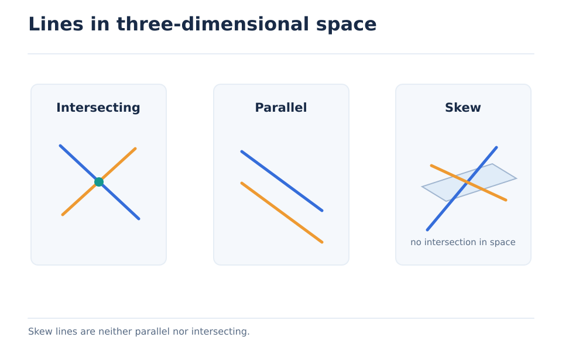

# M2-L13 – Distances, relative positions and simultaneous equations {#L13}

**Course area:** M2 – Upper secondary education / Abitur

**Level:** Upper secondary education / Abitur

**Prior knowledge:** No fixed prerequisites specified.

**Context:** Upper secondary education (Gymnasium) · analytical geometry

## What is this about? {#S1}

Having described lines and planes as sets of points, we face a practical question: do these objects meet, are they parallel, or do they not intersect at all? In space, two lines can even be distinct and non-parallel without intersecting. We also want to know how far a point is from a line or plane. To answer these questions, we combine geometrical intuition with systems of linear equations. Later, a matrix is simply a particularly clear way of writing and working with such systems.

## Basic idea and visual intuition {#S2}

A point of intersection must lie on all the objects involved **at the same time**. We therefore set their point descriptions equal to each other and look for common parameter values. Distance is about the **shortest connection**, which runs perpendicular to the object in question. Algebra answers the spatial question, and geometry helps us interpret the algebraic solution correctly.

## New symbols before the first formula {#S3}

| Symbol | How to read it | Meaning here | Other possible uses |
|---|---|---|---|
| $g$, $h$, $E$ | 'line g', 'line h', 'plane E' | Names of the geometrical objects being compared | Arbitrary labels |
| $r$, $s$, $t$ | 'r', 's', 't' | Independent parameters depending on the line or plane | Often displacement or time in physical models |
| $d(P,E)$ | 'distance from P to plane E' | Shortest distance in space | $d$ also occurs in differential notation elsewhere |
| $\lVert\vec v\rVert$ | 'norm', 'length of vector v' | Vector length from [M2-L11](M2-L11.md) | General norms in higher mathematics |
| $\vec{n}$ | 'normal vector n' | Direction perpendicular to the plane, from [M2-L12](M2-L12.md) | Name of any other vector |
| $\lvert a\rvert$ | 'absolute value of a' | Non-negative magnitude of a real number | Vertical bars in other contexts: cardinality of a set, determinant |
| $\perp$ | 'is perpendicular to' | Direction of the shortest connection to a line or plane | Orthogonality in general |
| `LGS` | 'system of linear equations' (German abbreviation) | Several linear equations simultaneously | Abbreviation, not a mathematical operator |
| $A\cdot\vec x=\vec b$ | 'matrix A times vector x equals vector b' | Compact notation for a linear system | A can denote an area elsewhere |
| `[a b; c d]` | 'matrix with two rows and two columns' | Text representation of a rectangular table of numbers | Not an ordinary fraction; the semicolon indicates a new row here |

An **intersection** is the set of common points. Two lines can intersect in at most one point or be completely identical; for a line and a plane, the common set is empty, a point or the entire line. **Two planes** can also share an entire plane (if they are identical) or intersect along a line. We use the expressions 'no intersection', 'one point of intersection' and 'identical' without assuming knowledge of another set symbol.

## Two lines: intersecting, parallel, identical or skew? {#S4}

Two lines in space can intersect at a point, be parallel and distinct, be identical or be **skew**. Skew means that they are neither parallel nor have a point in common. This is impossible in a plane but entirely normal in three-dimensional space.

{alt="Three possible relative positions of two lines, including skew lines in space."}

**Mini-example of skew lines:**

$$
\begin{aligned}
g:\quad X(t)&=(t;0;0)\\
h:\quad X(s)&=(0;s;1)
\end{aligned}
$$

**Read aloud:** 'Line g has points with coordinates t, zero, zero; line h has points with coordinates zero, s, one.' The first line is the x-axis at height zero. The second runs parallel to the y-axis at height one. Their directions are different, so they are not parallel. Yet a common point is impossible, since the third coordinate on g is always zero and on h always one. The two lines are **skew**.

For a genuine intersection, **all three coordinate equations must be satisfied with the same parameter values**. Two apparently matching coordinates are not enough.

**Comparison with intersecting and parallel lines:** The lines $g:\ X(t)=(t;0;0)$ and $k:\ X(s)=(0;s;0)$ intersect at the origin when $t=s=0$: all three coordinates agree. By contrast, $g$ and $m:\ X(s)=(s;1;0)$ have the same direction vector up to a scalar factor, but have no point in common because their second coordinates differ: they are **parallel and distinct**, not skew. Two lines would be identical only if their direction vectors were parallel **and** a reference point of one lay on the other.

## A line and a plane: substituting rather than guessing {#S5}

If a plane is already given in Cartesian form, we can substitute the coordinates of the line directly. We use:

$$
\begin{aligned}
g:\quad X(t)&=(0;0;1)+t\cdot(1;1;2)\\
E:\quad z&=5
\end{aligned}
$$

**Read aloud:** 'Line g starts at zero, zero, one and runs in direction one, one, two; plane E consists of all points with z-coordinate five.' The third coordinate of a point on the line is $z=1+2t$. An intersection requires $1+2t=5$, so $t=2$. Substituting this into the equation of the line gives:

$$
X(2)=(2;2;5)
$$

**Read aloud:** 'When t equals two, the point on the line is two, two, five.' This point satisfies the plane equation and, by construction, lies on the line. We have therefore established the point of intersection.

The possible cases are:

- **One point of intersection:** The line crosses the plane at exactly one point.
- **No point of intersection:** The line is strictly parallel to the plane.
- **Infinitely many points of intersection:** The whole line lies in the plane.

In an equation, we can often recognise these cases by whether there is exactly one solution for the line parameter, a contradiction or an identity.

**General decision test:** For the line $X(t)=\vec p+t\cdot\vec u$ with $\vec u\neq\vec 0$ and a plane with reference point $\vec{a}$ and normal vector $\vec n\neq\vec 0$, substitution gives:

$$
\vec{n}\cdot(\vec{p}-\vec{a})+t\,(\vec{n}\cdot\vec{u})=0
$$

**Read aloud:** 'n dot p minus a plus t times n dot u is zero.' If $\vec n\cdot\vec u\neq0$, there is **exactly one** parameter value and hence one point of intersection. If $\vec n\cdot\vec u=0$, the other term decides: if also $\vec n\cdot(\vec p-\vec a)=0$, the whole line lies in the plane; otherwise, the line and plane are **strictly parallel**. These are the three possible cases.

## Distances: the shortest route {#S6}

Between two points, the straight-line connection is the shortest route. Between a point and a plane, the shortest connection is **perpendicular to the plane**. This explains why we can use the normal vector.

### Point to point {#abschnitt-7}

For $A(1;2;3)$ and $B(4;6;3)$, the connecting vector is $\overrightarrow{AB}=(3;4;0)$. As in [M2-L11](M2-L11.md), this gives the distance $\lVert\overrightarrow{AB}\rVert=5$ units of length.

### Point to plane {#abschnitt-8}

Let a plane be given by a reference point with position vector $\vec{p}$ and a non-zero normal vector $\vec{n}$. Let the point under consideration have position vector $\vec{q}$.

$$
d(Q,E)=\frac{\lvert\vec{n}\cdot(\vec{q}-\vec{p})\rvert}{\lVert\vec{n}\rVert}
$$

**Read in full:** 'The distance from point Q to plane E is the absolute value of the scalar product of normal vector n and the connecting vector from reference point p to point q, divided by the length of the normal vector.' The absolute value symbol `|...|` ensures that the distance is not negative.

**Mini-example:** Plane $E:\ z=0$ is the horizontal plane through the origin. Its normal vector is $(0;0;1)$. For point $Q(1;2;3)$, the scalar product with the normal vector gives three. The length of the normal vector is one, so the distance is **three units of length**. This agrees with our intuition: the height of the point above the plane is three. For the sloping plane $z-y=2$ from [M2-L12](M2-L12.md) and $Q(1;0;0)$, however, with $\vec{p}=(1;0;2)$ and $\vec{n}=(0;-1;1)$, we obtain $\frac{\lvert-2\rvert}{\sqrt2}=\sqrt2$. Here the mere difference between the z-coordinates would **not** give the perpendicular distance.

**Important note:** The formula does not depend on the arbitrary length of the chosen normal vector. If we multiply $\vec{n}$ by a non-zero factor, the numerator and denominator change accordingly and the distance remains the same.

### Point to line – an accessible preview {#abschnitt-9}

For a line, the shortest connecting vector is perpendicular to its direction. We therefore split the connecting vector from a point on the line to Q into a component **along** the line and a component **across** it. The perpendicular component is the shortest connection we are looking for.

With $\vec{a}$ as the position vector of the reference point on the line, $\vec{u}$ as the non-zero direction vector and $\vec{q}$ as the position vector of Q, the projection onto the line is:

$$
\begin{aligned}
\vec w&=\vec q-\vec a\\
\operatorname{proj}_{\vec u}(\vec w)&=\frac{\vec w\cdot\vec u}{\vec u\cdot\vec u}\cdot\vec u
\end{aligned}
$$

**Read aloud:** 'Vector w is q minus a. The projection of w onto u is the scalar product of w and u divided by the scalar product of u with itself, multiplied by vector u.' `proj` is short for **projection**. The remaining vector $\vec w-\operatorname{proj}_{\vec u}(\vec w)$ is perpendicular to the line; its length is the distance from the point to the line.

**Numerical example:** For the x-axis with $\vec{a}=(0;0;0)$ and $\vec{u}=(1;0;0)$ and point $Q(0;2;0)$, we have $\vec{w}=(0;2;0)$. The scalar product with u is zero; the projection is therefore zero and the distance is **two**.

**Non-trivial projection:** For $\vec{a}=(0;0;0)$, $\vec{u}=(1;1;0)$ and $Q(2;0;0)$, we have $\vec{w}=(2;0;0)$. Since $\vec{w}\cdot \vec{u}=2$ and $\vec{u}\cdot \vec{u}=2$, we obtain $\operatorname{proj}_{\vec u}(\vec w)=(1;1;0)$. The remaining vector $(1;-1;0)$ satisfies $(1;-1;0)\cdot(1;1;0)=0$ and has length $\sqrt{2}$. Thus $d(Q,g)=\sqrt2$ units of length; the foot of the perpendicular is at $(1;1;0)$.

## Systems of linear equations behind the geometry {#S7}

When we find the intersection of two lines or of a line and a plane, we obtain several linear equations for the unknown parameters. We already solved such systems algebraically in M1-L9. In space, three coordinates can produce several simultaneous conditions; sometimes they contradict one another, and sometimes a condition is redundant.

**An accessible worked example:**

$$
\begin{aligned}
2s+t&=5\\
s-t&=1
\end{aligned}
$$

**Read aloud:** 'Twice s plus t is five; s minus t is one.' Adding the two equations eliminates $t$ and gives $3s=6$, so $s=2$. The second equation then gives $t=1$. Both values satisfy the first equation: four plus one is five. Such values could be parameters of a spatial intersection problem.

Not every system of equations has exactly one solution. The geometrical interpretation is often particularly helpful: no intersection corresponds to a system with no solution, while a shared line can be associated with infinitely many **parameter solutions**. The number of possible solutions depends on the particular system.

## Matrices: readable shorthand {#S8}

A **matrix** is, first of all, a rectangular table of numbers. Each row can, for example, contain the coefficients of an equation, and each column a coefficient of an unknown variable. For the preceding example, we write the system as:

$$
\begin{aligned}
A&=\begin{bmatrix}2&1\\1&-1\end{bmatrix},
\quad\vec x=(s;t),\quad\vec b=(5;1)\\
A\cdot\vec x&=\vec b
\end{aligned}
$$

**Read aloud:** 'A is the two-row matrix with first row two, one and second row one, minus one. Vector x contains s and t. Vector b contains five and one. Matrix A times vector x equals vector b.'

The shorthand `[2 1; 1 −1]` means **two rows**; the semicolon separates the rows here. The matrix-vector product forms the scalar product of the coefficients in each row with the vector of unknowns. This reproduces precisely our two equations. In this example, the system gives $\vec{x}=(2;1)$. The coefficient matrix has determinant $2\cdot(-1)-1\cdot1=-3$. Since this is non-zero, the solution here is unique. If the determinant were zero, however, a square system could have **no solutions or infinitely many**; the determinant alone does not distinguish these cases.

**A preview rather than a claim about compulsory content:** At university, matrices are studied extensively as linear maps, transformations and mathematical objects used in calculations. Here they merely provide a bridge from school-level systems of equations to later linear algebra.

## What is it useful for? {#S9}

Camera systems use line-plane intersections to determine where a viewing ray strikes a virtual surface. Robotics uses intersection and distance calculations for collision warnings and obstacle planning. In 3D CAD, distances between points, lines and surfaces help with design and measurement. Large linear systems and matrices also occur in optimisation, simulation and machine learning, often involving numerical approximation methods.

## Assumptions and limitations {#S10}

- The formulas describe straight lines, flat surfaces and **Euclidean** distance in Cartesian space.
- A plane's normal vector and a line's direction vector must both be **non-zero**.
- In three dimensions, lines can be skew; 'not parallel' alone is insufficient to prove an intersection.
- Distances from a point to a line refer to the **infinite line**. For a bounded line segment, an endpoint may be the closest point.
- Numerical calculations should take nearly parallel directions and rounding errors into account. A problem that can be solved exactly by algebra may become unstable with finite computational precision.
- Matrix notation is merely a representation of the system; it guarantees neither a unique solution nor good numerical conditioning.

## Connection to the next lesson {#S11}

**[M2-L14](M2-L14.md) – Additional geometry topics for engineering** explores the cross product, determinants and rotations in greater depth. After that, [M2-L15](M2-L15.md) begins upper secondary probability and statistics.

## Sources {#S12}

No individual sources are listed separately for this lesson.
