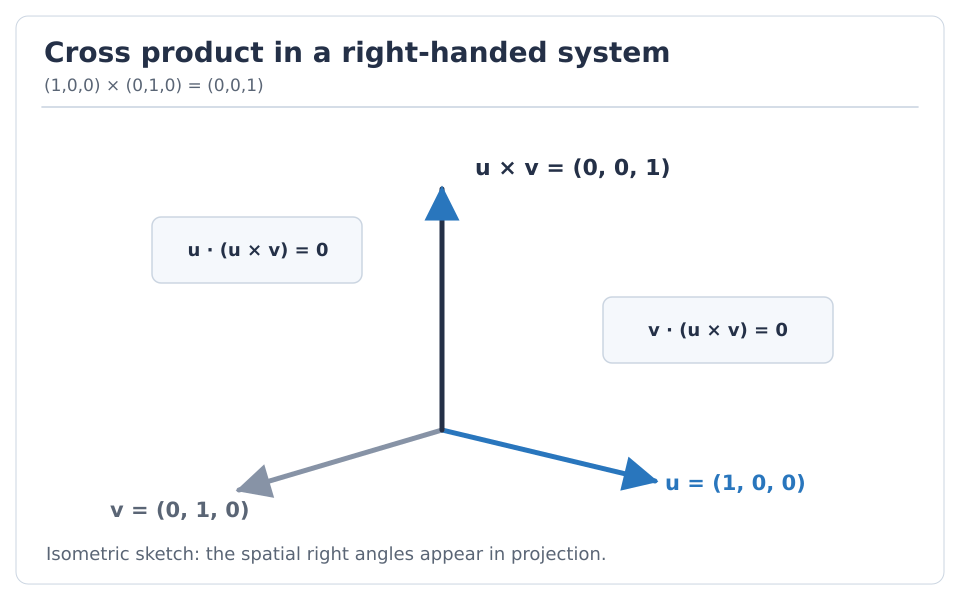

# M2-L14 – Cross product, determinants and rotations in space {#L14}

**Course area:** M2 – Upper secondary education / Abitur

**Level:** Upper secondary education / Abitur

**Prior knowledge:** No fixed prerequisites specified.

**Context:** Upper secondary education / technical supplementary module as a bridge to university. Not designated as generally compulsory material for the Berlin Abitur.

## What is this about? {#S1}

The scalar product from [M2-L11](M2-L11.md) answers the question of how strongly two vectors point in the same direction. We now need a second, different vector operation: it gives a direction **perpendicular** to two given directions. Determinants help us recognise changes in area and volume and the orientation of coordinate systems. Rotation matrices, in turn, describe precisely how a point or vector is rotated. These tools are particularly useful in 3D graphics, camera technology and robotics.

## Basic idea and visual intuition {#S2}

Imagine two arrows starting at the same point. If they are not parallel, they span a plane. The **cross product** points out of this plane at right angles; its length equals the area of the parallelogram spanned by the arrows. For a square matrix, a **determinant** gives the signed factor by which areas or volumes are changed by the corresponding linear transformation. A **rotation** turns a direction without changing its length in an ideal rotation.

## New symbols before the first formula {#S3}

| Symbol | How to read it | Meaning here | Other possible uses |
|---|---|---|---|
| $\vec{u}$, $\vec{v}$ | 'vector u', 'vector v' | Arrows in space from [M2-L11](M2-L11.md) | Any directed quantities |
| $\times$ | 'cross', cross product | Forms a new vector from two vectors in three dimensions | Also a multiplication sign in everyday texts; here **not** ordinary multiplication |
| $\vec u\times\vec v$ | 'u cross v' | Vector perpendicular to u and v | Order is crucial |
| $\det(A)$ | 'determinant of A' | Signed area/volume factor of a square matrix A | Other matrix properties, such as the trace, are different |
| $\lvert A\rvert$ | 'determinant of A' in this context | Alternative determinant notation | Absolute value of a number or cardinality of a set; so prefer $\det(A)$ |
| `[a b; c d]` | Matrix with two rows | First row a, b; second row c, d | The semicolon indicates a new row here |
| $R(\varphi)$ | 'rotation matrix R of phi' | Rotation through angle phi | R may otherwise denote any matrix |
| $\theta$ | 'theta' | Angle between two non-zero vectors | Other angles in geometry |
| $\lVert\vec{u}\rVert$ | 'length of vector u' | Euclidean vector length from [M2-L11](M2-L11.md) | Other norms are possible |
| $R^{\mathrm T}$, $I$ | 'R transposed', 'identity matrix I' | Rows and columns interchanged; matrix that leaves vectors unchanged | General matrix notation |
| $\varphi$ | 'phi' | Angle of rotation here | Any parameter elsewhere |
| $\cos(\varphi)$, $\sin(\varphi)$ | 'cosine phi', 'sine phi' | Trigonometric functions familiar from [M1-L16](M1-L16.md)/M1-L20 | Always pay attention to the units used for angles |
| $A\cdot\vec v$ | 'matrix A times vector v' | Linear transformation, here a rotation | Not component-wise multiplication |
| `−` | 'minus' | Negative component or subtraction | Reversal of orientation |

Unless stated otherwise, the formulae use Cartesian, **right-handed** coordinate axes and three-dimensional vectors. An angle of 90° is the same as a quarter of a full turn; in radians, as introduced in [M1-L20](M1-L20.md), it is $\frac\pi2$.

## Cross product: the perpendicular direction {#S4}

For two vectors in space with components $\vec u=(u_1;u_2;u_3)$ and $\vec v=(v_1;v_2;v_3)$, we define:

The cross product of the x and y unit vectors points in the positive z direction.

$$
\begin{aligned}
\vec u\times\vec v&=\begin{pmatrix}u_2v_3-u_3v_2\\u_3v_1-u_1v_3\\u_1v_2-u_2v_1\end{pmatrix}
\end{aligned}
$$

**Read aloud in full:** 'u cross v is the vector whose first component is u two times v three minus u three times v two; whose second component is u three times v one minus u one times v three; and whose third component is u one times v two minus u two times v one.' The subscripts one, two and three denote the components in the x, y and z directions here.

**Mini-example:** Let $\vec{u}=(1;0;0)$ and $\vec{v}=(0;1;0)$. The first arrow points along the x-axis, the second along the y-axis. Substitution gives:

$$
\vec{u}\times\vec{v}=(0;0;1)
$$

**Read aloud:** 'u cross v gives the vector zero, zero, one.' The result points along the positive z-axis and is perpendicular to both original vectors. Its direction follows the **right-hand rule**: when curling the fingers from the first towards the second vector, the thumb points in the direction of the cross product, provided the coordinate system is right-handed.

### Order and area {#abschnitt-5}

The cross product is **not commutative**: reversing the order reverses the direction of the result.

$$
\vec{v}\times\vec{u}=-(\vec{u}\times\vec{v})
$$

**Read aloud:** 'v cross u is the negative of the vector u cross v.' Interchanging the vectors in the example gives $(0;0;-1)$.

The length of the cross product also reveals the area of the parallelogram:

$$
\text{Area}=\lVert\vec{u}\times\vec{v}\rVert
$$

**Read aloud:** 'The area equals the length of the cross product vector.' In the example the area is one. More generally, for non-zero vectors with included angle $0^{\text{°}}\leq\theta\leq180^{\text{°}}$, we also have $\lVert\vec u\times\vec v\rVert=\lVert\vec u\rVert\cdot\lVert\vec v\rVert\cdot\sin(\theta)$; read aloud: 'length u times length v times the sine of the included angle.' At 90° the area is greatest for fixed lengths; at 0° or 180° it is zero.

**Second worked example:** $\vec{u}=(2;0;0)$ and $\vec{v}=(1;3;0)$ give $\vec u\times\vec v=(0;0;6)$. The parallelogram therefore has area $6$; the triangle with the same two edges has area $3$. Both values are non-negative, even though the cross product changes sign when the edges are interchanged.

**Limits:** The cross product in this usual form is defined specifically for three dimensions. If the vectors are parallel or either is a zero vector, the cross product is the zero vector; no unique perpendicular orientation can then be specified. For the area of a triangle, the parallelogram area must be halved.

## Determinant: orientation and scaling {#S5}

A matrix with two rows and two columns can describe a linear transformation of the plane. Its **determinant** is a number. For the matrix $A=\begin{bmatrix}a&b\\c&d\end{bmatrix}$ we have:

$$
\det(A)=a\cdot d-b\cdot c
$$

**Read aloud:** 'The determinant of A is a times d minus b times c.' The letters $a$, $b$, $c$ and $d$ are the four matrix entries. Unlike the cross product, the result is **a number**, not a vector.

**Mini-example of stretching:**

$$
\begin{aligned}
A&=\begin{pmatrix}2&0\\0&3\end{pmatrix}\\
\det(A)&=2\cdot3-0\cdot0=6
\end{aligned}
$$

The transformation stretches an area by a factor of two in one coordinate direction and by a factor of three in the other. Overall the area grows by a factor of six.

What does the sign mean?

- **Positive:** Orientation is preserved by a non-degenerate transformation.
- **Negative:** Orientation is reversed, for example by reflection.
- **Zero:** The transformation compresses area or volume into a lower dimension; it is not invertible.

The **ordinary area scaling factor** is the non-negative absolute value $\lvert\det(A)\rvert$; the determinant itself is *signed* and may be negative.

**Check cases:** The reflection $S=\begin{bmatrix}-1&0\\0&1\end{bmatrix}$ has $\det(S)=-1$: areas stay the same, but orientation is reversed. The matrix $D=\begin{bmatrix}1&2\\2&4\end{bmatrix}$ has $\det(D)=1\cdot4-2\cdot2=0$: it maps the plane onto a line in a non-invertible way. Positive determinants alone do not establish that a transformation is a rotation either.

### Extension to space: volume {#abschnitt-7}

In three dimensions, three vectors $\vec{u}$, $\vec{v}$ and $\vec{w}$ can be regarded as edges of a parallelepiped. We then have:

$$
\begin{aligned}
\text{signed volume}&=\vec u\cdot(\vec v\times\vec w)\\
\text{volume}&=\left|\vec u\cdot(\vec v\times\vec w)\right|
\end{aligned}
$$

**Read aloud:** 'The signed volume is the scalar product of u with the cross product of v and w. The ordinary, non-negative volume is its absolute value.' The first value corresponds to the determinant of the matrix whose columns are these three vectors. If the vectors become linearly dependent, the volume vanishes. The sign depends on the order: with $\vec{u}=(2;0;0)$, $\vec{v}=(1;3;0)$ and $\vec{w}=(0;0;-2)$, the scalar triple product $\vec u\cdot(\vec v\times\vec w)=-12$; the actual volume is $12$. Interchanging two edges changes only the sign of the signed volume.

## Rotation as matrix multiplication {#S6}

If we rotate points about the origin of a two-dimensional plane anticlockwise through angle $\varphi$, a rotation matrix is sufficient:

$$
R(\varphi)=\begin{pmatrix}\cos(\varphi)&-\sin(\varphi)\\\sin(\varphi)&\cos(\varphi)\end{pmatrix}
$$

**Read aloud in full:** 'R of phi is the matrix with first row cosine of phi and minus sine of phi, and second row sine of phi and cosine of phi.' A matrix maps the two coordinates of an input to two new coordinates.

A point or position vector $\vec{v}$ is rotated by multiplication $R(\varphi)\cdot\vec v$. **Mini-example:** The vector $(1;0)$ becomes $(0;1)$ after rotating anticlockwise through 90 degrees, because $\cos(90^{\text{°}})=0$ and $\sin(90^{\text{°}})=1$.

$$
\begin{aligned}
R(90^{\text{°}})&=\begin{pmatrix}0&-1\\1&0\end{pmatrix}\\
R(90^{\text{°}})\begin{pmatrix}1\\0\end{pmatrix}&=\begin{pmatrix}0\\1\end{pmatrix}
\end{aligned}
$$

**Read aloud:** 'The rotation matrix for ninety degrees turns the unit vector in the x direction into the unit vector in the y direction.' The calculation is not a translation: the origin remains in place.

A proper rotation has determinant one and preserves lengths, angles and areas. **However, determinant one alone is not sufficient to identify a matrix as a rotation:** a shear can also have determinant one even though it changes angles and lengths. A rotation matrix must also be orthogonal, meaning its columns must have unit length and be mutually perpendicular. In matrix notation this is $R^{\mathrm T}\cdot R=I$ (read aloud: 'R transposed times R is the identity matrix'). Together with $\det(R)=1$ this characterises a proper rotation. **Counterexample:** The shear matrix $H=\begin{bmatrix}1&1\\0&1\end{bmatrix}$ has $\det(H)=1$, but maps $(0;1)$ to $(1;1)$: the length increases from $1$ to $\sqrt{2}$. A determinant of one is therefore not sufficient. The rotation matrix applies to an **active rotation of vectors** in a fixed coordinate system. If the coordinate system changes instead, the reverse rotation is often needed. In screen coordinates the y-axis often points downwards; a positive rotation may therefore look different from the usual mathematical coordinate system.

## Bridge to 3D graphics and robotics {#S7}

A camera needs to know which directions mean 'right', 'up' and 'forward'. From two suitable non-parallel directions, the cross product can provide a third direction perpendicular to both. However, the original directions are not automatically perpendicular to each other; for an **orthonormal** camera coordinate system, they must also be suitably orthogonalised and all axes normalised. Rotation matrices describe the orientation of a robot joint or camera. Determinants help to check whether a transformation preserves orientation, reflects or degenerates.

**Important distinction:** A rotation and a translation (shift) are not the same thing. For pure rotations about the origin the matrices shown here are sufficient. To combine rotations and translations, 3D systems later often use **homogeneous coordinates** and larger transformation matrices. This technique belongs to later university-level study of robotics and is not needed to understand this lesson.

## What is it useful for? {#S8}

In a ray tracer or a 3D engine, a surface normal can be found from two edges of a triangle. In a CAD tool the determinant of a transformation reveals a reflection or loss of area. In robotics, rotations are fundamental to comparing sensor data, gripper positions and camera directions between coordinate systems. In numerical software, particular care is needed with nearly parallel vectors and rounding errors.

## Assumptions and limits {#S9}

All examples refer to Euclidean coordinates with consistent units. The cross product is not a universal multiplication of arbitrary vectors; its result depends on the orientation of the space used. The determinant requires a **square matrix**, and a small absolute value of the determinant alone does **not** establish poor conditioning: even uniform scaling can make it small. However, with matrix columns of comparable scale it can warn of near linear dependence. In practice, rotation matrices are often estimated from noisy measurements; such matrices may deviate slightly from an ideal rotation.

## Connection to the next lesson {#S10}

[M2-L15](M2-L15.md) moves from geometrical models to **probability models**. It is no longer about the direction of a vector, but about how likely various outcomes are under particular assumptions.

## Sources {#S11}

No individual sources are listed separately for this lesson.
