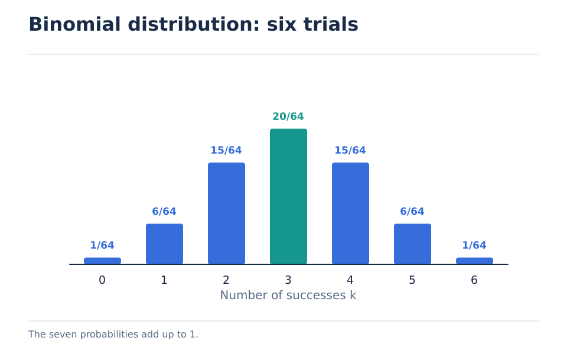

# M2-L15 – Chance, conditional probability and the binomial distribution {#L15}

**Course area:** M2 – Upper secondary education / Abitur

**Level:** Upper secondary education / Abitur

**Prior knowledge:** No fixed prerequisites specified.

**Context:** Upper secondary education (Gymnasium) · probability and statistics

## What is this about? {#S1}

With a die, a quality test or the response of an AI classifier, it is often uncertain which outcome will occur next. However, we can describe which outcomes are possible and how likely they are under a particular model. It is particularly important to know whether events influence one another. Finally, the binomial distribution helps describe the number of successes in a fixed sequence of similar trials. To do this, we combine the foundations from [M1-L12](M1-L12.md) and [M1-L22](M1-L22.md) into a common mathematical language.

## Basic idea and visual intuition {#S2}

A probability is not a prediction that must come true in every individual trial. It describes the behaviour of a **probability model**. A tree diagram makes several successive events visible; at each branch we take account of the path so far. For the binomial distribution we consider many repetitions of a simple yes-or-no decision: 'success' or 'failure'. The distribution tells us how likely zero, one, two or more successes are.

## New symbols before the first formula {#S3}

| Symbol | How to read it | Meaning here | Other possible uses |
|---|---|---|---|
| $\Omega$ | 'omega', sample space | All possible elementary outcomes of the experiment | Other technical symbols, e.g. ohm |
| $A$, $B$ | 'event A', 'event B' | Sets of outcomes | Geometrical points, matrices |
| $P(A)$ | 'probability of A' | Number from zero to one | $P$ can otherwise denote a point |
| $A\cap B$ | 'A intersection B' | Both events occur | Intersection of any sets |
| $A\cup B$ | 'A union B' | At least one of the events occurs | Union of any sets |
| $A^{\mathrm c}$ | 'complement of A' | A does not occur | Superscript c is **not an exponent** here |
| $P(B\mid A)$ | 'probability of B given A' | Probability after learning that A occurred | Vertical bar in other contexts: absolute value, divisibility |
| $n$ | 'n' | Number of repetitions | General number, index |
| $k$ | 'k' | Number of observed successes | Proportionality factor elsewhere |
| $p$ | 'p' | Probability of success in one trial | Also a model parameter |
| $1-p$ | 'one minus p' | Probability of failure | General complementary event |
| $n!$ | 'n factorial' | Product of all positive integers up to n; $0!=1$ | `!` often means logical NOT in programs |
| $C(n,k)$ / `n choose k` | 'n choose k', binomial coefficient | Number of ways of placing k successes in n positions | Notation with two numbers written one above the other |
| $X$ | 'random variable X' | Number of successes in n trials | Position coordinate or arbitrary variable elsewhere |
| $P(X=k)$ | 'probability that X equals k' | Exactly k successes | General probability of a random variable |

The vertical bar `∣` in $P(B\mid A)$ **means 'given A' here**, not division. The notation $A^{\mathrm c}$ assumes that the sample space of the experiment has been clearly defined.

## Events and basic rules {#S4}

An **event** is a collection of possible outcomes. When rolling a fair die once, $A$ might be the event 'even number'. It then includes 2, 4 and 6, and the probability is one half.

Two types of relationship are important:

- $A\cap B$: **Both A and B** occur.
- $A\cup B$: **A or B or both** occur; the 'or' is inclusive.

The complementary probability is:

$$
P(A^{\mathrm{c}})=1-P(A)
$$

**Read aloud:** 'The probability that A does not occur is one minus the probability of A.' If a test gives a positive result with a probability of 0.9, the complementary event has a probability of 0.1 in the same model. This does not automatically mean that the test is 90 per cent **correct**: what counts as 'positive' and what counts as 'correct' must be defined separately.

## Conditional probability: what do we already know? {#S5}

Sometimes we have additional information before asking the next question. Of all the possible cases, we then consider only those in which the known condition is satisfied.

$$
P(B\mid A)=\frac{P(A\cap B)}{P(A)}
$$

**Read aloud in full:** 'The probability of B given A is the probability of A and B occurring together, divided by the probability of A.' **Requirement:** $P(A)>0$, so the condition must have a positive probability in the model.

Rearranging gives the **multiplication rule** for a probability tree:

$$
P(A\cap B)=P(A)\cdot P(B\mid A)
$$

**Read aloud:** 'The probability of A and B together is the probability of A times the conditional probability of B after A has occurred.' The two numbers along a path through the tree are multiplied; alternative, disjoint paths to the same goal are added.

**Mini-example without replacement:** A box contains three red and two blue counters. We draw two counters in succession without putting the first one back. The probability of 'red twice' is:

$$
\begin{aligned}
P(\text{red first})&=\frac35\\
P(\text{red next}\mid\text{red})&=\frac24\\
P(\text{red twice})&=\frac35\cdot\frac24=\frac3{10}
\end{aligned}
$$

**Read aloud:** 'The probability of drawing red twice is three fifths times two quarters, or three tenths.' The second fraction changes because after the first red counter, only two red counters remain out of four.

With replacement, the second fraction would be three fifths again, giving $9/25$. This shows why the **assumptions** about the experiment are crucial.

## Independence is a separate assumption {#S6}

Two events are independent if information about one does not change the probability of the other. For $P(A)>0$, this can be expressed as follows, for example:

$$
P(B\mid A)=P(B)
$$

**Read aloud:** 'The probability of B given A is the same as the probability of B without any additional condition.' In this case the joint probability simplifies to $P(A\cap B)=P(A)\cdot P(B)$. This **product equation** is the general criterion for independence, even when $P(A)=0$ and the conditional probability $P(B\mid A)$ therefore cannot be defined.

**Check example to distinguish independence from mutual exclusivity:** For a fair die, let $A=\{1\}$ and $B=\{2\}$. Both have probability $1/6$, but they can never occur together: $P(A\cap B)=0$, whereas $P(A)\cdot P(B)=\frac1{36}$. The events are therefore mutually exclusive **and dependent**.

**Do not confuse:** Independent events are not the same as **mutually exclusive** events. Two events that cannot occur together are not independent if their individual probabilities are positive.

## Combinatorics: in which order do successes occur? {#S7}

If we want to count in $n$ trials exactly $k$ successes, we must consider **which positions** the successes occupy. This number is the binomial coefficient:

$$
C(n,k)=\frac{n!}{k!\cdot(n-k)!}
$$

**Read aloud in full:** 'n choose k is n factorial divided by the product of k factorial and n minus k factorial.' The requirements are integers $n\geq 0$ and $0\leq k\leq n$.

**Mini-example:** In three trials, exactly one success can occur in the first, second or third position. There are $C(3,1)=3$ arrangements. The order is therefore important for counting, even though each of these three arrangements has the same probability for identical independent trials.

## Binomial distribution: exactly k successes {#S8}

A sequence of trials follows a **binomial model** if four conditions hold: there is a fixed number $n$ of trials; each trial has exactly two possible categories; the trials are independent; and the probability of success $p$ remains constant.

{alt="Discrete binomial distribution for six trials"}

For the number $X$ of successes we then have:

$$
P(X=k)=C(n,k)\cdot p^k\cdot{(1-p)}^{n-k}
$$

**Read aloud in full:** 'The probability of exactly k successes is n choose k times p to the power k times one minus p to the power n minus k.' The binomial coefficient counts the different arrangements. $p^k$ accounts for the k successes and ${(1-p)}^{n-k}$ for the remaining failures. The permitted values are integers $n\geq 0$, integers $k$ from zero to n, and $0\leq p\leq 1$. Outside this range of success counts, $P(X=k)=0$; the boundary cases $p=0$ or $p=1$ are degenerate distributions with certainly zero or certainly n successes, respectively.

**Worked mini-example:** An independently repeated test produces a success in each trial with probability $p=0.2$. In $n=3$ trials we ask for **exactly one success**.

$$
\begin{aligned}
\binom31&=3\\
P(X=1)&=3\cdot0.2\cdot{(1-0.2)}^2\\
&=3\cdot0.2\cdot0.64\\
&=0.384=38.4\,\%
\end{aligned}
$$

**Read aloud:** 'The probability of exactly one success in three independent trials is thirty-eight point four per cent.' This is not the probability of **at least one** success: we would also need to include two and three successes.

A compact way to calculate 'at least one success' uses the complementary event 'no successes':

$$
P(X\geq1)=1-{(1-p)}^n
$$

**Read aloud:** 'At least one success is one minus the probability that all n trials fail.' Here the $\geq$ symbol means 'greater than or equal to' and includes one, two and three successes. **For the numbers above**, $p=0.2$, $n=3$, this gives $P(X\geq1)=1-{(0.8)}^3=1-0.512=0.488$, or **48.8%**. As a check: the cases with exactly one, two and three successes have probabilities $0.384$, $0.096$ and $0.008$; their sum is also $0.488$. Confusing **exactly** one success with **at least** one success would make a difference of 10.4 percentage points here.

## Where the models can fail in everyday life {#S9}

A computer can simulate any number of die rolls, but only **under the assumptions we program into it**. A classifier, for example, can make correlated errors on similar images: its test results are then not independent. The success rate may also change with different types of images, lighting or data distributions. Such deviations violate the simple binomial model.

Nor should a high conditional success probability be confused with the **probability of the actual cause given a positive result**. For that, we need information about base rates and false positive rates (see [M1-L22](M1-L22.md); later, Bayes' theorem).

## What is it useful for? {#S10}

Tree diagrams can help structure chains of failures in software and technical systems. The binomial distribution allows us to make rough plans for how many successful results to expect from repeated independent tests. In quality assurance, probabilities of rare faults can be calculated. In AI systems, it is particularly important to check whether data points really are independent and probabilities of success remain stable.

## Assumptions and limits {#S11}

All the probabilities calculated refer to the probability models explicitly stated in the text. Unknown distributions, changing success rates or dependent observations can alter the results. The binomial coefficient counts possible arrangements but does not by itself say anything about their probabilities. With real data, the population, data collection method and selection bias must be examined in particular.

## Connection to the next lesson {#S12}

[M2-L16](M2-L16.md) considers not only the probabilities of individual success counts but also summarises entire distributions with **expected value, variance and standard deviation**. We then learn about normal distributions and the logic of statistical hypothesis tests.

## Sources {#S13}

No individual sources are listed separately for this lesson.
