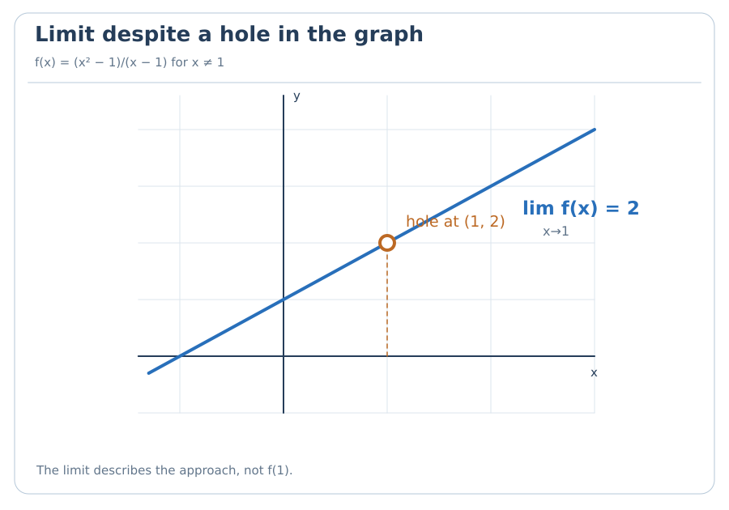

# M2-L2 – Limits, limit notation and continuity {#L2}

**Course area:** M2 – Upper secondary education / Abitur

**Level:** Upper secondary education / Abitur

**Prior knowledge:** No specific prerequisites stated.

**Classification:** Upper secondary education at a Gymnasium · Calculus

## What is this about? {#S1}

In calculus we often want to know how a function value behaves **as we get increasingly close to a particular input**. We do not necessarily have to be able to substitute that input. A limit describes the value that the outputs approach — not necessarily a value that the function actually takes at the point in question. Continuity answers a different, related question: does the actual function value agree with what we observe immediately beside it?

## Basic idea and intuition {#S2}

Imagine zooming further and further into a graph around a certain point. If the function values from the left and right approach the same height, the function has a **finite two-sided limit** there. The curve may nevertheless have a gap at exactly that point. A function is continuous there if the function value exists and agrees with the value being approached. The **two-sided** limits studied here require that we can approach the target from both directions using admissible inputs; at endpoints we consider the accessible side.

{alt="Straight line y equals x plus 1 with an open circle at (1,2); the function has a gap there and the limit is 2."}

A limit can exist even though the function is undefined at that point.

An approach also works for large inputs: we can ask whether a quantity approaches a fixed bound in the long term, grows without bound or oscillates. The symbol for ‘infinity’ does **not denote an ordinary real number** that we could substitute like three or five.

## New symbols before the first formula {#S3}

| Symbol | Read aloud | Meaning here | Other possible uses |
|---|---|---|---|
| $\lim$ | ‘limit’ | Limit of a function | Also used with sequences and series |
| $x\to a$ | ‘x tends to a’ | Inputs approach a without necessarily reaching it | Arrow also denotes a mapping in [M1-L18](M1-L18.md) |
| $x\to a^-$ | ‘x tends to a from the left’ | Approach through smaller input values | Superscript minus is *not* a negative sign for a here |
| $x\to a^+$ | ‘x tends to a from the right’ | Approach through larger input values | Plus is a direction marker here |
| $\infty$, $+\infty$, $-\infty$ | ‘infinity’, ‘plus infinity’, ‘minus infinity’ | Unbounded increase or decrease, or increasingly large inputs | Not ordinary real numbers |
| $f(x)$ | ‘eff of x’ | Function value for input x | Familiar from [M1-L4](M1-L4.md)/M2-L1 |
| $a$ / $L$ | ‘ay’ / ‘ell’ | a: target of inputs; L: possible value being approached | Letters are not fixed mathematical constants |
| `≠` | ‘is not equal to’ | Values are unequal | General comparison |
| `≈` | ‘is approximately equal to’ | Numerical approximation | Do not read as an exact equality |

## Reading limits in everyday language {#S4}

A classic example is a simple straight line:

$$
\begin{aligned}
f(x)&=2x+1\\
\lim_{x\to3}f(x)&=7
\end{aligned}
$$

**Read aloud, first line:** ‘Eff of x equals two times x plus one.’ $f$ is the function name, $x$ the input; $2x$ means two times x; $+1$ is a fixed addition.

**Read aloud, second line:** ‘The limit of eff of x as x tends to three equals seven.’ $\lim$ asks for the value being approached; $x\to3$ describes the input approaching three; $f(x)$ is the observed function value; $7$ is the limit. Here direct substitution is allowed because the straight line is continuous at three: twice three plus one equals seven.

For more complicated functions, the limit question cannot always be answered by substitution. That is exactly what makes the concept useful.

## A limit despite a gap: fully explained example {#S5}

Consider a function that is **undefined** at x equals one:

$$
\begin{aligned}
f(x)&=\frac{x^2-1}{x-1}\quad\text{(only for }x\ne1\text{)}
\end{aligned}
$$

**Read aloud:** ‘Eff of x equals x squared minus one, divided by x minus one. X must not be one.’ The horizontal line is the fraction bar, $x^2$ means x times x, and `≠` means not equal to. At $x=1$, both numerator and denominator would be zero; **the original division is undefined there**. The notation $\frac00$ is an *indeterminate form* in the calculation of limits and does not itself give a numerical value.

The numerator can be factorised using the **difference of two squares** familiar from M1-L13. For all admissible inputs, the expression simplifies to:

$$
\frac{x^2-1}{x-1}=\frac{(x-1)(x+1)}{x-1}=x+1\qquad(x\neq1)
$$

**Read aloud:** ‘X squared minus one divided by x minus one equals x plus one, provided that x is not one.’ Cancellation explicitly requires a **non-zero** factor $x-1$. We have **not** defined the function at the forbidden point; we have merely rewritten it for all other inputs.

| Input $x$ | Output $f(x)$ |
|---|---|
| $0.9$ | $1.9$ |
| $0.99$ | $1.99$ |
| $1.01$ | $2.01$ |
| $1.1$ | $2.1$ |

The values approach two from both sides. In limit notation:

$$
\lim_{x\to1}\frac{x^2-1}{x-1}=2
$$

**Read aloud:** ‘The limit of x squared minus one divided by x minus one as x tends to one equals two.’ Two is the value **that the function values approach**; it is not automatically the function value $f(1)$. In this example $f(1)$ does not exist. If we explicitly add $f(1)=2$, the original gap is filled. If instead we set $f(1)=5$, **the limit would remain 2**, but the new function would not be continuous at one. The limit does not depend on the individual function value at the target point.

## From the left and from the right: one-sided limits {#S6}

A function can behave differently from either side. This can be seen at a jump. Consider the following piecewise-defined model:

$$
f(x)=\begin{cases}0&\text{for }x<0\\1&\text{for }x\geq0\end{cases}
$$

**Read aloud:** ‘Eff of x is zero for negative inputs and one for inputs greater than or equal to zero.’ The less-than sign `<` and `≥` (greater than or equal to) restrict the respective input cases.

Approaching **from the left** gives the limit zero, and approaching **from the right** gives the limit one:

$$
\begin{aligned}
\lim_{x\to0^-}f(x)&=0\\
\lim_{x\to0^+}f(x)&=1
\end{aligned}
$$

**Read aloud:** ‘The limit of eff of x as x tends to zero from the left is zero; from the right it is one.’ Since the two values being approached **do not agree**, **no finite two-sided limit** exists at this point. This is a **jump discontinuity**.

## What does continuity mean? {#S7}

A function is continuous at a point if a function value exists there, if the graph approaches this same value from the left and right, and if the limit and function value agree.

$$
\lim_{x\to a}f(x)=f(a)
$$

**Read aloud:** ‘The limit of eff of x as x tends to a equals eff of a.’ On the left is the value being approached; on the right is the **actual** function value at input $a$. This equation is the short form of the continuity condition, provided that $f(a)$ and the finite two-sided limit are defined. At an **interior point** of the domain, both sides of approach are relevant. At the **endpoint** of an interval, continuity is checked relative to the domain, that is, from the accessible side. Example: $f(x)=\sqrt{x}$ on $x\ge0$ is right-continuous at zero, even though approaching from the left within its real domain is impossible. At isolated points, the usual limit definition is not applicable in the same way as at points of an interval.

Intuitively, we distinguish a **removable discontinuity** (as in the cancelled rational-function example), a **jump** (two different one-sided limits) and **unbounded behaviour** near a point (for instance, $\frac1x$ near zero: from the right the expression tends to $+\infty$, from the left to $-\infty$; therefore no common finite limit exists). A function that continues without a jump may nevertheless have a **corner**; continuity alone does not guarantee differentiability.

## What happens for large inputs? {#S8}

Consider $g(x)=\frac1x$ for positive inputs only. The larger $x$ becomes, the smaller and more nearly zero the positive value of $g(x)$ becomes.

$$
\begin{aligned}
g(x)&=\frac1x\qquad(x>0)\\
\lim_{x\to\infty}g(x)&=0
\end{aligned}
$$

**Read aloud:** ‘Gee of x is one divided by x, for positive inputs. The limit of gee of x as x tends to infinity is zero.’ The horizontal limiting value zero is not attained by the function values for finite positive $x$. $x\to\infty$ describes inputs growing without bound and is **not substitution of x by a number called infinity**.

## What is it useful for? {#S9}

Limits prepare us for the concept of an **instantaneous rate of change**: in [M2-L3](M2-L3.md) we consider increasingly small time intervals to determine a local gradient. In **software development**, limits are used in algorithms, iterative approximation methods and stability analyses. Continuity helps us understand sensor and control signals, although actual measurements are discrete and noisy. In AI optimisation we also distinguish between well-behaved smooth objectives and models with jumps or undefined regions.

## Assumptions, limitations and common mistakes {#S10}

- A limit is **not the same** as substituting the target number. The function value may be missing there.
- The form $\frac00$ is **not a result**. It initially shows only that direct substitution is insufficient for finding the limit; the function being studied must be defined in a punctured neighbourhood of the target point.
- Different values from the right and left give no common finite limit. Strong oscillation can also prevent a limit from existing, even if the function values remain bounded.
- ‘Tends to infinity’ is not the same as ‘has a particularly large finite value’.
- Limits at a point are local statements. They do not automatically confirm that a real model works outside its range of validity.

## Link to the next unit {#S11}

In **[M2-L3](M2-L3.md)** we imagine shrinking an input interval further and further. The limit of an average change then leads to the **derivative**, the instantaneous rate of change and gradient of the tangent.

## Sources (external) {#S12}

No external sources listed.
