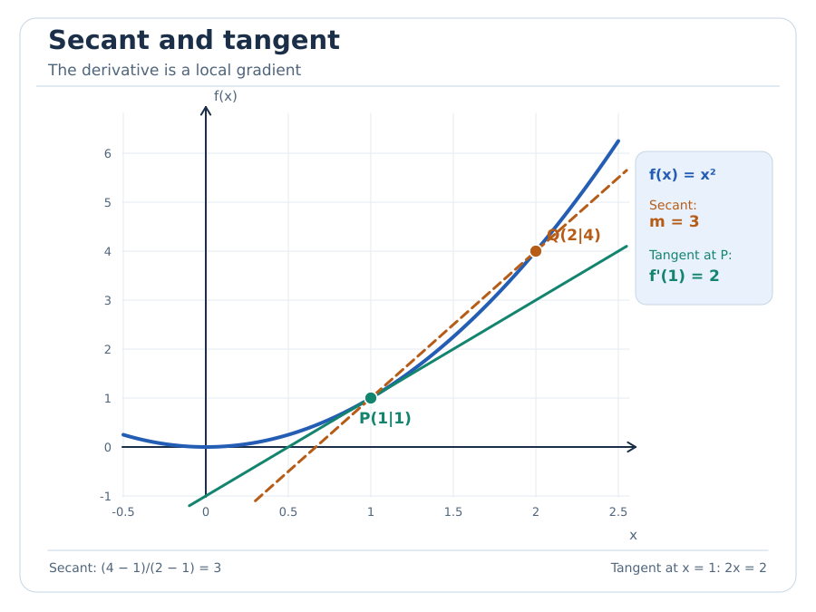

# M2-L3 – The derivative as an instantaneous rate of change {#L3}

**Course area:** M2 – Upper secondary education / Abitur

**Level:** Upper secondary education / Abitur

**Prior knowledge:** No specific prerequisites stated.

**Classification:** Upper secondary education at a Gymnasium · Calculus

## What is this about? {#S1}

An average change can be calculated from two measurements. It is often more interesting to know **how quickly a value changes at a single instant** — for example, the speed right now rather than during the last hour. Calculus solves this problem by imagining smaller and smaller gaps between the inputs being considered. The limit of the average rates of change is called the **derivative**. Geometrically, the derivative describes the gradient of the tangent to the graph.

## Basic idea and intuition {#S2}

On a straight line the gradient is the same everywhere; on a curved line it changes from point to point. If we join two nearby points on a curve with a straight line, we obtain a **secant**. As the second point approaches the first, the gradient of the secant approaches — where the limit exists — the **gradient of the tangent**. The derivative therefore gives a local answer to the question ‘How much does the output change for a tiny change in the input?’

{alt="Parabola f(x) = x² with P(1,1) and Q(2,4). The dashed orange secant has gradient 3; the green tangent at P has gradient 2."}

For $f(x)=x^2$: the secant through $(1,1)$ and $(2,4)$ has gradient 3; $f'(1)=2$ is the gradient of the tangent.

## New symbols before the first formula {#S3}

| Symbol | Read aloud | Meaning here | Other possible uses |
|---|---|---|---|
| $\Delta$ | ‘delta’ | Finite change, the difference between two values | Already used for differences in [M1-L8](M1-L8.md); later also an operator name |
| $\Delta x$, $\Delta y$ | ‘delta x’, ‘delta y’ | Change in input or output over an interval | Not identical to a differential |
| $h$ | ‘aitch’ | Small input gap from the point in question | For example, height in [M1-L5](M1-L5.md), but not a height here |
| $x_0$ | ‘x nought’, ‘x subscript zero’ | Fixed input where the gradient is sought | Subscript zero may denote an initial value |
| $\lim_{h\to0}$ | ‘limit as h tends to zero’ | Limit for an increasingly small gap | Limit notation from [M2-L2](M2-L2.md) |
| $f'(x)$ or $f'(x)$ | ‘eff prime of x’ | First derivative of function f at x | In geometry a prime may mark another figure |
| $\frac{\mathrm{d}y}{\mathrm{d}x}$ | ‘dee y by dee x’ or ‘differential y over differential x’ | Leibniz notation for the derivative of y with respect to x | In integrals $\mathrm{d}x$ has a different role; precise definition later |
| $s(t)$ | ‘ess of t’ | Here: distance travelled as a function of time t | Elsewhere s may denote another quantity |

## Average rate of change: the difference quotient {#S4}

Consider two inputs $x_1$ and $x_2$ and the corresponding outputs $f(x_1)$ and $f(x_2)$. The average change per unit of input is:

$$
\frac{\Delta y}{\Delta x}=\frac{f(x_2)-f(x_1)}{x_2-x_1}\qquad (x_2\ne x_1)
$$

**Read aloud:** ‘Delta y divided by delta x equals the function value at x two minus the function value at x one, divided by x two minus x one.’ $\Delta y$ is the total difference in output; $\Delta x$ is the difference in input; `/` means division; $x_2\ne x_1$ prevents a zero denominator. The quantity is the **gradient of the secant** between the two points. The unit and meaning depend on the axes: metres and seconds give metres per second.

## The instantaneous rate of change: from average to limit {#S5}

For the derivative we keep an input $x_0$ fixed and consider a second point at a distance $h$. Then we let $h$ tend to zero. Provided that the function is defined in an **open neighbourhood** of $x_0$ and the finite two-sided limit exists, this is the ordinary derivative at $x_0$:

$$
f'(x_0)=\lim_{h\to 0}\frac{f(x_0+h)-f(x_0)}{h}
$$

**Read aloud:** ‘Eff prime of x nought equals the limit as h tends to zero of eff of x nought plus h minus eff of x nought, all divided by h.’ The numerator describes the change in output; $h$ is the gap between the two inputs; the $\lim$ expression considers arbitrarily small **non-zero** gaps. **Never substitute zero directly for h in the fraction.** The required limit is the instantaneous gradient. **Both signs of h** must lead to admissible inputs for an ordinary two-sided derivative. Endpoints of a model require separate one-sided consideration.

$f'(x)$ represents a **new function**, where it is defined for the corresponding x values. Its value is the local gradient of the original function. For a graph with a positive gradient the derivative is positive; for a negative gradient it is negative. A derivative of zero means a **horizontal tangent** — but not necessarily a maximum or minimum point.

## Fully explained mini-example: a quadratic distance model {#S6}

As a simplified model of motion for **$t\ge0\,\mathrm{s}$**, suppose that the distance travelled since the start at time $t$ follows a quadratic pattern. For negative times the interpretation as *distance travelled since the start* would not be appropriate. To ensure that the **units agree**, with $t$ in seconds and $s$ in metres we first write:

$$
\begin{aligned}
s(t)&=(1\,\mathrm{m}/\mathrm{s}^2)\cdot t^2\\
\text{Numerical-value formula: }\quad s(t)&=t^2\\
&\quad(t\text{: numerical value of time in }\mathrm{s};\\
&\qquad s(t)\text{: numerical value of distance in }\mathrm{m})
\end{aligned}
$$

**Read aloud:** ‘Ess of t equals one metre per second squared times t squared.’ The factor $1\,\mathrm{m}/\mathrm{s}^2$ ensures that the right-hand side has the unit metre. In the following short rearrangements, $t$ and $h$ stand for **numerical values of times in seconds**; the calculated change in distance is given in metres and the derivative in metres per second. In the physical model, the two times being compared must also satisfy $t\ge0$ and $t+h\ge0$. The notation $s(t)=t^2$ alone is therefore a simplified numerical-value formula, not a complete physical equation with units.

Between the times $t=2\,\mathrm{s}$ and $t=4\,\mathrm{s}$ the distance increases from four to sixteen metres. The average speed is therefore:

$$
\frac{16\,\mathrm{m}-4\,\mathrm{m}}{4\,\mathrm{s}-2\,\mathrm{s}}=6\,\mathrm{m}/\mathrm{s}
$$

**Read aloud:** ‘Sixteen metres minus four metres, divided by four seconds minus two seconds, equals six metres per second.’ This is an average speed **over two seconds**.

What happens instead **at exactly three seconds**? For the instantaneous rate of change we substitute the general function rule with the small gap $h$:

$$
\begin{aligned}
\frac{s(3+h)-s(3)}h&=\frac{{(3+h)}^2-9}h\\
&=\frac{6h+h^2}h\\
&=6+h\quad\text{for }h\neq0
\end{aligned}
$$

**Read aloud:** ‘The distance value at three plus h minus the distance value at three, divided by h, simplifies to six plus h — provided that h is not zero.’ Here $h$ has the dimension of time, measured in seconds; the numerical coefficients of the simplified terms carry the appropriate units in the physical model. The closer $h$ is to zero, the closer the quotient is to six metres per second. Therefore:

$$
s'(3)=6\,\mathrm{m}/\mathrm{s}\qquad\text{(shorthand: derivative at }t=3\,\mathrm{s}\text{)}
$$

**Read aloud:** ‘Ess prime at three equals six metres per second.’ The **instantaneous speed** at $t=3\,\mathrm{s}$ equals the previously calculated average speed between two and four seconds in this special case. This is because the interval is symmetrical about three, and it does not hold for arbitrary curves and intervals.

In general, the same calculation for the quadratic model gives the gradient function:

$$
\begin{aligned}
s'(t)&=(2\,\mathrm{m}/\mathrm{s}^2)\cdot t\\
\text{Numerical-value formula: }\quad s'(t)&=2t
\quad(t\text{ in seconds; speed in }\mathrm{m}/\mathrm{s})
\end{aligned}
$$

**Read aloud:** ‘Ess prime of t equals two times t.’ The numerical value of the speed function increases linearly with time; the implicit unit scale of the original distance model must be carried through.

## The two notations for the derivative {#S7}

A derivative can be written in two common forms:

$$
f'(x)=\frac{\mathrm{d}y}{\mathrm{d}x}\qquad\text{when }y=f(x)
$$

**Read aloud:** ‘Eff prime of x equals dee y by dee x, when y equals eff of x.’ $f'(x)$ comes from **Lagrange notation**; $\frac{\mathrm{d}y}{\mathrm{d}x}$ is **Leibniz notation**. Here both denote the same first derivative. As an introductory intuition, $\frac{\mathrm{d}y}{\mathrm{d}x}$ can be read as the limiting case of ‘small change in output per small change in input’; however, it is **not simply an ordinary fraction made up of two arbitrary small numbers**. The more formal meaning of differentials comes later.

Leibniz notation often makes it particularly clear **which quantity is differentiated with respect to which other quantity**. This becomes important later with functions of several variables, in physics and in robotics.

## When does a derivative not exist? {#S8}

A function need not be differentiable at a point. At a **sharp corner**, the gradients from the left and right may differ. The simplest example is the absolute value function $f(x)=|x|$: to the left of zero the gradient is minus one, and to the right it is plus one. The function is **continuous** at zero but has **no two-sided derivative** there. For $h\ne0$, the difference quotient at zero is $\frac{|h|-0}{h}=\frac{|h|}{h}$: for $h<0$ it gives $-1$, and for $h>0$ it gives $+1$. There is no common limit. A jump discontinuity is also not differentiable.

Measurements present a different problem: we have only finitely many time points and no exact continuous function. A ‘derivative’ calculated numerically from measurements is therefore an **estimate**. Very small time gaps may amplify noise or rounding errors.

## What is it useful for? {#S9}

Derivatives are used in **AI** to understand how sensitive an objective function is to changes in individual model parameters — the basis of gradient methods. In **robotics** they describe speeds and, later, accelerations of movements. In **software analysis** they help describe local changes in a metric and optimise smooth models. For actual sensor data we must distinguish between the mathematical derivative of a model and a numerically estimated rate of change.

## Assumptions and limitations {#S10}

- A derivative is **local** information; a large local gradient does not guarantee sustained growth.
- The denominator of the difference quotient must not be zero; only taking the limit gives the derivative.
- $f'(x)=0$ does **not** prove a maximum or minimum.
- Continuity is necessary for differentiability at **interior points of the domain**, but not sufficient; a corner may be continuous and not differentiable. At the endpoint of a physical time interval we can instead examine a one-sided rate of change.
- A physical model requires consistent **units**; the derivative of a distance function with respect to time has the unit distance per time.

## Link to the next unit {#S11}

In **[M2-L4](M2-L4.md)** we learn practical rules for finding derivatives of combined functions without recalculating the limit for every expression each time.

## Sources (external) {#S12}

No external sources listed.
