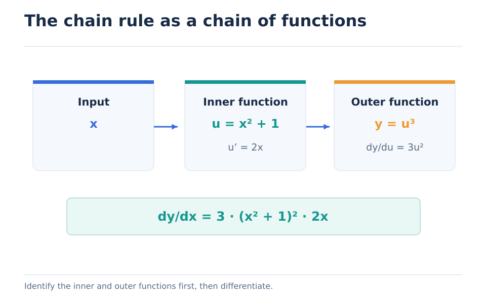

# M2-L4 – Differentiation rules and combinations of functions {#L4}

**Course area:** M2 – Upper secondary education / Abitur

**Level:** Upper secondary education / Abitur

**Prior knowledge:** No specific prerequisites stated.

**Classification:** Upper secondary education at a Gymnasium · Calculus; some rules for combining functions are studied in greater depth depending on level

## What is this about? {#S1}

In [M2-L3](M2-L3.md) we learnt about the derivative as the limit of average rates of change over increasingly small intervals. Calculating such limits individually would be cumbersome for long formulas. Fortunately, derivatives follow clear **calculation rules**. They show how the local change of a sum, product, quotient or nested function is composed of simpler derivatives. This makes differential calculus a practical tool for modelling, optimisation and the mathematics behind neural networks.

## Basic idea and intuition {#S2}

A composite function is rather like a program that performs several calculation steps. When the input changes slightly, the result may change by different amounts at each intermediate step. The **chain rule** follows a small change through such a sequence of operations. In a **product**, each factor generally changes; in a **quotient**, the denominator also influences the change. The rules deal with these dependencies systematically.

## New symbols before the first formula {#S3}

| Symbol | Read aloud | Meaning here | Other possible uses |
|---|---|---|---|
| $f$, $g$, $u$, $v$ | ‘eff’, ‘gee’, ‘you’, ‘vee’ | Names of functions of an input x | The same letters may denote numbers, vectors or quantities |
| $f'(x)$, $g'(x)$ | ‘eff prime of x’, ‘gee prime of x’ | First derivatives of f and g respectively | In geometry a prime also marks similar figures |
| $(fg)(x)$ | ‘product function f times g at x’ | $f(x)\cdot g(x)$ | Brackets may otherwise group arguments |
| $f(g(x))$, $f\circ g$ | ‘eff of gee of x’, ‘f composed with g’ | Composition: apply g first, then f; `∘` is the composition symbol | Often nested function calls in code |
| $n$ | ‘en’ | Here: fixed exponent | Often a count or index in other topics |
| $c$ | ‘see’ | Here: fixed constant | In geometry, for example, the hypotenuse |
| `≠` | ‘not equal to’ | Excludes a zero denominator | General comparison symbol |
| $\mathbb R$, $\pi$, `°` | ‘real numbers’, ‘pi’, ‘degrees’ | Real number system, circle constant, angles in degrees | The degree sign is not a differentiation variable |
| $e$, $\ln$, $\sin$, $\cos$ | ‘Euler’s number’, ‘natural logarithm’, ‘sine’, ‘cosine’ | Familiar functions from [M1-L19](M1-L19.md)/M2-L1 | Differentiation rules for trigonometric functions use radians |

## The simplest rules: constants, sums and powers {#S4}

For a **constant function**, the derivative is zero: a number that always stays the same does not change. The derivative of the **constant multiple** $c\cdot u(x)$ is $c\cdot u'(x)$; a sum or difference can be **differentiated term by term**. For a power, the fixed exponent becomes a factor in front and is reduced by one.

$$
\begin{aligned}
f(x)=c&\implies f^{\prime}(x)=0\\
f(x)=u(x)+v(x)&\implies f^{\prime}(x)=u^{\prime}(x)+v^{\prime}(x)\\
f(x)=cu(x)&\implies f^{\prime}(x)=cu^{\prime}(x)\\
f(x)=x^n&\implies f^{\prime}(x)=nx^{n-1}
\end{aligned}
$$

**Read aloud, first line:** ‘If eff of x is the constant c, then eff prime of x is zero.’ $c$ does not depend on $x$.

**Second line:** ‘The derivative of the sum of u of x and v of x is the sum of u prime and v prime at x.’ $u$ and $v$ are two differentiable component functions.

**Third line:** ‘The derivative of c times u of x is c times u prime of x.’ The constant is not itself differentiated.

**Fourth line:** ‘The derivative of x to the power of n is n times x to the power of n minus one.’ The exponent $n$ is **fixed**, not a second variable. This power rule applies to **positive** integer exponents throughout $\mathbb R$ and to $n=0$ as the constant function $1$ (defined this way even at $x=0$; this does not imply a general definition of the isolated expression $0^0$). For **negative integer** exponents we require $x\ne0$; for general real exponents the usual real domain $x>0$ is safe. The exponent is not a second variable.

**Mini-example:** For $f(x)=3x^2+2x+7$, the derivative of $3x^2$ is $6x$, the derivative of $2x$ is the constant $2$, and the derivative of $7$ is zero. Hence:

$$
f'(x)=6x+2
$$

**Read aloud:** ‘Eff prime of x equals six times x plus two.’ The result describes the local gradient of the original parabola for each admissible input.

## The product rule — when both factors vary {#S5}

In a product of two functions, **both factors** may change with the input. Therefore it is not enough simply to multiply the two derivatives together: ${(f\cdot g)}'$ is generally **not** $f'\cdot g'$.

$$
{(f\cdot g)}'(x)=f'(x)\cdot g(x)+f(x)\cdot g'(x)
$$

**Read aloud:** ‘The derivative of the product of f and g is f prime times g plus f times g prime, each at x.’ The first term accounts for the change in $f$ while imagining $g$ held fixed; the second accounts for the change in $g$ while imagining $f$ held fixed. For an ordinary derivative both component functions must be differentiable at the point.

**Mini-example:** We multiply $f(x)=x^2$ by $g(x)=x+1$:

$$
\begin{aligned}
h(x)&=x^2(x+1)\\
h^{\prime}(x)&=(2x)(x+1)+x^2\cdot1=3x^2+2x
\end{aligned}
$$

**Read aloud:** ‘H prime of x is two x times x plus one in brackets, plus x squared times one; altogether three x squared plus two x.’ $h$ names the new product function. We can check the result by first expanding $x^2(x+1)$ to $x^3+x^2$ and then differentiating term by term. For example, at $x=2$ we obtain $h'(2)=3\cdot2^2+2\cdot2=16$; incorrectly multiplying the individual derivatives would give only $2x\cdot1=4$.

## The quotient rule — when the denominator also varies {#S6}

For a quotient of functions the denominator must be non-zero. The rule for differentiation accounts for the fact that the denominator itself may depend on the input.

$$
\left(\frac fg\right)'(x)=\frac{f'(x)\cdot g(x)-f(x)\cdot g'(x)}{{(g(x))}^2}
$$

**Read aloud:** ‘The derivative of f over g is f prime times g minus f times g prime, divided by g squared, all at x.’ $f$ is the numerator function, $g$ the denominator function; ${(g(x))}^2$ means that the entire denominator function value is squared. Both functions must be differentiable at the point being considered and $g(x)\ne0$. **Do not confuse:** The derivative of $\frac fg$ is generally not $\frac{f'}{g'}$.

**Mini-example:**

$$
\begin{aligned}
q(x)&=\frac{x}{x+1}\quad(x\neq-1)\\
q^{\prime}(x)&=\frac{(1)(x+1)-x(1)}{{(x+1)}^2}=\frac1{{(x+1)}^2}
\end{aligned}
$$

**Read aloud:** ‘Q prime of x is one times x plus one in brackets, minus x times one, divided by x plus one squared; this simplifies to one over x plus one squared.’ The value $x=-1$ remains excluded; the differentiated formula must not be used there either.

## The chain rule — change through several calculation steps {#S7}

In a **composition**, we first calculate the inner function $g(x)$ and substitute its result into the outer function $f$. The derivative takes account of how much the inner quantity changes **and** how sensitive the outer function is to that change.

{alt="Chain of functions and derivative of a composite function"}

$$
{(f\circ g)}'(x)=f'(g(x))\cdot g'(x)
$$

**Read aloud:** ‘The derivative of f composed with g is f prime evaluated at g of x, times g prime of x.’ The new symbol `∘` is called the **composition symbol** or ‘circle’ and means: apply the function $g$ on the right first, then the function $f$ on the left. It is **not ordinary multiplication**. For the rule, $g$ must be differentiable at $x$, $g(x)$ must lie in the domain of $f$, and $f$ must be differentiable at $g(x)$.

**Fully explained mini-example:**

$$
\begin{aligned}
H(x)&={(3x+1)}^2\\
H^{\prime}(x)&=2(3x+1)\cdot3=6(3x+1)
\end{aligned}
$$

**Read aloud:** ‘H of x is three x plus one in brackets squared. H prime of x is two times three x plus one in brackets times three, that is six times three x plus one in brackets.’ The **inner function** is $g(x)=3x+1$ with derivative three. The **outer function** squares its input; its derivative is twice that input. Therefore the factor three from the inner derivative must be included. It must not be forgotten.

## More common derivatives as a reading dictionary {#S8}

The following familiar functions have particularly simple derivatives. We will need them again later in specific models.

| Original function | First derivative | In words and with domain of validity |
|---|---|---|
| $f(x)=e^x$ | $f'(x)=e^x$ | ‘E to the power of x stays e to the power of x’; all real x |
| $f(x)=\ln(x)$ | $f'(x)=\frac1x$ | ‘The natural logarithm becomes one over x’; positive x |
| $f(x)=\sin(x)$ | $f'(x)=\cos(x)$ | ‘The sine function becomes the cosine function’; angles in radians |
| $f(x)=\cos(x)$ | $f'(x)=-\sin(x)$ | ‘The cosine function becomes minus sine’; angles in radians |

**Explanation of symbols:** $e$ is Euler’s number, $\ln$ the natural logarithm, and $\sin$ and $\cos$ are sine and cosine. `−` before $\sin$ means the negative of the sine value. The natural logarithm model requires $x>0$. For trigonometric derivatives, **radians** are essential: if an angle variable is measured in degrees instead, the differentiation factors change. Example for a numerical value $x$ in **degrees**: $g(x)=\sin\left(\frac{\pi x}{180}\right)$ has $g'(x)=\left(\frac{\pi}{180}\right)\cdot\cos\left(\frac{\pi x}{180}\right)$. The extra factor comes from the chain rule. $\pi$ denotes the circle constant pi.

## Which rule suits which formula? {#S9}

- For a **sum**, we study the individual terms.
- For a **product** of two variable factors, we use the product rule.
- For a **quotient** with a variable denominator, we use the quotient rule as long as the denominator is non-zero.
- For a **nested** calculation, we use the chain rule; it may be needed in addition to the product or quotient rule.

The notation determines which calculation methods are particularly simple: sometimes **expanding before differentiating** is shorter than using the product rule. There is not always exactly one suitable method.

## What is it useful for? {#S10}

In **AI**, the chain rule is the mathematical core of *backpropagation*: an error measure depends on model parameters through many layers, and local changes are combined backwards. In **robotics**, derivatives determine how a movement responds to changes in joint angles or control variables. In **software**, they help optimise objective functions or analyse the sensitivities of a model. Automatic differentiation can apply these rules systematically to a computational graph; however, it does not replace checking domains and modelling assumptions.

## Assumptions and limitations {#S11}

- The rules apply at points where the relevant functions are **differentiable**. For compositions, the outer function must also be differentiable at the **inner function value**.
- In the quotient rule the **denominator must be non-zero**.
- The power rule must be restricted appropriately depending on the exponent and domain; the simple school formula with $x^n$ does not permit arbitrary complex values.
- Results for discrete or noisy data may only be useful as approximations. Mathematical differentiability of a model is not the same as physical measurability.
- **Advanced-course scope (Leistungskurs):** The selection and depth of individual combinations and methods here is a subject-based presentation, not an officially verified list of requirements for a particular Berlin Abitur year.

## Link to the next unit {#S12}

In **[M2-L5](M2-L5.md) – Curve sketching and geometric properties**, we use derivatives to study intervals of increase and decrease, horizontal tangents, maximum and minimum points, and points of inflection in an understandable way.

## Sources (external) {#S13}

No external sources listed.
