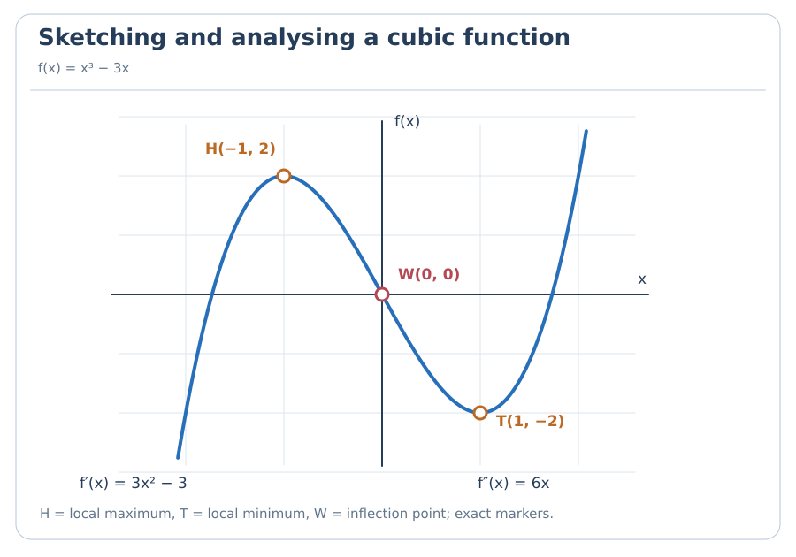

# M2-L5 – Curve sketching and geometric properties {#L5}

**Course area:** M2 – Upper secondary education / Abitur

**Level:** Upper secondary education / Abitur

**Prior knowledge:** No specific prerequisites stated.

**Classification:** Upper secondary education at a Gymnasium · Calculus

## What is this about? {#S1}

A formula can describe the shape of a curve without our having to draw it immediately. Using derivatives, we can identify where the curve rises or falls, where it has local maxima and minima, and where its concavity changes. This investigation is called **curve sketching**. It answers not only the question of what a curve looks like, but also which conclusions about a model are actually justified. We build on the concept of the derivative from [M2-L3](M2-L3.md) and the calculation rules from M2-L4.

## Basic idea and intuition {#S2}

Imagine travelling through a hilly landscape. The **first derivative** tells you whether the road runs uphill or downhill at a particular point. The **second derivative** describes how this gradient changes along the horizontal coordinate. A local maximum often occurs where the gradient changes from positive to negative; a local minimum occurs at a change from negative to positive. A point of inflection marks a change in concavity, not necessarily a maximum or minimum.

## New symbols before the first formula {#S3}

| Symbol | Read aloud | Meaning here | Other possible uses |
|---|---|---|---|
| $f'(x)$ | ‘eff prime of x’ | First derivative; local gradient | A prime can mark points and objects |
| $f''(x)$ | ‘eff double prime of x’, ‘second derivative’ | Rate of change of the first derivative | Two primes do not indicate squaring |
| $f'''(x)$ | ‘eff triple prime of x’, ‘third derivative’ | Rate of change of the second derivative | Not a triple product |
| $x_0$ | ‘x nought’ | Input value at which we check a property | Initial value, index or reference point |
| `>` and `<` | ‘greater than’, ‘less than’ | Sign of the derivative | General comparisons |
| `⇒` | ‘it follows that’ | A sufficient condition leads to a conclusion | General implication symbol in logic |
| $m$, $b$ | ‘em’, ‘bee’ | Gradient and intercept of a straight line | Any other parameters |
| $t(x)$ | ‘tee of x’ | Name of a tangent line | $t$ also often denotes time |

## Monotonicity: where does the graph rise or fall? {#S4}

The derivative measures the **local gradient**. If it is positive throughout an interval, the function value increases strictly there as $x$ increases. If it is negative throughout the interval, the function value decreases strictly there. We consider a **connected interval** on which the function is continuous and differentiable in its interior; the sign of the derivative must satisfy the stated condition throughout the interior. A positive derivative at just one point does not establish monotonicity along an entire stretch.

$$
\begin{aligned}
f'(x)>0&\implies f\text{ increases on the interval under consideration.}\\
f'(x)<0&\implies f\text{ decreases on the interval under consideration.}
\end{aligned}
$$

**Read aloud:** ‘If eff prime of x is greater than zero, the function increases on the interval under consideration.’ The second line reads: ‘If eff prime of x is less than zero, the function decreases on the interval under consideration.’ The derivative must exist in the relevant interval and have the stated sign throughout it.

A derivative that is non-negative everywhere allows us to say the function is **monotonically non-decreasing**. Even if the derivative is zero at individual points, the function as a whole may be strictly increasing: the function $x^3$, for example, is strictly increasing, although its derivative vanishes at zero. Its derivative is $3x^2$: it is zero at zero and positive elsewhere. This also shows why $f'(x_0)=0$ **does not by itself prove that there is an extremum**.

## Extremum points: identifying maxima and minima {#S5}

A **local maximum** is a function value that is at least as large as the values in its immediate neighbourhood. A **local minimum** is correspondingly no greater than those values. We call the corresponding points extremum points.

For an interior local extremum of a differentiable function, the following is a **necessary** condition:

$$
f'(x_0)=0
$$

**Read aloud:** ‘Eff prime at x nought equals zero.’ The tangent is horizontal there. Necessary means that this condition must hold at an interior extremum if the function is differentiable there. It does **not** mean that every zero of the derivative is automatically an extremum.

To decide, we consider the signs of the first derivative immediately to the left and right of the candidate input value:

| Sign change of $f'$ | Conclusion |
|---|---|
| positive → negative | Local maximum point |
| negative → positive | Local minimum point |
| no change | Not an extremum for that reason alone |

If a function is **not differentiable** at a possible extremum, there may still be an extremum: $f(x)=|x|$ has a local and global minimum at $x=0$, but because of the sharp corner it has no derivative there ([M2-L3](M2-L3.md)). An often convenient additional test uses the second derivative: if $f'(x_0)=0$ and $f''(x_0)<0$, there is a **strict local maximum** there; if $f''(x_0)>0$, there is a **strict local minimum**. If $f''(x_0)=0$, this test is inconclusive. It does not automatically establish an extremum or a point of inflection.

## Points of inflection and concavity {#S6}

A **point of inflection** is a point at which a sufficiently smooth curve changes its concavity. In the usual German upper-secondary terminology, the change in sign of the second derivative is described as a change between ‘curving to the left’ and ‘curving to the right’ (concave upwards and concave downwards).

$$
\begin{aligned}
f''(x)>0&\longrightarrow\text{The gradient increases there.}\\
f''(x)<0&\longrightarrow\text{The gradient decreases there.}
\end{aligned}
$$

**Read aloud:** ‘If the second derivative is greater than zero, the first derivative increases.’ If the sign is negative, it decreases. The sign must be considered over an entire region, not just at one isolated point.

For a function that is twice differentiable in a neighbourhood, $f''(x_0)=0$ is a typical **candidate** for a point of inflection. What matters is an actual **change in concavity**; a sign change of $f''$ provides a simple way of establishing it. **Counterexample:** $g(x)=x^4$ has $g''(x)=12x^2$ and therefore $g''(0)=0$, but the second derivative is positive on both sides: there is no point of inflection at zero. If $f''$ exists in a neighbourhood of $x_0$ and is differentiable at $x_0$, then $f''(x_0)=0$ together with $f'''(x_0)\ne0$ is a **sufficient test**: the second derivative then changes sign near that input value.

## A worked mini-example from start to finish {#S7}

We consider a simple cubic function. Cubic powers have already been introduced, and the derivatives can be calculated using the power rule from [M2-L4](M2-L4.md):

{alt="Graph of the function f(x) equals x cubed minus three x, with a local maximum at minus one, two, a local minimum at one, minus two, and a point of inflection at the origin."}

Curve sketching: $H(-1,2)$, $T(1,-2)$ and $W(0,0)$.

$$
\begin{aligned}
f(x)&=x^3-3x\\
f^{\prime}(x)&=3x^2-3\\
f''(x)&=6x
\end{aligned}
$$

**Read aloud:** ‘Eff of x equals x cubed minus three times x.’ The first derivative is ‘three x squared minus three’. The second derivative is ‘six x’.

**Step 1 – horizontal tangents:** $3x^2-3=0$ gives $x^2=1$, so $x=-1$ or $x=1$. These are only candidates for extremum points.

**Step 2 – check:** For $x=-1$ the second derivative is $-6$, so there is a local maximum there. The function value is $f(-1)=2$. For $x=1$ the second derivative is $6$, giving a local minimum with $f(1)=-2$.

**Step 3 – point of inflection:** From $f''(x)=6x$ we obtain the candidate $x=0$. For negative $x$, $6x$ is negative; for positive $x$, it is positive. The concavity changes: $(0;0)$ is a point of inflection. The tangent here is not horizontal, since $f'(0)=-3$.

**Step 4 – shape:** The function increases for $x<-1$, decreases for $-1<x<1$ and increases again for $x>1$. This follows from the factorisation $3x^2-3=3(x-1)(x+1)$: outside the zeros, both factors have the same sign (positive product); between them, their product is negative. The points $x=-1$ and $x=1$ are the interval endpoints and belong to the extremum points.

**Result:** The formula can be translated into an understandable map: local maximum $(-1;2)$, local minimum $(1;-2)$, point of inflection $(0;0)$ and the corresponding intervals of increase and decrease. Nevertheless, over the entire set of real numbers there is **no global maximum or minimum**, because the cubic function is unbounded above and below.

## Reading the tangent equation {#S8}

The tangent is the straight line that has the same gradient as a differentiable curve at the point under consideration. For its equation we need the function value and the derivative at that point:

$$
t(x)=f'(x_0)\cdot(x-x_0)+f(x_0)
$$

**Read aloud:** ‘Tee of x equals eff prime at x nought times x minus x nought, plus eff at x nought.’ The tangent gradient is $f'(x_0)$, and the point of contact has coordinates $(x_0;f(x_0))$.

**Mini-example:** For our function at $x_0=2$, the value is $f(2)=2$ and the gradient is $f'(2)=9$. The tangent is therefore $t(x)=9\cdot(x-2)+2$, simplified to $t(x)=9x-16$. For $x=2$ it gives the same value as the curve. The tangent is a **linear approximation near** this point, not a second representation of the entire curve: for example, at $x=3$ the straight line gives the value $11$, but the curve gives $f(3)=18$.

## Why is this useful? {#S9}

In technical data analysis, a derivative reveals when a measured quantity increases or decreases; a point of inflection can indicate a change in the behaviour of its growth rate. Local optima can be identified in performance curves, for example for throughput or energy requirements. In AI optimisation, derivatives help to determine the direction of beneficial parameter changes. Curve sketching is an example of analysing **one-dimensional, smooth models**, not yet a general algorithm for high-dimensional neural networks.

## Assumptions and limitations {#S10}

- Statements about first and second derivatives require the corresponding **differentiability**. Sharp corners, jumps or undefined points must be investigated separately.
- $f'(x_0)=0$ is necessary but not sufficient for interior extrema at differentiable points. Similarly, $f''(x_0)=0$ does not guarantee a point of inflection.
- Local maxima and minima are not automatically the highest or lowest values of an entire domain. **Endpoints**, gaps in the domain and limiting behaviour can be decisive; a curve investigation therefore begins with the domain.
- A polynomial is an idealised description. Real measurement curves contain noise; numerical differentiation of them can be unstable.

## Link to the next lesson {#S11}

[M2-L6](M2-L6.md) uses exactly these tools to address a new question: **How do we find the best permissible value of a quantity when there are constraints?**

## Sources (external) {#S12}

No external sources listed.
