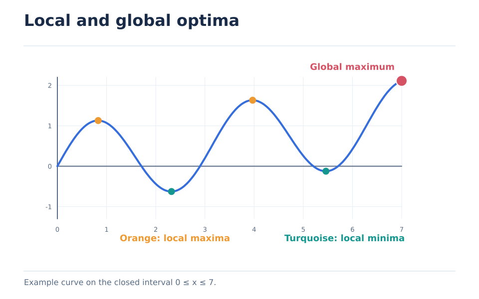

# M2-L6 – Optimisation using derivatives {#L6}

**Course area:** M2 – Upper secondary education / Abitur

**Level:** Upper secondary education / Abitur

**Prior knowledge:** No specific prerequisites stated.

**Classification:** Upper secondary education at a Gymnasium · Calculus and modelling

## What is this about? {#S1}

Optimisation means finding the most favourable solution possible under given conditions. Depending on the problem, we want to maximise area, profit or throughput, or minimise time, costs or energy consumption. A practical challenge is first to translate a situation into a mathematical function. Derivatives can then locate possible optimal values. However, the result must be checked against the **permissible values and boundary conditions**.

## Basic idea and intuition {#S2}

Imagine you have only a certain amount of material and want to enclose as large a rectangular area as possible. The length of one side necessarily affects the other side. If you keep making one side longer, the other will eventually become so short that the area shrinks again. There is therefore a best compromise, which can be determined mathematically.

The three components are called the **objective quantity**, **decision variable** and **constraint**. The objective quantity is described as a function of the decision variable; the constraint restricts the allowed values. This terminology is also used later in operations research and machine learning.

## New symbols before the first formula {#S3}

| Symbol | Read aloud | Meaning here | Other possible uses |
|---|---|---|---|
| $A(x)$ | ‘ay of x’ | Rectangular area depending on a side length x | $A$ may be an event, matrix or point |
| $x$ | ‘x’ | Decision variable: first side length | Otherwise a coordinate or function argument |
| $y$ | ‘y’ | Second side length | Otherwise a function value |
| $[0;12]$ | ‘closed interval from zero to twelve’ | Permissible values including both endpoints | Square brackets also for lists and matrices |
| $A'(x)$ | ‘ay prime of x’ | First derivative of the objective function | A prime has other uses |
| $A''(x)$ | ‘ay double prime of x’ | Second derivative; helps with local testing | Not the square of the first derivative |
| `max` and `min` | ‘maximum’, ‘minimum’ | Largest or smallest permissible value | `max` also a function name in programs |
| `≤`, `≥` | ‘less than or equal to’, ‘greater than or equal to’ | Inequalities for constraints | General comparisons |

## From the problem to the objective function {#S4}

A rectangular area is to be enclosed using a total of **24 metres of boundary material**. All four sides require material. Opposite sides are equal in length. The lengths must not be negative. **Unit convention for the calculation:** in the following example, $x$ and $y$ denote the **numerical values** of the side lengths in metres, and $A(x)$ the numerical value of the area in square metres. The numbers 24, 12 and 6 in the equations therefore always have a clear connection to the units.

The **constraint** is thus:

$$
2x+2y=24\qquad\text{(}x,y\text{: numerical values of the lengths in metres)}
$$

**Read aloud:** ‘Two times x plus two times y equals twenty-four.’ $x$ and $y$ are the numerical values of the two side lengths in metres, each contributing twice to the perimeter. The perimeter is **24 m**; hence the numerical value 24 on the right.

We rearrange for the second length: $y=12-x$. The area of a rectangle is length times width. After substitution, just the one independent variable remains:

$$
A(x)=x\cdot(12-x)=12x-x^2
$$

**Read aloud:** ‘The area ay of x equals x times twelve minus x, that is twelve x minus x squared.’ For a **non-degenerate rectangle**, both sides must be positive: $x>0$ and $y=12-x>0$, so $0<x<12$. To examine the **boundary** systematically, we include the limiting cases $x=0$ and $x=12$ in the calculation; both have zero area but do not represent real rectangles. Outside $0\le x\le12$, a negative side length would result.

The actual area measures $A(x)$ **square metres**; here, $A(x)$ therefore denotes its numerical value and is not itself a physical quantity with an attached unit. A calculated maximum without permissible side lengths would not be a valid solution.

## Finding candidates for the optimum using a derivative {#S5}

For the derivative, we use the familiar power rule:

$$
A'(x)=12-2x
$$

**Read aloud:** ‘Ay prime of x equals twelve minus two x.’ The derivative describes how strongly the calculated area increases or decreases when $x$ changes slightly. As $A(x)$ here means only the numerical value of the area in square metres, and $x$ only the numerical value of the length in metres, $A'(x)$ itself is a derivative of numerical values. The **physical rate of change of area with respect to length** has the unit $\frac{\mathrm{m}^2}{\mathrm{m}}=\mathrm{m}$. The numerical values agree for the chosen unit, the metre.

We first look for a **horizontal tangent**, where the local rate of change is zero:

$$
12-2x=0\quad\Longrightarrow\quad x=6
$$

**Read aloud:** ‘Twelve minus two x equals zero; it follows that x equals six.’ Then $y=12-6=6$. A square is thus a candidate for the largest area.

That is not sufficient on its own. We check using the second derivative and the boundary values:

$$
\begin{aligned}
A''(x)&=-2\\
A(0)&=0,\quad A(6)=36,\quad A(12)=0
\end{aligned}
$$

**Read aloud:** ‘The second derivative is minus two.’ It is negative everywhere: the function is concave downwards on the interval, and at $x=6$ there is a strict local maximum. The fact that the value of **36 square metres** is also the **global** maximum for all real rectangles with $0<x<12$ can even be demonstrated exactly rather than just graphically. We complete the square: $A(x)=12x-x^2=36-{(x-6)}^2$. A square is never negative, so this expression is **at most 36**, and is exactly 36 when $x=6$. The zero areas at the **endpoints included only for calculation purposes** are correspondingly smaller. The boundary values are comparison and limiting values, not rectangles in their own right.

**Result:** With a perimeter of 24 metres, the rectangle has its greatest area at $6\,\mathrm{m}\times6\,\mathrm{m}$, namely $36\,\mathrm{m}^2$. This is a **model result**, not an instruction for every real plot of land.

## The steps of a simple optimisation {#S6}

The same sequence of reasoning helps with other problems too:

1.  **Set the objective:** What should be as large or small as possible – costs, time, yield, area?
2.  **Determine the variable:** What can we actually change?
3.  **Formulate constraints:** Which resources, limits, relationships or safety requirements are binding?
4.  **Set up the objective function:** How does the objective quantity depend on the variable quantity?
5.  **Identify candidates:** Set the derivative equal to zero; also consider points where there is no derivative and permissible **endpoints**.
6.  **Compare candidates:** Only allowed values can provide possible solutions. For global optima, the limits of an unbounded domain also matter where relevant.

This sequence also corresponds to the modelling of software problems: only after we clarify **what** should be improved and **which rules** apply can we choose a suitable algorithm.

## Local and global optima {#S7}

A **local maximum** is largest only within a small neighbourhood. At an endpoint, such neighbourhoods refer to **permissible** values; global optima may also occur there. Example: $f(x)=x$ on the closed interval $[0;2]$ has the global maximum $f(2)=2$ at an endpoint, even though $f'(x)=1$ throughout the interior and is **nowhere zero**. A **global maximum** is largest over the entire permissible domain. A derivative becoming zero initially identifies only candidates. A local peak may be lower than another peak or even an allowed boundary value.

{alt="Local and global extrema of a function on an interval"}

On a **closed and bounded interval**, every continuous real-valued function attains a largest and a smallest value. Open intervals or unbounded domains behave differently. For instance, the function $f(x)=x$ on the open set $0<x<1$ has no largest function value, although its values approach one arbitrarily closely.

**Read the restriction $0<x<1$ aloud:** ‘X is greater than zero and less than one.’ The endpoints do not belong to the permissible domain. A limiting value that can only be approached need not be an actually attainable optimum.

## Technical application: an ideal solution cannot always be implemented {#S8}

Consider running several software jobs in parallel. A theoretical objective function might use a real variable for computing capacity. In reality, however, the number of processes started, for example, can often be chosen only as a whole number. A calculated solution of $x=6.4$ processes would then not be permissible at all. Instead, we must check the allowed whole numbers nearby – and possibly further permissible values if the model is complicated.

In AI systems, the **loss function** to be minimised may depend on millions of parameters. There, methods such as gradient descent replace simple curve sketching. The basic idea remains related: calculate changes, look for a favourable step and respect constraints. These methods are studied later in university-level optimisation.

## Why is this useful? {#S9}

An optimisation model helps compare costs and capacities, for example when allocating server resources to several tasks. When planning technical systems, we can look for the best possible geometry or setting within a material or energy limit. AI control uses similar concepts of objectives and constraints, although often in many more dimensions. Not every real problem can be represented by a smooth function of a single variable.

## Assumptions and limitations {#S10}

- The rectangle calculation considers only a fixed perimeter, plane geometry and freely selectable side lengths; building regulations, doors, wall thicknesses and material losses are omitted. $x=0$ and $x=12$ are merely limiting cases of the calculation model, **not permissible real rectangles**.
- $A'(x)=0$ provides **candidates**, not a guarantee. Optima may occur at non-differentiable points and permissible boundary values.
- A local optimum need not be globally optimal; this distinction becomes especially important with several variables.
- Continuous variables must not be equated with discrete decisions. Programs also need tolerances for numerical calculation errors.

## Link to the next lesson {#S11}

So far, we have determined the **instantaneous change** from a function. [M2-L7](M2-L7.md) reverses the direction: how can we reconstruct an original function from a known rate of change?

## Sources (external) {#S12}

No external sources listed.
