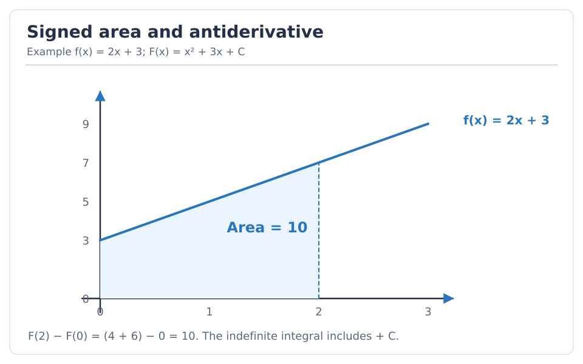

# M2-L7 – Antiderivatives and integral notation {#L7}

**Course area:** M2 – Upper secondary education / Abitur

**Level:** Upper secondary education / Abitur

**Prior knowledge:** No specific prerequisites stated.

**Classification:** Upper secondary education at a Gymnasium · Introduction to integral calculus

## What is this about? {#S1}

Using a derivative, we determine how a quantity is changing at a given instant. Often, however, we know only this change and want to reconstruct the original quantity from it. Such a calculation in reverse leads to the concept of the **antiderivative**. The integral sign allows us to write the entire family of antiderivatives compactly. This is the starting point for integral calculus, which in the next lessons also describes accumulated changes and signed areas.

## Basic idea and intuition {#S2}

Suppose we know the velocity of a moving object at every instant. The derivative of a **position function along a straight axis** gives the **signed velocity**; conversely, we can recover position as a function of time from it. However, knowing the velocity does not yet tell us **where** the object was initially. Velocity differs from *speed*, which is always non-negative: when the object turns back, its displacement can be negative even though further distance is travelled. The result therefore contains an initially free additive constant that is later determined by an initial condition.

The transition from a **rate of change** to a **stored quantity** is also useful in software models: a **net rate of change** from inflow and outflow describes, for example, the change in the length of a queue, but not its initial length. In the real queue model the quantity must not become negative; a solution reconstructed mathematically must therefore be adapted to the limits of the model if necessary. The definite integral – the actual accumulated change over an interval – is covered in detail only in M2-L8.

## New symbols before the first formula {#S3}

| Symbol | Read aloud | Meaning here | Other possible uses |
|---|---|---|---|
| $F(x)$ | ‘capital eff of x’ | Antiderivative of the function $f(x)$ | Capital letters may denote sets, matrices or other functions |
| $F'(x)$ | ‘capital eff prime of x’ | Derivative of the antiderivative | The derivative is familiar from [M2-L3](M2-L3.md)/M2-L4 |
| $f(x)$ | ‘lower-case eff of x’ | Given function whose antiderivative is sought | Any other function rule |
| $\int$ | ‘integral sign’, ‘integral of’ | Here indicates indefinite integration | With limits it later denotes a definite integral |
| $\mathrm{d}x$ | ‘dee x’ | Identifies the integration variable x | A separate, context-dependent role in differential notation |
| $C$ | ‘capital see’ | Freely selectable **constant of integration** | Otherwise any constant or name of an object |
| `∈` | ‘is an element of’ | Membership of a set | General set theory, studied in more depth later |
| $\mathbb R$ | ‘set of real numbers’ | Real number system | Already introduced in [M1-L1](M1-L1.md) |
| $n$ | ‘en’ | Fixed exponent in the power rule | Often also a step count or index |
| $k$ | ‘kay’ | Any constant numerical value | In other problems a running index |
| Absolute value notation | ‘absolute value of x’ | Non-negative distance from zero; here in the logarithm for both signs | Norms and other absolute value notation too |

## Antiderivatives: thinking of differentiation in reverse {#S4}

A function $F$ is called an antiderivative of the function $f$ on an interval if $F$ is differentiable there and its derivative at every interior point of the interval equals $f$ (at included endpoints, suitable one-sided derivatives are considered).

$$
F'(x)=f(x)
$$

**Read aloud:** ‘The derivative of capital eff at x equals lower-case eff of x.’ This equation defines what is meant by an **antiderivative**. Unlike differentiation, the reverse process can give several different functions with the same derivative.

For example, the functions $x^2$, $x^2+5$ and $x^2-100$ all have the same derivative $2x$. Any constant shift disappears during differentiation. A constant term is therefore needed when calculating in reverse.

## The indefinite integral {#S5}

We use compact notation for the family of all antiderivatives:

$$
\int f(x)\,\mathrm{d}x=F(x)+C
$$

**Read in full:** ‘The indefinite integral of lower-case eff of x with respect to x equals capital eff of x plus the constant of integration see.’

The individual components:

- $\int$: an elongated S, historically connected with the idea of summation. **Here** it indicates finding antiderivatives.
- $f(x)$: the **integrand**, the expression we want to integrate.
- $\mathrm{d}x$: indicates the variable **with respect to which** we integrate. In this introduction, we should not simply treat $\mathrm{d}x$ as an arbitrarily tiny number by which we multiply.
- $F(x)$: a chosen antiderivative whose derivative gives $f(x)$.
- $+C$: the free additive constant. On a connected interval, all antiderivatives of the same function differ only by a constant.

**Important:** In this representation, the indefinite integral is a **family of functions**, not a single numerical area. We discuss the interpretation as area and net change with **limits of integration** in M2-L8.

## A fully explained mini-example {#S6}

We want to find an antiderivative of the function $f(x)=2x+3$. To do so, we recall two derivatives: the derivative of $x^2$ is $2x$, and the derivative of $3x$ is $3$.

{alt="Graph of the function f(x) equals two x plus three, with positive area under the graph from zero to two, of size ten."}

For the antiderivative $F(x)=x^2+3x+C$: the net change from 0 to 2 is 10.

$$
\begin{aligned}
f(x)&=2x+3\\
\int(2x+3)\,\mathrm{d}x&=x^2+3x+C
\end{aligned}
$$

**Read aloud:** ‘Eff of x equals two x plus three. The indefinite integral of two x plus three with respect to x equals x squared plus three x plus see.’

Why is this correct? If we differentiate the function we found, $F(x)=x^2+3x+C$, we obtain $2x+3+0=2x+3$. The constant $C$ disappears during differentiation. Thus each of these functions satisfies the condition for an antiderivative.

Now an **initial condition** might be added: the original stored quantity is exactly five units at input $x=0$. We read this as $F(0)=5$ and substitute: $0^2+3\cdot0+C=5$. Hence $C=5$. The antiderivative determined by this condition is $F(x)=x^2+3x+5$.

## Understanding simple integration rules {#S7}

We can recognise many standard functions by using the familiar differentiation rules in reverse:

$$
\begin{aligned}
\int x^n\,\mathrm{d}x&=\frac{x^{n+1}}{n+1}+C\quad(n\neq-1;\ \text{suitable domain})\\
\int k\,\mathrm{d}x&=kx+C\quad(k\text{ is a constant})
\end{aligned}
$$

**First formula read aloud:** ‘The integral of x to the power en with respect to x equals x to the power en plus one divided by en plus one, plus see.’ The exponent $n$ is fixed and must not be minus one for this formula. For **every real exponent $n\ne-1$**, the rule is valid on the interval **$x>0$**. For integer exponents it is also valid on larger suitable domains, for example for $n=2$ on all of $\mathbb R$ or for $n=-2$ on any interval not containing zero. Division by $n+1$ requires this value to be non-zero.

**Second formula read aloud:** ‘The integral of the constant number kay with respect to x equals kay times x plus see.’ If the rate of change always stays the same, the reconstructed quantity varies linearly.

**Mini-example:** For $\int x^2\,\mathrm{d}x$, increase the exponent two to three and divide by three: $\frac{x^3}{3}+C$. Checking by differentiation gives $x^2$ again.

### The important exception for an exponent of minus one {#abschnitt-8}

For $x^{-1}=\frac1x$, the general power rule just given would require division by zero. For $x>0$, the following applies instead:

$$
\int\frac1x\,\mathrm{d}x=\ln(x)+C\qquad(x>0)
$$

**Read aloud:** ‘The integral of one over x with respect to x equals the natural logarithm of x plus see.’ We have already encountered $\ln$ when studying logarithms. For negative $x$, on the separate interval we obtain $\ln(-x)+C$ correspondingly; in summary, on an interval not containing zero, we can write the formula $\ln|x|+C$. Here the absolute value bars mean that the value between them is considered without its sign. Zero itself remains excluded. On the two separate intervals $x<0$ and $x>0$, we may choose **different additive constants** for $\int\frac1x\,\mathrm{d}x$; only within a connected interval is the difference between two antiderivatives constant.

## The connection with accumulation {#S8}

Why is the new calculation step called **integration**? In a model involving time, a rate of change can be considered for many small time intervals. Adding the respective small changes over increasingly fine intervals leads to the idea of a **definite integral**. The antiderivative then provides an elegant way to calculate this accumulated result.

We should distinguish two statements clearly:

| Question | Object sought | Covered in detail in |
|---|---|---|
| ‘Which function has this derivative?’ | Family of antiderivatives $F(x)+C$ | [M2-L7](M2-L7.md) |
| ‘How much has changed in total between two times?’ | A number with an appropriate unit | [M2-L8](M2-L8.md) |
| ‘Why can I calculate an accumulated change using an antiderivative?’ | Fundamental theorem of calculus | [M2-L9](M2-L9.md) |

## Why is this useful? {#S9}

In physical simulations we can reconstruct how position varies from a **signed velocity function** once an initial position is known. By contrast, the **total distance travelled** is the accumulated magnitude of the velocity: an outward and return journey can have zero net displacement and still cover a distance. In modelling energy and consumption, time-dependent rates lead to total quantities. In software metrics, the idea can explain how throughput data produce a record of how a stored quantity varies. Derivatives are commonplace in neural networks; thinking in the reverse mathematical direction is more common in continuous models, probability theory and dynamical systems.

## Assumptions and limitations {#S10}

- $\int f(x)\,\mathrm{d}x$ **here** denotes an indefinite integral, a family of antiderivatives; without limits of integration, we are not yet calculating a specific signed area.
- A continuous function on an interval has an antiderivative. However, an antiderivative cannot always be expressed as a simple combination of familiar elementary functions.
- The constant $C$ can be chosen freely on a **connected interval**. If a domain consists of separate intervals, the constants on them can be chosen independently.
- Initial conditions must fit the function model. Real measurement data also involve measurement errors, rounding errors and uncertainty about the rate of change.
- The symbol $\mathrm{d}x$ identifies the integration variable in this lesson. Its more precise meaning is explained in greater depth at university.

## Link to the next lesson {#S11}

In **[M2-L8](M2-L8.md)**, we add limits to the integral sign and for the first time directly answer the question: **How large is the accumulated change between two specific input values?**

## Sources {#S12}

No individual sources are listed separately for this lesson.
