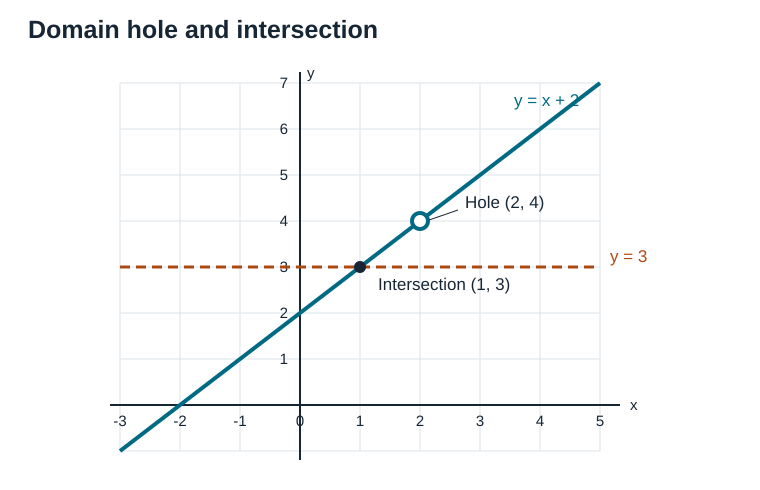

# M3-L1 – Rational expressions and equations {#L1}

**Course area:** M3 – Expressions, equations and inequalities

**Level:** Lower secondary education · foundations

**Prior knowledge:** [M1-L2](M1-L2.md); [M1-L3](M1-L3.md)

**Context:** Core mathematics extension, informed by Bavaria’s LehrplanPLUS M8.

## Learning objectives {#S1}

After this lesson, you can determine the domain of a rational expression, manipulate rational expressions without losing their original domain restrictions, and solve rational equations with a substitution check. You can recognise when an algebraic candidate is invalid because it lies outside the domain.

## Determine the domain before calculating {#S2}

Here a rational expression is a quotient of two polynomials. The numerator is above the fraction bar and the denominator is below. We work over $\mathbb R$ (the real numbers). Division by zero is undefined, so we exclude every zero of each original denominator. For example:

$$T(x)=\frac{x^2-4}{x-2},\qquad D=\mathbb R\setminus\{2\}.$$

The symbol $\setminus$ means “excluding”, and $D$ denotes the domain. For $x\ne2$, factor the numerator as $(x-2)(x+2)$. Cancelling gives $T(x)=x+2$, but only for $x\in D$ (read: x belongs to D). The simplified expression, treated as a separate function, has a larger domain than the original. The original graph has a missing point at $(2,4)$; the restriction survives the simplification.

{alt="Coordinate system: rising line with open circle at 2,4; horizontal line at y equals 3; filled intersection point at 1,3."}

## Operations with rational expressions {#S3}

| Operation | Rule | Condition |
| --- | --- | --- |
| Multiplying numerator and denominator | $\frac ab=\frac{ac}{bc}$ | $b\ne0,c\ne0$ |
| Cancelling | $\frac{ac}{bc}=\frac ab$ | $b\ne0,c\ne0$ |
| Addition / subtraction | $\frac ab\pm\frac cd=\frac{ad\pm bc}{bd}$ | $b\ne0,d\ne0$ |
| Multiplication | $\frac ab\cdot\frac cd=\frac{ac}{bd}$ | $b\ne0,d\ne0$ |
| Division | $\frac ab:\frac cd=\frac{ad}{bc}$ | $b\ne0,d\ne0,c\ne0$ |

The letters represent numbers or expressions; with variables, the conditions must hold for each substitution. Only common factors may be cancelled, not individual terms in a sum. Thus $(x+3)/x$ is not equal to 3 in general. A common denominator must be nonzero at every permitted input.

For example, $\frac{2}{x}+\frac1{x+1}=\frac{3x+2}{x(x+1)}$, where $x\ne0,-1$. For $\frac{x}{x+1}:\frac{x-2}{x}$ we additionally require $x\ne2$ as well as $x\ne0,-1$. The result $\frac{x^2}{(x+1)(x-2)}$ must retain the original restriction $x\ne0$.

## Solving a rational equation {#S4}

We want $\frac{x^2-4}{x-2}=3$. First record $D=\mathbb R\setminus\{2\}$. On this set, multiplying both sides by $x-2$ is reversible:

$$x^2-4=3x-6\quad\Longleftrightarrow\quad(x-1)(x-2)=0.$$

The candidates are 1 and 2. Only 1 belongs to $D$. Check: $(1-4)/(1-2)=3$. The solution set is $L=\{1\}$. The figure in S2 shows the same solution as an intersection; there is no function value at $x=2$. Solving the simplified equation $x+2=3$ yields the same value directly, provided the domain is retained.

## Application: combined flow rate {#S5}

One pump fills a tank on its own in 6 hours. A second takes $x$ hours. With constant additive rates and a simultaneous start, both pumps fill the tank in 4 hours. One full tank is the unit; the filling rates are $1/6$ and $1/x$ tanks per hour. Therefore $1/6+1/x=1/4$, so $1/x=1/12$ and $x=12$. The contextual restriction is $x>0$, not merely $x\ne0$. Check: $1/6+1/12=1/4$. If the pumps interact or their rates vary, this model need not apply.

## Self-assessment {#S6}

### Exercises

1. Determine the domain of $(x^2-9)/(x-3)$ and simplify. Is the original expression defined at $x=3$?
2. Calculate $2/(x-1)+3/(x+1)$ and state its domain.
3. Solve $x/(x-2)=3$ and check by substitution.
4. Explain why $(x^2-9)/(x-3)=6$ has no solution.
5. One machine completes a job in 10 hours; two together take 4 hours. Find the second machine's individual time under the same assumptions as in S5.

::: {.lc-solutions data-lc-section="S6"}
1. $D=\mathbb R\setminus\{3\}$, simplified to $x+3$ on $D$. The value at 3 remains excluded.
2. $D=\mathbb R\setminus\{-1,1\}$, result $(5x-1)/(x^2-1)$.
3. $x\ne2$; $x=3(x-2)$ gives $x=3$. Check: $3/(3-2)=3$.
4. On $D$, $x+3=6$ gives the sole candidate 3. It is not permitted; $L=\varnothing$.
5. $1/x=1/4-1/10=3/20$. Thus $x=20/3$ hours, or 6 hours 40 minutes. The two rates sum to $1/4$.
:::

## Connections and limitations {#S7}

Review [M1-L2](M1-L2.md) for fractions and [M1-L3](M1-L3.md) for algebraic transformations. [M2-L1](M2-L1.md) examines families of functions further. Rational inequalities also require analysing the denominator's sign; the rules for linear inequalities in [M3-L2](M3-L2.md) are a prerequisite. This lesson is limited to equations and real inputs.

## Sources {#S8}

- [Serlo – Rechnen mit Bruchtermen (Operations with rational expressions)](https://de.serlo.org/mathe/156343/rechnen-mit-bruchtermen) · Section 4, domain restrictions and their preservation; the source uses rational inputs, whereas this lesson explicitly uses real inputs · Last accessed: 2026-11-24 · Content verified: 2026-11-24
- [Serlo – Bruchgleichungen lösen (Solving rational equations)](https://de.serlo.org/mathe/1851/bruchgleichungen-loesen) · Solving procedure and exclusion of invalid candidates · Last accessed: 2026-11-24 · Content verified: 2026-11-24
