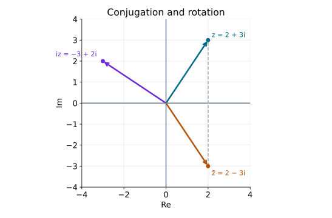

# M4-L1 – Complex numbers in the complex plane {#L1}

**Course area:** M4 – Complex numbers

**Level:** Upper secondary education · elective extension

**Prior knowledge:** [M1-L7](M1-L7.md); [M1-L20](M1-L20.md)

**Context:** Elective extension informed by Bavaria’s LehrplanPLUS M12; not a nationwide requirement.

## Learning objectives {#S1}

Represent complex numbers in algebraic form and in the complex plane, perform arithmetic, and justify division using the complex conjugate.

## Extending the real numbers {#S2}

The equation $x^2=-1$ has no real solution. Extend the number system to $\mathbb C$ by introducing a number $i$ satisfying $i^2=-1$. Every complex number has a unique representation $z=a+bi$ with $a,b\in\mathbb R$. The real and imaginary parts $\operatorname{Re}(z)=a$ and $\operatorname{Im}(z)=b$ are real numbers; the imaginary part is not $bi$. Real numbers correspond to points with $b=0$. For instance $-3i=0-3i$. Two complex numbers are equal precisely when both components agree. The equation $z^2=-9$ has two solutions, $3i$ and $-3i$.

## Arithmetic with two components {#S3}

Add and subtract component by component. To multiply, expand the brackets and replace $i^2$ by $-1$:

$$ (a+bi)(c+di)=(ac-bd)+(ad+bc)i. $$

For example, $(2+3i)(1-2i)=2-4i+3i-6i^2=8-i$. Powers of $i$ cycle every four steps: $1,i,-1,-i,1$. Consequently $i^{27}=i^3=-i$. The distributive law still holds. In contrast, no order extending the real order is compatible with all field operations on $\mathbb C$: if either $i>0$ or $-i>0$, its square would have to be positive, although it equals $-1$.

## Geometry, modulus and conjugation {#S4}

The complex number $a+bi$ corresponds to the point $(a,b)$. Addition is vector addition. The conjugate $\bar z=a-bi$ is reflection across the real axis. The modulus $|z|=\sqrt{a^2+b^2}$ is distance from the origin; expanding $(a+bi)(a-bi)$ gives $z\bar z=|z|^2$. For $z=2+3i$, the modulus is $\sqrt{13}$. Multiplication by $i$ yields $iz=-b+ai$: a 90° counterclockwise rotation about the origin. The modulus is unchanged.

{alt="Complex plane with z at (2,3), conjugate at (2,−3) and iz at (−3,2)."}

## Dividing by a complex number {#S5}

For $w=c+di\ne0$, we have $c^2+d^2>0$. Multiply numerator and denominator by $\bar w$ to obtain a real denominator:

$$\frac{a+bi}{c+di}=\frac{(a+bi)(c-di)}{c^2+d^2}=\frac{ac+bd+(bc-ad)i}{c^2+d^2}.$$

For example, $(4+2i)/(1-i)=(2+6i)/2=1+3i$. Check: $(1+3i)(1-i)=4+2i$. Division by zero remains undefined. The reciprocal $1/z$ is $\bar z/|z|^2$ for $z\ne0$; it is not in general just the conjugate.

## Application: rotation and scaling {#S6}

Multiply the point $z=3-i$ by $2i$. The result $2+6i$ is twice as far from the origin and rotated through 90°. This combines two geometric operations in one multiplication. To rotate about another point $p$, first form $z-p$, rotate, then add $p$ back. The next lesson [M4-L2](M4-L2.md) generalizes this representation to arbitrary angles.

## Self-assessment {#S7}

### Exercises

1. Calculate $(3-2i)+(1+5i)$ and $(3-2i)(1+5i)$.
2. Find the modulus and conjugate of $-5+12i$.
3. Calculate $(3+i)/(2-i)$ and verify by multiplication.
4. Find every solution of $z^2+16=0$.
5. Rotate the point $2-i$ by 90° counterclockwise about $1+i$. Use the translation method.

::: {.lc-solutions data-lc-section="S7"}
1. Sum $4+3i$; product $3+15i-2i-10i^2=13+13i$.
2. Modulus $13$; conjugate $-5-12i$.
3. Multiply by $2+i$: $(5+5i)/5=1+i$. Check $(1+i)(2-i)=3+i$.
4. $(z-4i)(z+4i)=z^2+16$; both solutions $4i,-4i$.
5. Difference $1-2i$; after rotation $2+i$; after translating back $3+2i$.
:::

## Sources {#S8}

- [OpenStax – Precalculus 2e, 3.1 Complex Numbers](https://openstax.org/books/precalculus-2e/pages/3-1-complex-numbers) · Algebraic form, conjugation, arithmetic · Last accessed: 2026-11-24 · Content verified: 2026-11-24
- [OpenStax – Precalculus 2e, 8.5 Polar Form of Complex Numbers](https://openstax.org/books/precalculus-2e/pages/8-5-polar-form-of-complex-numbers) · Complex plane, modulus and angle · Last accessed: 2026-11-24 · Content verified: 2026-11-24
