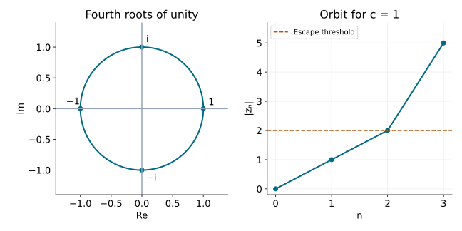

# M4-L2 – Polar form, roots of unity and iteration {#L2}

**Course area:** M4 – Complex numbers

**Level:** Upper secondary education · elective extension

**Prior knowledge:** [M4-L1](M4-L1.md); [M1-L20](M1-L20.md)

**Context:** Elective extension informed by Bavaria’s LehrplanPLUS M12; not a nationwide requirement.

## Learning objectives {#S1}

Convert between algebraic and polar form, find all nth roots, solve quadratic equations and distinguish proven divergence from numerical conjecture in complex iteration.

## Polar form and angles {#S2}

For $z=a+bi\ne0$, write $z=r(\cos\varphi+i\sin\varphi)$ with $r=|z|>0$. The angle $\varphi$ is unique only up to integer multiples of $2\pi$. The abbreviation $\operatorname{cis}\varphi$ means $\cos\varphi+i\sin\varphi$. For $z=-1+i$, $r=\sqrt2$ and $\varphi=3\pi/4$; taking the ordinary arctangent of $b/a$ would give the wrong quadrant. Use the position in the plane or a two-argument angle function atan2. For $z=0$ there is no distinguished angle.

## Multiplication and powers {#S3}

The trigonometric addition identities imply $\operatorname{cis}\alpha\operatorname{cis}\beta=\operatorname{cis}(\alpha+\beta)$. Hence multiplication multiplies moduli and adds angles. Division by a nonzero number divides moduli and subtracts angles. Repeated application yields de Moivre's formula for positive integers $n$:

$$[r\operatorname{cis}\varphi]^n=r^n\operatorname{cis}(n\varphi).$$

For example, $(1+i)^4=(\sqrt2)^4\operatorname{cis}(\pi)=-4$. Unlike multiplication, addition does not combine polar parameters component by component.

## Roots and quadratic equations {#S4}

For $w=R\operatorname{cis}\theta\ne0$ with $R>0$, all solutions of $z^n=w$ for integer $n\ge1$ are

$$z_k=R^{1/n}\operatorname{cis}\left(\frac{\theta+2\pi k}{n}\right),\quad k=0,\ldots,n-1.$$

The solutions are evenly spaced on a circle; raising each to the nth power gives angles differing only by multiples of $2\pi$. For $w=1,n=4$, the roots are $1,i,-1,-i$. For $w=0$, only $z=0$ is possible. The quadratic equation $z^2-2z+5=0$ becomes $(z-1)^2=-4$ and has solutions $1\pm2i$. Completing the square also works over $\mathbb C$; include both square roots.

{alt="Unit circle with four roots and orbit values 0, 1, 2, 5 with threshold 2."}

## Iteration: the Mandelbrot set {#S5}

Choose a fixed complex parameter $c$ and start at $z_0=0$. The recurrence is $z_{n+1}=z_n^2+c$. For $c=-1$ the sequence alternates between 0 and −1; for $c=1$ it begins 0, 1, 2, 5 and then grows without bound. The Mandelbrot set consists exactly of the parameters $c$ whose entire orbit remains bounded. For $|c|\le2$, after the modulus exceeds 2 we have $|z_{n+1}|\ge |z_n|^2-2>|z_n|$. If $r=|z_n|>2$, the increment stays at least $r^2-r-2>0$, proving unbounded growth. For $|c|>2$, the orbit already starts at $|z_1|=|c|$; for $r\ge|c|$, $|z_{n+1}|\ge r^2-|c|\ge r(r-1)>r$, again implying divergence. Exceeding 2 is therefore sufficient for stopping.

## A numerical experiment {#S6}

Choose a grid of parameters and compute the orbit of each for at most $N=50$ steps. Mark a parameter as escaped once $|z|^2>4$, and as undecided otherwise. Increasing the step limit can reveal more escaping points. A finite run does not prove membership without an additional analytical argument. Floating-point errors can also affect borderline cases. Use $c=0$ (constant), $c=-2$ (orbit 0, −2, 2, 2, …), and $c=1$ (escape on step three) as control values. The strict inequality matters.

## Self-assessment {#S7}

### Exercises

1. Convert $-\sqrt3+i$ to polar form.
2. Calculate $(2\operatorname{cis}(\pi/6))^3$.
3. Find the three solutions of $z^3=8$.
4. Solve $z^2+4z+13=0$.
5. For $c=i$, compute the first four iterates after $z_0=0$. Does the result prove membership?

::: {.lc-solutions data-lc-section="S7"}
1. $r=2$, $\varphi=5\pi/6$ (modulo $2\pi$).
2. $8\operatorname{cis}(\pi/2)=8i$.
3. $2,-1+i\sqrt3,-1-i\sqrt3$.
4. $(z+2)^2=-9$, so $-2\pm3i$.
5. $z_1=i$, $z_2=-1+i$, $z_3=-i$, $z_4=-1+i=z_2$. Since the recurrence is deterministic, the orbit repeats periodically; boundedness is proved here, not merely conjectured.
:::

## Sources {#S8}

- [OpenStax – Precalculus 2e, 8.5 Polar Form of Complex Numbers](https://openstax.org/books/precalculus-2e/pages/8-5-polar-form-of-complex-numbers) · Polar form, de Moivre, nth roots · Last accessed: 2026-11-24 · Content verified: 2026-11-24
- [University of Massachusetts Boston – The Mandelbrot Set](https://www.math.umb.edu/~lbnguyen/blog/mandelbrot.html) · Definition and escape criterion, theorems 1 and 2 · Last accessed: 2026-11-24 · Content verified: 2026-11-24
