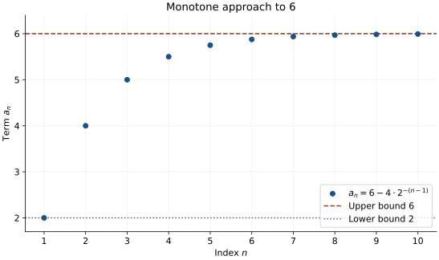

# M5-L1 – Sequences, recursion and mathematical induction {#L1}

**Course area:** M5 – Sequences and series

**Level:** Upper secondary education · elective extension

**Prior knowledge:** [M1-L17](M1-L17.md); [M1-L19](M1-L19.md)

**Context:** Elective extension informed by Bavaria’s LehrplanPLUS M12; not a nationwide requirement.

## Learning objectives {#S1}

Describe sequences explicitly and recursively, construct proofs by mathematical induction, and investigate monotonicity, bounds and limits. Distinguish a conjecture based on a few terms from a statement about all natural numbers.

## Sequences as functions {#S2}

A real sequence assigns exactly one real number to every natural number from a starting index onward. Here we start at $n=1$. Order matters: a sequence is not an unordered set. An explicit formula gives $a_n$ directly from $n$; a recurrence uses earlier terms and an initial value. For example, $a_n=3n+2$ produces $5,8,11,14,\ldots$; equivalently, $a_1=5$ and $a_{n+1}=a_n+3$. An arithmetic sequence has constant difference $d$, so $a_n=a_1+(n-1)d$. A geometric sequence satisfies $a_{n+1}=qa_n$ and $a_n=a_1q^{n-1}$. For $q=0$, the latter formula applies for $n\ge2$, with a separately specified initial term. Do not confuse the first term with the starting index.

## Recursion and induction {#S3}

Consider $a_1=2$, $a_{n+1}=(a_n+6)/2$. The first values are $2,4,5,5.5$. A possible explicit formula is $a_n=6-4\cdot2^{-(n-1)}$. To prove it, first establish the base case: for $n=1$ the formula gives $6-4=2$. In the induction step assume the claim for an arbitrary $k\ge1$. Then

$$a_{k+1}=\frac{6-4\cdot2^{-(k-1)}+6}{2}=6-4\cdot2^{-k}.$$

This is precisely the claim for $k+1$. Together the two steps prove the formula for every $n\ge1$. The assumption for $k$ alone is not a proof; deriving the next case is essential.

## Monotonicity and boundedness {#S4}

A sequence is nondecreasing if $a_{n+1}\ge a_n$ and nonincreasing if $a_{n+1}\le a_n$ for all indices under consideration. Strict monotonicity uses strict inequalities. An upper bound $B$ satisfies $a_n\le B$ for all $n$; a lower bound $b$ satisfies $b\le a_n$. For our recursive sequence, $a_{n+1}-a_n=2\cdot2^{-(n-1)}>0$. Also $2\le a_n<6$. A plot shows only finitely many points; the proof follows from the formula. The sequence $(-1)^n$ is bounded but not monotone and has no limit.

{alt="Discrete sequence terms from n equal to 1 through 10 between 2 and 6; dashed upper bound at 6."}

## Limits {#S5}

A limit $L$ means that for every positive error tolerance $\varepsilon$ there is an index $N$ such that $|a_n-L|<\varepsilon$ for all $n\ge N$. Individual terms need not reach $L$. The monotone convergence theorem states that a nondecreasing real sequence bounded above converges; likewise a nonincreasing sequence bounded below converges. For our sequence we have $|a_n-6|=4\cdot2^{-(n-1)}$. This error halves at every step and tends to zero. For a tolerance of $0.1$, $N=7$ suffices because $4/64=0.0625<0.1$. All subsequent errors are smaller.

## From model to proof {#S6}

In a simplified temperature model, half the difference from the ambient temperature of 20 °C is removed each minute. With $T_1=12$, we have $T_{n+1}=(T_n+20)/2$. The difference $20-T_n$ halves, so $T_n=20-8\cdot2^{-(n-1)}$. The sequence increases and approaches 20 °C. The equation $L=(L+20)/2$ gives a possible limit but already assumes convergence. In contrast, $b_1=1$, $b_{n+1}=-b_n$ gives the possible limit equation $L=-L$, yet does not converge. The temperature model assumes constant surroundings and a constant adjustment rate; real measurements may differ.

## Self-check {#S7}

### Exercises

1. Give the explicit formula and sixth term for $a_1=7$, $a_{n+1}=a_n-2$.
2. Prove by induction that $1+3+\cdots+(2n-1)=n^2$ for $n\ge1$.
3. Investigate $b_n=3+1/n$ for monotonicity, bounds and limit.
4. For the sequence in S3, find the smallest index from which $|a_n-6|<1/100$ holds.
5. Investigate $c_n=(-1)^n/n$ for monotonicity and convergence.

::: {.lc-solutions data-lc-section="S7"}
1. $a_n=7-2(n-1)$, $a_6=-3$.
2. Base: $1=1^2$. Hypothesis: the sum through term $k$ is $k^2$. Step: $k^2+(2(k+1)-1)=k^2+2k+1=(k+1)^2$. The claim holds for every $n\ge1$.
3. $b_{n+1}-b_n=-1/[n(n+1)]<0$. We have $3<b_n\le4$, and $1/n\to0$, hence $b_n\to3$.
4. At $n=9$, $4/256=1/64>1/100$; at $n=10$, $4/512=1/128<1/100$. Since the error halves, $N=10$ is minimal.
5. Not monotone: alternating signs with decreasing magnitude; $|c_n|=1/n\to0$, hence $c_n\to0$.
:::

## Sources {#S8}

- [OpenStax – Calculus Volume 2, 5.1 Sequences](https://openstax.org/books/calculus-volume-2/pages/5-1-sequences) · Sequences, monotonicity and convergence · Last accessed: 2026-11-24 · Content verified: 2026-11-24
- [Oscar Levin – Discrete Mathematics: An Open Introduction, Proof by Induction](https://discrete.openmathbooks.org/dmoi4/sec_seq-induction.html) · Induction principle and proof structure · Last accessed: 2026-11-24 · Content verified: 2026-11-24
