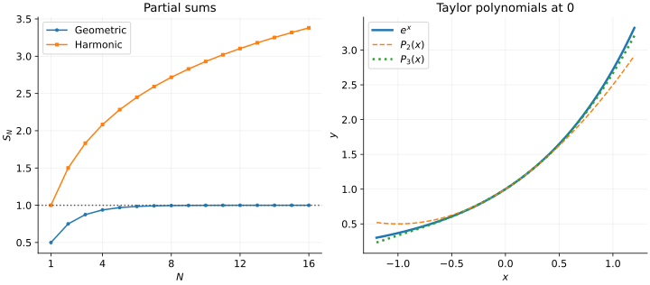

# M5-L2 – Series and Taylor polynomials {#L2}

**Course area:** M5 – Sequences and series

**Level:** Upper secondary education · elective extension

**Prior knowledge:** [M5-L1](M5-L1.md); [M2-L4](M2-L4.md)

**Context:** Elective extension informed by Bavaria’s LehrplanPLUS M12; not a nationwide requirement.

## Learning objectives {#S1}

Calculate partial sums of geometric series, justify convergence or divergence, and approximate the exponential function by Taylor polynomials with an error bound.

## Sequence, partial sum and series {#S2}

A sequence $(a_n)$ determines the partial-sum sequence $S_N=\sum_{n=1}^N a_n$. An infinite series $\sum_{n=1}^\infty a_n$ converges exactly when $S_N$ has a finite limit. Only then do we call that limit the sum of the series. For example, $a_n=2^{-n}$ begins $1/2,1/4,1/8$; the partial sums are $1/2,3/4,7/8$. The sequence and the series have different limits. Since $a_N=S_N-S_{N-1}$, the terms of any convergent series must tend to zero. The converse is false.

## Geometric series {#S3}

For $N\ge1$ and $q\ne1$, set $G_N=a\sum_{k=0}^{N-1}q^k$. Subtracting $qG_N$ from $G_N$ leaves only the initial and final terms:

$$G_N-qG_N=a(1-q^N),\qquad G_N=\frac{a(1-q^N)}{1-q}.$$

For $q=1$, $G_N=Na$. If $|q|<1$, then $q^N$ tends to zero and the infinite series has value $a/(1-q)$. If $a\ne0$ and $|q|\ge1$, the terms cannot tend to zero, so the series diverges. If $a=0$, every partial sum is zero. For example, $4+2+1+\cdots=8$. After five terms the partial sum is $31/4$; the remaining tail is $1/4$. In general, when $|q|<1$, the tail equals $aq^N/(1-q)$.

## The harmonic series {#S4}

The terms $1/n$ tend to zero but their series diverges. Consider the partial sums $H_N=\sum_{n=1}^N1/n$. After the initial term, group the summands into blocks ending at indices $2,4,8,16,\ldots$. The block from $2^{j-1}+1$ to $2^j$ contains $2^{j-1}$ terms, each at least $1/2^j$. Each block therefore contributes at least $1/2$. Hence $H_{2^m}\ge1+m/2$ for $m\ge1$. The partial sums are unbounded, so there is no finite limit. Even very slow unbounded growth is divergence.

## Taylor polynomials {#S5}

At the expansion point $a$, a Taylor polynomial matches a sufficiently differentiable function in its value and derivatives through order $m$:

$$P_m(x)=\sum_{k=0}^m\frac{f^{(k)}(a)}{k!}(x-a)^k.$$

Here $f^{(0)}=f$ and $0!=1$. For $f(x)=e^x$ and $a=0$, every derivative has value 1 there. Thus $P_2(x)=1+x+x^2/2$ and $P_3(x)=P_2(x)+x^3/6$. At $x=0.5$, $P_3=79/48\approx1.645833$, while $e^{0.5}\approx1.648721$. The approximation is local; farther from the expansion point the error may be larger.

{alt="Left: geometric partial sums with limit 1 and growing harmonic partial sums; right: exponential function and Taylor polynomials of degrees two and three."}

## Error bound and Taylor series {#S6}

As an advanced result, use Taylor's theorem with the Lagrange remainder: if $f$ is sufficiently smooth on the interval between $a$ and $x$, and $|f^{(m+1)}(t)|\le M$ there, then

$$|f(x)-P_m(x)|\le\frac{M|x-a|^{m+1}}{(m+1)!}.$$

For the exponential function on $[0,0.5]$, we have $M=e^{0.5}<2$. At $m=3$ and $x=0.5$, the error is less than $2(1/2)^4/24=1/192\approx0.00521$. For any fixed real $x$, choose $M=e^{|x|}$. The expression $|x|^{m+1}/(m+1)!$ tends to zero: for $x\ne0$ the ratio of consecutive terms is $|x|/(m+2)$, eventually at most $1/2$, and for $x=0$ the terms are zero. This justifies $e^x=\sum_{k=0}^\infty x^k/k!$ for this function. For other functions convergence to the function must be checked separately; the existence of all derivatives alone is insufficient.

## Self-check {#S7}

### Exercises

1. Calculate the sum of the first four terms and the infinite sum of $3\sum_{k=0}^\infty(1/3)^k$.
2. Does $\sum_{k=0}^\infty(-1)^k$ converge? Justify using partial sums.
3. Prove $H_{32}\ge7/2$ without decimal arithmetic.
4. Calculate $P_2(-1/2)$ for $e^x$ about zero and give an error bound with $M=1$.
5. For $x=1/2$, find the smallest degree $m\ge0$ for which the bound $2(1/2)^{m+1}/(m+1)!$ is less than $0.001$.

::: {.lc-solutions data-lc-section="S7"}
1. $G_4=(9/2)(1-1/81)=40/9$; infinite sum $9/2$.
2. No. The partial sums alternate between 1 and 0, so have no limit.
3. $32=2^5$. Five blocks each contribute at least $1/2$ in addition to the initial term 1: $H_{32}\ge1+5/2=7/2$.
4. $P_2(-1/2)=1-1/2+1/8=5/8$. On $[-1/2,0]$, $e^t\le1$, so $|R_2|\le(1/2)^3/6=1/48$.
5. At $m=3$ the bound is $1/192>0.001$; at $m=4$ it is $1/1920<0.001$. The bound decreases with degree, so $m=4$ is minimal.
:::

## Sources {#S8}

- [OpenStax – Calculus Volume 2, 5.2 Infinite Series](https://openstax.org/books/calculus-volume-2/pages/5-2-infinite-series) · Geometric and harmonic series · Last accessed: 2026-11-24 · Content verified: 2026-11-24
- [OpenStax – Calculus Volume 2, 6.3 Taylor and Maclaurin Series](https://openstax.org/books/calculus-volume-2/pages/6-3-taylor-and-maclaurin-series) · Taylor polynomials and remainder · Last accessed: 2026-11-24 · Content verified: 2026-11-24
