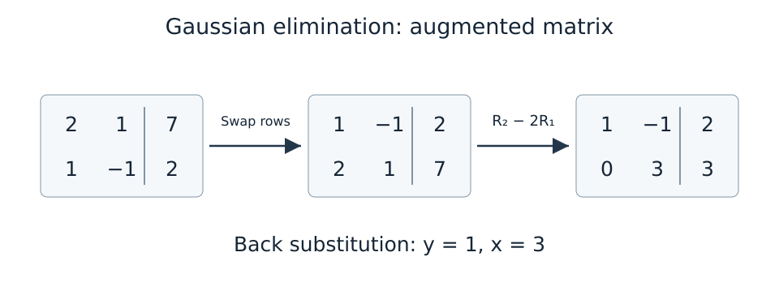

# M6-L1 – Matrix arithmetic and Gaussian elimination {#L1}

**Course area:** M6 – Matrices and transition models

**Level:** Upper secondary education · elective extension

**Prior knowledge:** [M1-L9](M1-L9.md); [M2-L13](M2-L13.md)

**Context:** Elective extension informed by Bavaria’s LehrplanPLUS M12; not a nationwide requirement.

## Learning objectives {#S1}

You will read matrix dimensions, add and multiply matrices, solve linear systems using reversible row operations, distinguish unique, infinitely many and absent solutions, and verify an inverse by multiplication.

## Matrices as ordered data {#S2}

A matrix $A=(a_{ij})$ with $m$ rows and $n$ columns has size $m\times n$. The first index identifies the row and the second the column. At a school kiosk, two rows might represent two days and three columns three products. In

$$A=\begin{pmatrix}4&2&1\\3&0&5\end{pmatrix}$$

$a_{23}=5$ represents five units of the third product on the second day. Matrices of equal size are added entry by entry; scalar multiplication scales every entry. Thus $2A$ represents doubled quantities, while $A+A$ retains the same dimensions. Matrices of different sizes cannot be added.

## Matrix products and order {#S3}

For an $m\times n$ matrix $A$ and an $n\times p$ matrix $B$, $(AB)_{ij}=\sum_{k=1}^n a_{ik}b_{kj}$. The inner dimensions agree; the product has size $m\times p$. With the price vector $v=(2,3,4)^T$ in euros, the kiosk receives $Av=(18,26)^T$ euros. Each entry comes from one row and one column, not from multiplying corresponding entries.

Even for square matrices, order matters. For

$$C=\begin{pmatrix}1&1\\0&1\end{pmatrix},\qquad D=\begin{pmatrix}2&0\\0&3\end{pmatrix}$$

$CD=\begin{pmatrix}2&3\\0&3\end{pmatrix}$ but $DC=\begin{pmatrix}2&2\\0&3\end{pmatrix}$. Matrix multiplication is associative but generally not commutative. With column vectors, $CDx$ means apply $D$ first, then $C$.

## Gaussian elimination {#S4}

Write a linear system as an augmented matrix $[A\mid b]$. Allowed operations are swapping rows, multiplying a row by a nonzero number, and adding a multiple of another row. Each operation is reversible and therefore preserves the solution set. The pivot is the leading entry used to eliminate entries beneath it. If a proposed pivot is zero, find a suitable entry beneath it and swap rows; if none exists, move to the next column.

Example: $2x+y=7$, $x-y=2$. First swap rows, then subtract twice the first row from the second:

$$\left(\begin{array}{cc|c}2&1&7\\1&-1&2\end{array}\right)\to\left(\begin{array}{cc|c}1&-1&2\\2&1&7\end{array}\right)\to\left(\begin{array}{cc|c}1&-1&2\\0&3&3\end{array}\right).$$

Back substitution gives $y=1$ and $x=3$. Checking gives $6+1=7$ and $3-1=2$. A row $[0\;0\mid1]$ indicates a contradiction. A zero row instead indicates a redundant equation. If a consistent system has a variable without a pivot, that variable can be freely chosen; there are infinitely many real solutions.

{alt="Three augmented matrices: row swap, elimination of 2 below the pivot, then back substitution."}

## Identity matrix and inverse {#S5}

The identity matrix $I_n$ has ones on the main diagonal and zeros elsewhere. A square matrix $A$ is invertible if a matrix $A^{-1}$ exists with $AA^{-1}=A^{-1}A=I_n$. For a $2\times2$ matrix,

$$\begin{pmatrix}a&b\\c&d\end{pmatrix}^{-1}=\frac1{ad-bc}\begin{pmatrix}d&-b\\-c&a\end{pmatrix}$$

provided $ad-bc\ne0$. For $E=\begin{pmatrix}2&1\\1&1\end{pmatrix}$, the inverse is $E^{-1}=\begin{pmatrix}1&-1\\-1&2\end{pmatrix}$. Their product is $I_2$. For larger square matrices, row operations can transform $[A\mid I]$ into $[I\mid A^{-1}]$, provided the identity can actually be obtained on the left. If $A$ is invertible, $Ax=b$ has the unique solution $x=A^{-1}b$. If $A$ is not invertible, solvability must be checked separately.

## Modelling and checking {#S6}

A theatre sells 30 tickets at 8 or 12 euros and receives 300 euros. With $x$ cheaper and $y$ more expensive tickets, $x+y=30$ and $8x+12y=300$. Subtracting eight times the first equation from the second gives $4y=60$, so $y=15$ and $x=15$. The model also requires nonnegative integers. A mathematical solution such as $y=15.25$ would not be a valid ticket count. With rounded measurements, small pivots can amplify rounding errors; exact fractions in hand calculations and substitution into the original system are therefore useful.

## Self-check {#S7}

### Exercises

1. Find the size of $A$ from S2 and $a_{12}$, and calculate $Av$ for $v=(1,2,3)^T$.
2. Calculate $CD$ and $DC$ from S3 and explain the different order of transformations.
3. Solve $x+2y=8$, $3x-y=3$ by elimination and verify your result.
4. Investigate the systems $x+y=4$, $2x+2y=8$ and $2x+2y=9$ (each with the same first equation).
5. Find the inverse of $F=\begin{pmatrix}3&2\\1&1\end{pmatrix}$ and solve $Fz=(7,3)^T$.

::: {.lc-solutions data-lc-section="S7"}
1. $2\times3$, $a_{12}=2$ and $Av=(11,18)^T$.
2. $CD=\begin{pmatrix}2&3\\0&3\end{pmatrix}$; $DC=\begin{pmatrix}2&2\\0&3\end{pmatrix}$. With column vectors, the right-hand factor acts first.
3. Subtracting three times the first row from the second gives $-7y=-21$, so $y=3$, $x=2$. Check: $2+6=8$, $6-3=3$.
4. The first case gives $0=0$; all $(x,y)=(4-t,t)$ with $t\in\mathbb R$ solve the system. The second gives $0=1$, so there is no solution.
5. $\det F=1$, $F^{-1}=\begin{pmatrix}1&-2\\-1&3\end{pmatrix}$. Hence $z=(1,2)^T$; check: $3+4=7$, $1+2=3$.
:::

## Sources {#S8}

- [OpenStax – College Algebra 2e, 7.5 Matrices and Matrix Operations](https://openstax.org/books/college-algebra-2e/pages/7-5-matrices-and-matrix-operations) · matrix operations · Last accessed: 2026-11-24 · Content verified: 2026-11-24
- [OpenStax – College Algebra 2e, 7.6 Solving Systems with Gaussian Elimination](https://openstax.org/books/college-algebra-2e/pages/7-6-solving-systems-with-gaussian-elimination) · row operations · Last accessed: 2026-11-24 · Content verified: 2026-11-24
- [OpenStax – College Algebra, 7.7 Solving Systems with Inverses](https://openstax.org/books/college-algebra/pages/7-7-solving-systems-with-inverses) · inverses and solvability · Last accessed: 2026-11-24 · Content verified: 2026-11-24
