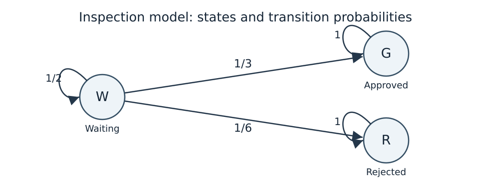

# M6-L2 – Transition matrices and absorbing states {#L2}

**Course area:** M6 – Matrices and transition models

**Level:** Upper secondary education · elective extension

**Prior knowledge:** [M6-L1](M6-L1.md); [M2-L15](M2-L15.md)

**Context:** Elective extension informed by Bavaria’s LehrplanPLUS M12; not a nationwide requirement.

## Learning objectives {#S1}

You will translate a state diagram into a transition matrix, calculate distributions after multiple steps, and check invariant distributions. For a model with absorbing states, you will determine the probability of a final outcome and distinguish model assumptions from measured data.

## States and transition matrices {#S2}

A discrete-time process is observed at times $n=0,1,2,\ldots$. A time-homogeneous Markov chain assumes that the conditional distribution of the next state depends only on the current state and that transition probabilities remain constant over time. We use row vectors: $p_{ij}$ is the probability of moving from state $i$ to state $j$. Each row of $P$ sums to one and all entries are nonnegative. Under the alternative column-vector convention, the matrix would be transposed.

A simplified bicycle rental model distinguishes $A$ (bike at station A) and $B$ (bike at station B). Suppose the hypothetical daily transitions are

$$P=\begin{pmatrix}3/4&1/4\\1/2&1/2\end{pmatrix}.$$

A bike at A remains there with probability $3/4$, whereas a bike at B moves to A with probability $1/2$. These invented numbers do not describe a measured rental operation.

## Distributions and multiple steps {#S3}

A distribution $v_n=(a_n,b_n)$ contains the probabilities of the two states; $a_n+b_n=1$. By the law of total probability, the next step is $v_{n+1}=v_nP$. For example, a bike starts at A with certainty, so $v_0=(1,0)$. Then $v_1=(3/4,1/4)$ and

$$v_2=v_1P=(9/16+1/8,3/16+1/8)=(11/16,5/16).$$

In general, $v_n=v_0P^n$, where $P^0=I$. The entries of $P^2$ are two-step transition probabilities. The probability of being at A after two days, starting at A, comes from two disjoint paths A–A–A and A–B–A. The total probability remains one because every row of $P$ sums to one.

## Invariant distribution and limiting behaviour {#S4}

An invariant distribution $\pi$ satisfies $\pi P=\pi$, has nonnegative entries and sums to one. For $\pi=(a,1-a)$, the first component gives $a=3a/4+(1-a)/2$, so $a=2/3$. Hence $\pi=(2/3,1/3)$. In the bicycle model, $a_{n+1}=1/2+a_n/4$, so $a_{n+1}-2/3=(a_n-2/3)/4$. Thus $a_n=2/3+(a_0-2/3)4^{-n}$: the distribution approaches the invariant distribution regardless of the starting distribution.

The existence of an invariant distribution alone does not guarantee convergence. For $P=\begin{pmatrix}0&1\\1&0\end{pmatrix}$, $(1/2,1/2)$ is stationary, whereas the start $(1,0)$ alternates between $(1,0)$ and $(0,1)$. Multiple invariant distributions can also exist, for example for the identity matrix.

## Absorbing states {#S5}

A state is absorbing if, once entered, it is retained with probability one. A simplified inspection process for an item has states $W$ (waiting for a decision), $G$ (approved) and $R$ (rejected). In each inspection round the item remains in W with probability $1/2$, is approved with probability $1/3$ and rejected with probability $1/6$. G and R are final. In the order W, G, R, the matrix is

$$Q=\begin{pmatrix}1/2&1/3&1/6\\0&1&0\\0&0&1\end{pmatrix}.$$

{alt="W leads to G with 1/3, to R with 1/6 and back to W with 1/2. G and R have self-loops of probability 1."}

The probability of still waiting after $n$ steps is $2^{-n}$. It tends to zero, so a decision is eventually reached with probability one. If $h$ is the probability of eventual approval starting at W, conditioning on the first step gives $h=1/3+h/2$. Rejection contributes zero and approval contributes one. Hence $h=2/3$ and the eventual rejection probability is $1/3$. After exactly $n$ rounds, the probability of approval is $(2/3)(1-2^{-n})$, because each additional round transfers one third of the remaining waiting mass to G.

## Application and limitations {#S6}

To estimate transitions from observations, divide the number of transitions to a particular destination by the total number observed from the corresponding starting state. Without observations, that row cannot be estimated. Use separate observation periods to test whether the probabilities are stable. If weather or day of the week affects bicycle movements, for example, a model with two constant states may be inadequate. More states or time-dependent matrices may then be useful. Moreover, absorption is not guaranteed merely by the existence of an absorbing state: it must also be reachable from other states; otherwise probability mass may remain outside indefinitely.

## Self-check {#S7}

### Exercises

1. Check whether $\begin{pmatrix}1/3&2/3\\1/4&3/4\end{pmatrix}$ is a transition matrix under the row convention. Calculate the distribution after one step from state 2.
2. Calculate $P^2$ for the bicycle model in S2 and the distribution after two days starting at B.
3. Solve the invariant-distribution equation for the matrix in exercise 1.
4. For the inspection model, calculate the distribution after two rounds starting at W.
5. Change the first row of the inspection model to $(1/4,1/4,1/2)$. Find the eventual approval probability and explain why a decision is reached with probability one.

::: {.lc-solutions data-lc-section="S7"}
1. Yes, the rows sum to one and all entries are nonnegative. The distribution is $(1/4,3/4)$.
2. $P^2=\begin{pmatrix}11/16&5/16\\5/8&3/8\end{pmatrix}$; starting at B gives $(5/8,3/8)$.
3. $a=a/3+(1-a)/4$, so $a=3/11$ and $\pi=(3/11,8/11)$; substitution confirms $\pi P=\pi$ for the matrix in the exercise.
4. $(1/4,1/2,1/4)$, since after round 1 the distribution is $(1/2,1/3,1/6)$.
5. $h=1/4+h/4$, so $h=1/3$. The waiting mass $(1/4)^n$ tends to zero; eventual rejection has probability $2/3$.
:::

## Sources {#S8}

- [Aditya Mahajan – Probability and Random Signals II, 11 Markov chains](https://adityam.github.io/probability-and-random-signals/markov-chains.html) · transition matrices, distributions, invariant distributions · Last accessed: 2026-11-24 · Content verified: 2026-11-24
