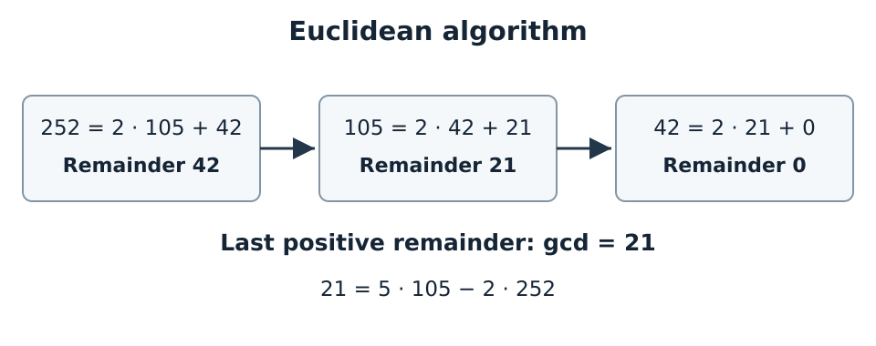

# M7-L1 – Divisibility, congruences and the Euclidean algorithm {#L1}

**Course area:** M7 – Elementary number theory

**Level:** Upper secondary education · elective extension

**Prior knowledge:** [M1-L1](M1-L1.md); [M1-L7](M1-L7.md)

**Context:** Elective extension informed by Bavaria’s LehrplanPLUS M12; not a nationwide requirement.

## Learning objectives {#S1}

You will determine divisibility, calculate the greatest common divisor (gcd) without prime factorisation, and justify the Euclidean algorithm. You will find Bézout coefficients, work with residue classes and solve linear congruences, checking when division modulo an integer is legitimate.

## Divisibility and division with remainder {#S2}

For integers $a\ne0$ and $b$, the notation $a\mid b$ means that $b=ak$ for some integer $k$. For instance, $7\mid35$ but $7\nmid36$. For $m>0$, every integer $a$ has a unique representation $a=qm+r$ with $0\le r<m$. The quotient may be negative: $-17=(-4)\cdot5+3$. The nonnegative remainder is 3. Divisibility by $m$ corresponds to a zero remainder.

The gcd of two integers, not both zero, is their largest positive common divisor. For $84$ and $30$, prime factorisations $84=2^2\cdot3\cdot7$ and $30=2\cdot3\cdot5$ give gcd 6. Factoring large integers is unnecessary here. Two numbers with gcd 1 are coprime; neither needs to be prime.

## Euclidean algorithm {#S3}

Suppose $a,b>0$ and $a=qb+r$. The pairs $(a,b)$ and $(b,r)$ have the same common divisors: every common divisor of $a,b$ divides $r=a-qb$, and every common divisor of $b,r$ divides $a=qb+r$. Hence $\gcd(a,b)=\gcd(b,r)$. Successive remainders strictly decrease until zero is reached. The last nonzero remainder is the gcd.

Example for $252$ and $105$:

$$252=2\cdot105+42,\qquad105=2\cdot42+21,\qquad42=2\cdot21+0.$$

Thus $\gcd(252,105)=21$. If one input is zero, $\gcd(a,0)=|a|$ for $a\ne0$. For negative inputs, first take absolute values.

{alt="Three divisions with remainders 42, 21 and 0; the last positive remainder 21 is the gcd."}

## Bézout and back substitution {#S4}

The gcd can be written as an integer linear combination $sa+tb$. Every computed remainder is an integer combination of its two predecessors; tracing these combinations back reaches the inputs. The method of finding $s,t$ is the extended Euclidean algorithm.

For the example, work backwards:

$$21=105-2\cdot42=105-2(252-2\cdot105)=5\cdot105-2\cdot252.$$

Checking gives $525-504=21$. The coefficients are not unique. Adding a multiple of $b/d$ to $s$ and subtracting the same multiple of $a/d$ from $t$ leaves $sa+tb=d$ unchanged, where $d=\gcd(a,b)$.

## Congruences and arithmetic rules {#S5}

For a modulus $m\ge2$, $a\equiv b\pmod m$ means $m\mid(a-b)$. Equivalently, the two integers have the same nonnegative remainder. Modulo 7, the integers $-2$, $5$ and $12$ are congruent. The seven residue classes have representatives $0,1,\ldots,6$. If $a\equiv b$ and $c\equiv d$ modulo $m$, then $a+c\equiv b+d$ and $ac\equiv bd$ modulo $m$. For example, $(19\cdot23)\bmod7=(5\cdot2)\bmod7=3$. Powers of congruent numbers with nonnegative integer exponents are also congruent.

Cancellation is not always legitimate: $2\cdot1\equiv2\cdot4\pmod6$, yet $1\not\equiv4\pmod6$. Ordinary division by 2 would lose a solution.

## Modular inverses and linear congruences {#S6}

An inverse of $a$ modulo $m$ is an integer $u$ satisfying $au\equiv1\pmod m$. It exists exactly when $\gcd(a,m)=1$: Bézout then gives $sa+tm=1$, hence $sa\equiv1\pmod m$. Conversely, any common divisor of $a,m$ must divide 1 if $au-1$ is a multiple of $m$. The inverse is unique as a residue class because multiplication by an existing inverse cancels the factor $a$.

Example: $26=3\cdot7+5$, $7=5+2$, $5=2\cdot2+1$. Back substitution gives $1=3\cdot26-11\cdot7$. Thus $7^{-1}\equiv-11\equiv15\pmod{26}$; check $7\cdot15=105=4\cdot26+1$. The congruence $7x\equiv9\pmod{26}$ gives $x\equiv15\cdot9\equiv5\pmod{26}$.

In general, $ax\equiv b\pmod m$ has a solution exactly when $d=\gcd(a,m)$ divides $b$. Necessity follows from $ax-my=b$; sufficiency follows by multiplying a Bézout representation of $d$ by $b/d$. If solvable, divide the entire integer equation by $d$ to obtain a congruence modulo $m/d$. When $m/d>1$, the remaining coefficient is invertible. Exactly $d$ of the original $m$ residue classes are solutions. When $m/d=1$, all classes are solutions. Example: $4x\equiv6\pmod{10}$ becomes $2x\equiv3\pmod5$, hence $x\equiv4\pmod5$. Modulo 10 the solutions are 4 and 9.

## Self-check {#S7}

### Exercises

1. Find the quotient and remainder of $-29$ divided by 8. Does $8\mid-29$ hold?
2. Calculate $\gcd(198,72)$ using the Euclidean algorithm.
3. Express the gcd from exercise 2 as an integer combination of 198 and 72.
4. Find the inverse of 9 modulo 28 and solve $9x\equiv4\pmod{28}$.
5. Solve $6x\equiv9\pmod{15}$ and explain why $6x\equiv8\pmod{15}$ has no solution.

::: {.lc-solutions data-lc-section="S7"}
1. $-29=(-4)\cdot8+3$. Quotient $-4$, remainder 3; not divisible.
2. $198=2\cdot72+54$, $72=54+18$, $54=3\cdot18$; gcd 18.
3. $18=72-54=3\cdot72-198$. Check: $216-198=18$.
4. $28-3\cdot9=1$, so the inverse is $-3\equiv25$. $x\equiv25\cdot4\equiv16\pmod{28}$; $9\cdot16=144\equiv4$.
5. $d=3$. The first congruence reduces to $2x\equiv3\pmod5$, giving $x\equiv4\pmod5$; residue classes 4, 9, 14 modulo 15. The second has no solution because 3 does not divide 8.
:::

## Sources {#S8}

- [MIT 18.310 – Michel Goemans, Modular Arithmetic and Elementary Algebra (2015)](https://math.mit.edu/~goemans/18310S15/modarithm-algebra-notes.pdf) · §§ 1–2, pp. 1–4 · Last accessed: 2026-11-24 · Content verified: 2026-11-24
