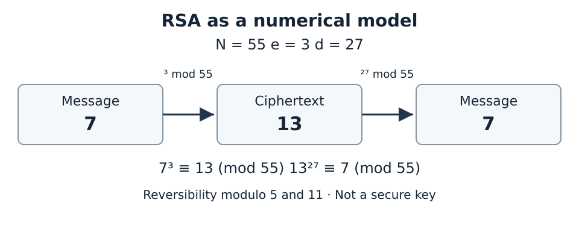

# M7-L2 – Chinese remainder theorem, Fermat and RSA as a mathematical model {#L2}

**Course area:** M7 – Elementary number theory

**Level:** Upper secondary education · elective extension

**Prior knowledge:** [M7-L1](M7-L1.md)

**Context:** Elective extension informed by Bavaria’s LehrplanPLUS M12; not a nationwide requirement.

## Learning objectives {#S1}

You will combine remainder conditions using the Chinese remainder theorem, calculate large powers by repeated squaring and prove Fermat’s little theorem. You will distinguish a conclusive trial-division primality test from a Fermat test, and explain why encryption and decryption agree in a numerical RSA model.

## Chinese remainder theorem {#S2}

If $m,n\ge2$ are coprime, the conditions $x\equiv a\pmod m$ and $x\equiv b\pmod n$ determine exactly one residue class modulo $mn$. Set $x=a+mk$. The second condition becomes $mk\equiv b-a\pmod n$. Coprimality guarantees that $m$ has an inverse modulo $n$, so there is a unique class for $k$ modulo $n$. Changing $k$ by $n$ changes $x$ by $mn$. This establishes both existence and uniqueness.

Example: $x\equiv2\pmod5$, $x\equiv3\pmod7$. Set $x=2+5k$, giving $5k\equiv1\pmod7$. The inverse of 5 is 3, hence $k\equiv3\pmod7$ and $x\equiv17\pmod{35}$. Check: $17\bmod5=2$, $17\bmod7=3$. All solutions are $17+35t$ with integer $t$. For several pairwise coprime moduli, combine the conditions successively. Without coprimality, conditions may conflict, such as $x\equiv0\pmod4$ and $x\equiv1\pmod6$ (even versus odd).

## Modular exponentiation {#S3}

To find $a^k\bmod m$, there is no need to compute the full power first. Square the latest remainder repeatedly to obtain exponents $1,2,4,8,\ldots$. Express $k$ as a sum of distinct powers of two and multiply the corresponding remainders. Reduce modulo $m$ after each multiplication.

Example: $3^{13}\bmod17$. We have $3^2\equiv9$, $3^4\equiv13$, $3^8\equiv16\pmod{17}$. Since $13=8+4+1$, $3^{13}\equiv16\cdot13\cdot3\equiv12\pmod{17}$. For $k=0$, the remainder is 1. The number of squarings and additional multiplications grows only logarithmically with a positive exponent $k$.

## Fermat’s little theorem {#S4}

If $p$ is prime and $p\nmid a$, then $a^{p-1}\equiv1\pmod p$. To prove this, consider the $p-1$ numbers $a,2a,\ldots,(p-1)a$ modulo $p$. None has remainder zero, and two distinct factors cannot give the same remainder: from $ai\equiv aj\pmod p$, the inverse of $a$ gives $i\equiv j\pmod p$. The list therefore contains each remainder from 1 to $p-1$ exactly once. Multiplying gives

$$a^{p-1}(p-1)!\equiv(p-1)!\pmod p.$$

Since none of the integers from 1 to $p-1$ is divisible by $p$, their product is not divisible by $p$ either. Its inverse permits cancellation. This proves the theorem. For every integer $a$, we also have $a^p\equiv a\pmod p$: if $p\mid a$, both sides are zero; otherwise multiply the first formula by $a$.

## Testing primes {#S5}

An integer $n\ge2$ is prime if it has no divisor between 2 and $\lfloor\sqrt n\rfloor$. If $n=uv$ with $u,v>1$, at least one factor must be at most $\sqrt n$. For 97 it suffices to check prime divisors 2, 3, 5 and 7; none divides 97. For 91 the divisor 7 is found. Trial division is conclusive but expensive for large numbers.

A Fermat test can detect many composite integers more quickly: for $1<a<n$, $a^{n-1}\not\equiv1\pmod n$ disproves primality. Passing the test for a single base does not prove primality. Example: $341=11\cdot31$, yet $2^{10}=1024\equiv1\pmod{341}$, so $2^{340}\equiv1\pmod{341}$. A base-2 test would miss this composite number.

## RSA as a mathematical model {#S6}

Choose distinct primes $p=5$, $q=11$. Then $N=pq=55$ and $\varphi(N)=(p-1)(q-1)=40$. Choose $e=3$ with $\gcd(e,40)=1$; the inverse of 3 modulo 40 is $d=27$, since $3\cdot27=81=1+2\cdot40$. The public numerical pair is $(N,e)$; the private exponent pair is $(N,d)$. For a message $0\le M<N$, the model defines $C=M^e\bmod N$ and $M'=C^d\bmod N$. With $M=7$, $C=343\bmod55=13$; reversing the calculation gives $13^{27}\bmod55=7$.

Why does this work even for messages not coprime to $N$? We have $ed=1+2(p-1)(q-1)$. If $p\nmid M$, Fermat gives $M^{ed}\equiv M\pmod p$; if $p\mid M$, both sides are zero. The congruence also holds modulo $q$. The Chinese remainder theorem gives $M^{ed}\equiv M\pmod N$. Since $M$ and $M'$ lie between 0 and $N-1$, they are equal. This proves mathematical reversibility, not security.

{alt="Message 7 becomes 13 by raising to power 3 modulo 55; exponent 27 recovers 7. Congruences modulo 5 and 11 establish reversibility."}

This deliberately tiny example is insecure and must not be used to protect data. Real RSA requires, among other things, suitable key sizes, vetted implementations and standardised message encoding; cryptographic security does not follow from the mathematical identity alone.

## Self-check {#S7}

### Exercises

1. Solve $x\equiv1\pmod4$ and $x\equiv2\pmod9$.
2. Calculate $5^{11}\bmod13$ by repeated squaring.
3. Simplify $7^{100}\bmod11$ using Fermat and justify the assumptions.
4. Test 143 by trial division. Explain why passing a Fermat test for one base does not prove primality.
5. In the RSA model $N=55,e=3,d=27$, encrypt message 10 and reverse the calculation. Why is the message valid despite its common divisor 5?

::: {.lc-solutions data-lc-section="S7"}
1. $x=1+4k$, $4k\equiv1\pmod9$. The inverse of 4 modulo 9 is 7. Thus $x\equiv29\pmod{36}$. Check: 29 has remainders 1 and 2.
2. $5^2\equiv12$, $5^4\equiv1$, $5^8\equiv1\pmod{13}$. Since $11=8+2+1$, the result is $1\cdot12\cdot5\equiv8$.
3. 11 is prime and does not divide 7. $7^{10}\equiv1\pmod{11}$, hence $7^{100}\equiv1$.
4. $143=11\cdot13$; 11 is below $\sqrt{143}$ and is a divisor. Composite numbers can satisfy the Fermat congruence for individual bases, as 341 in S5 shows.
5. $10^3\bmod55=10$; $10^{27}\bmod55=10$. Modulo 5 the message is zero; modulo 11 it is $-1$ and exponent 27 is odd. Reversibility holds in both residue classes and hence modulo 55.
:::

## Sources {#S8}

- [MIT 18.310 – Michel Goemans, Modular Arithmetic and Elementary Algebra (2015)](https://math.mit.edu/~goemans/18310S15/modarithm-algebra-notes.pdf) · §§ 4–5, pp. 6–8 · Last accessed: 2026-11-24 · Content verified: 2026-11-24
- [Veerman – Fermat’s Little Theorem and Primality Testing](https://math.libretexts.org/Bookshelves/Combinatorics_and_Discrete_Mathematics/An_Introduction_to_Number_Theory_%28Veerman%29/05%3A_Modular_Arithmetic_and_Primes/5.03%3A_New_Page) · § 5.3 · Last accessed: 2026-11-24 · Content verified: 2026-11-24
- [Dumas and McCarthy – Fermat’s Little Theorem](https://math.libretexts.org/Bookshelves/Mathematical_Logic_and_Proof/Transition_to_Higher_Mathematics_%28Dumas_and_McCarthy%29/07%3A_New_Page/7.04%3A_New_Page) · § 7.4 · Last accessed: 2026-11-24 · Content verified: 2026-11-24
