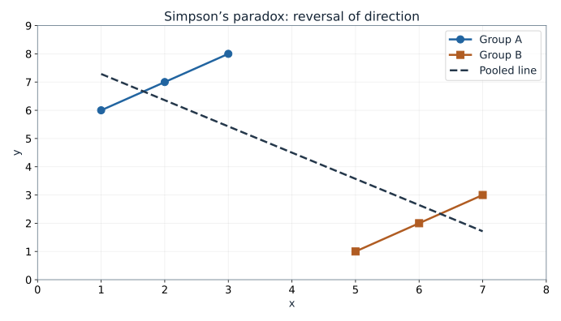

# M8-L1 – Measurement scales, regression and correlation {#L1}

**Course area:** M8 – Advanced data analysis

**Level:** Upper secondary education · elective extension

**Prerequisites:** [M1-L6](M1-L6.md); [M1-L8](M1-L8.md)

**Placement:** Elective extension under the Bavarian LehrplanPLUS M12; not compulsory nationwide.

## Learning objectives {#S1}

You distinguish measurement scales, calculate a least-squares line and Pearson's correlation coefficient, interpret residuals and identify limitations of statistical models. You compare grouped and pooled data and explain a reversal of direction in Simpson's paradox.

## Measurement scales and meaningful analyses {#S2}

The meaning of a number depends on how it is measured. A nominal variable distinguishes categories without a ranking (e.g. bus or bicycle); numeric codes do not create measurable distances. Frequencies and the mode are meaningful. Ordinal variables have a ranking (e.g. low, medium, high) but not necessarily equal intervals; medians and rank comparisons are possible. On an interval scale, differences are interpretable, as with Celsius temperatures, but ratios of readings are not. A ratio scale also has a meaningful zero, as with duration or length. Two hours are twice one hour; 20 °C is not twice as warm as 10 °C.

Discrete counts can also be quantitative. The key question is whether an operation has a meaningful interpretation. For the following linear regression, we use two quantitative variables with meaningful differences.

## Scatterplots and least squares {#S3}

Each data point $(x_i,y_i)$ is a pair of measurements from the same observation. We select $x$ as the explanatory variable and $y$ as the response. A line $\hat y=a+bx$ provides fitted values; residuals $e_i=y_i-\hat y_i$ are vertical deviations. Least squares minimises $Q(a,b)=\sum_i e_i^2$, not geometric distances to the line.

Define $S_{xx}=\sum_i(x_i-\bar x)^2$, $S_{yy}=\sum_i(y_i-\bar y)^2$ and $S_{xy}=\sum_i(x_i-\bar x)(y_i-\bar y)$. If $S_{xx}>0$, then

$$b=\frac{S_{xy}}{S_{xx}},\qquad a=\bar y-b\bar x.$$

Why? For fixed $b$, the quadratic function $Q$ of $a$ is minimised at $a=\bar y-b\bar x$. Substitution leaves $Q=S_{yy}-2bS_{xy}+b^2 S_{xx}$. Completing the square yields the stated minimum. The line therefore passes through $(\bar x,\bar y)$. If all $x_i$ are equal, the slope is not uniquely determined.

## Worked example and correlation {#S4}

An artificial dataset contains $(1,2),(2,4),(3,3)$. The means are $\bar x=2$, $\bar y=3$. We obtain $S_{xx}=2$, $S_{yy}=2$, $S_{xy}=1$, hence $\hat y=2+0.5x$. The fitted values 2.5, 3, 3.5 yield residuals −0.5, 1, −0.5. Their sum is zero and their sum of squares is 1.5.

For two nonconstant quantitative variables,

$$r=\frac{S_{xy}}{\sqrt{S_{xx}S_{yy}}},\qquad -1\le r\le1.$$

Here $r=0.5$. Its sign agrees with the slope's sign. Its magnitude describes the strength of the linear association, not the magnitude of the slope. For simple regression with an intercept, $R^2=r^2=0.25$: the residual sum of squares is 25% smaller than for a constant-mean model. This does not mean that 25% of observations were predicted correctly. If $y$ is constant, $r$ is undefined. Positive rescaling of units leaves $r$ unchanged but generally changes the slope.

## Simpson's paradox: consider groups {#S5}

Consider two artificial groups A with $(1,6),(2,7),(3,8)$ and B with $(5,1),(6,2),(7,3)$. Within each group $b=1$ and $r=1$. After pooling, the means are $\bar x=4$, $\bar y=4.5$, with $S_{xx}=28$ and $S_{xy}=-26$. The pooled slope is $-13/14\approx-0.929$. The direction reverses because the groups differ in both their typical $x$ and $y$ levels.

{alt="Group A is upper left and group B lower right. Both within-group lines increase, but the pooled regression line decreases."}

This illustrates Simpson's paradox. Pooling is not an arithmetic error; it answers a different question from a within-group comparison. The relevant grouping must be determined from the data collection process and research question. Statistical grouping alone cannot establish causality.

## Limitations and checks {#S6}

Correlation can result from a shared influencing variable. Even $r=1$ does not establish causality. Conversely, a strong nonlinear relationship can yield $r=0$: for $x=-1,0,1$ and $y=x^2$, $S_{xy}$ is zero despite complete functional dependence. Outliers can strongly change the line and $r$; they must not be removed without a substantive justification.

First draw a scatterplot, calculate the line, plot residuals against $x$ and look for patterns. Check units, missing values, grouping and provenance. Predictions outside the observed range are extrapolations and require additional assumptions. Even inside the range, a line is not a guarantee for individual observations.

## Self-assessment {#S7}

### Exercises

1. Classify mode of transport, rank, Celsius temperature and journey duration using the four measurement scales.
2. Find the line and correlation for $(1,1),(2,3),(3,5)$.
3. For the example in S4, calculate the fitted value at $x=2.5$ and explain why this is interpolation.
4. For the groups in S5, determine both individual lines and the intercept of the pooled line.
5. Use the example $y=x^2$ from S6 to explain why $r=0$ does not imply independence.

::: {.lc-solutions data-lc-section="S7"}
1. Nominal, ordinal, interval, ratio.
2. $\hat y=-1+2x$, $r=1$, all residuals zero.
3. $\hat y=3.25$. The value 2.5 is between 1 and 3, the observed range.
4. A: $\hat y=x+5$; B: $\hat y=x-4$. Pooled: $a=4.5+52/14=115/14\approx8.214$.
5. For the three symmetric values, the positive and negative products in $S_{xy}$ cancel, giving $r=0$. Nevertheless, $y$ is uniquely determined by $x$.
:::

## Sources {#S8}

- [OpenStax – Introductory Business Statistics 2e, 1.3 Levels of Measurement](https://openstax.org/books/introductory-business-statistics-2e/pages/1-3-levels-of-measurement) · 1.3 · Last accessed: 2026-11-24 · Content verified: 2026-11-24
- [Monash University – Correlation and least squares regression line](https://www.monash.edu/student-academic-success/mathematics/linear-regression-and-linear-relations/correlation-and-least-squares-regression-line) · Pearson coefficient, least squares, interpolation · Last accessed: 2026-11-24 · Content verified: 2026-11-24
- [Rafael A. Irizarry – Introduction to Data Science, 19.5 Simpson’s paradox](https://rafalab.dfci.harvard.edu/dsbook/association-is-not-causation.html) · 19.5 · Last accessed: 2026-11-24 · Content verified: 2026-11-24
