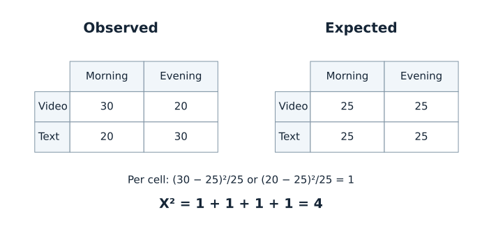

# M8-L2 – Independence testing and critical data analysis {#L2}

**Course area:** M8 – Advanced data analysis

**Level:** Upper secondary education · elective extension

**Prerequisites:** [M8-L1](M8-L1.md); [M2-L16](M2-L16.md)

**Placement:** Elective extension under the Bavarian LehrplanPLUS M12; not compulsory nationwide.

## Learning objectives {#S1}

You construct contingency tables, calculate expected counts under independence and perform Pearson's chi-square test. You distinguish statistical significance from effect size and causality and examine media claims for distorted denominators or unjustified conclusions.

## Contingency tables and hypotheses {#S2}

We consider two categorical variables. In a hypothetical random sample of 100 independently selected people, we record preferred learning format (video or text) and preferred study time (morning or evening). Each person belongs to exactly one cell. The observed counts $O_{ij}$ are:

| Format | Morning | Evening | Total |
|---|---:|---:|---:|
| Video | 30 | 20 | 50 |
| Text | 20 | 30 | 50 |
| Total | 50 | 50 | 100 |

The null hypothesis $H_0$ states that learning format and study time are independent in the underlying population. Thus $P(A\cap B)=P(A)P(B)$ for every combination of categories. The alternative $H_1$ states that this fails for at least one combination. A significance level, for example $\alpha=0.05$, is chosen before analysis.

## Expected counts and test statistic {#S3}

Under $H_0$, we estimate marginal probabilities using observed marginal proportions. For $n$ observations,

$$E_{ij}=n\cdot\frac{R_i}{n}\cdot\frac{C_j}{n}=\frac{R_iC_j}{n},$$

where $R_i$ is the row total and $C_j$ the column total. Expected counts need not be integers. In the example all four expected counts are 25. Expected marginal totals agree with observed marginal totals.

{alt="Observed table 30, 20, 20, 30; expected counts under independence are all 25. Each cell contributes 1 to the test statistic of 4."}

Pearson's test statistic is

$$X^2=\sum_{i=1}^{k}\sum_{j=1}^{m}\frac{(O_{ij}-E_{ij})^2}{E_{ij}}.$$

With four cells having deviations of ±5, $X^2=4\cdot25/25=4$. Larger values indicate greater discrepancies relative to expected counts, but do not alone determine a decision.

## Degrees of freedom and p-value {#S4}

For $k$ rows and $m$ columns, there are $(k-1)(m-1)$ degrees of freedom: when marginal totals are fixed, the upper-left $(k-1)\times(m-1)$ block can be chosen freely within the count constraints; the remaining cells are determined. Under appropriate conditions, $X^2$ has approximately a chi-square distribution under $H_0$ with these degrees of freedom. We use the uncorrected Pearson statistic.

Here $df=1$. The p-value is the probability under $H_0$ of obtaining a test statistic at least as large: $p=P(\chi^2_1\ge4)\approx0.0455$. At $\alpha=0.05$ we reject $H_0$; at $\alpha=0.01$ we do not. The p-value is neither the probability that $H_0$ is true nor the probability that the result is merely due to chance. Failure to reject does not establish independence.

The test requires independent observations and mutually exclusive categories. For school-level use we adopt the conservative rule of thumb that every $E_{ij}\ge5$. Empty marginal categories must be excluded beforehand; for small expected counts, the approximation can be unsuitable (for a 2×2 table, Fisher's exact test is one alternative). Repeated responses from one individual are not independent observations.

## Reproducible software analysis and effect size {#S5}

With Python and SciPy installed, the computation can be reproduced:

```python
from scipy.stats import chi2_contingency
observed = [[30, 20], [20, 30]]
x2, p, df, expected = chi2_contingency(observed, correction=False)
print(x2, p, df, expected)
```

The expected output is 4, approximately 0.0455, 1, and a 2×2 matrix containing four 25s. The option `correction=False` matters because software may otherwise apply a continuity correction for one degree of freedom. Alternatively, calculate $E$ and $X^2$ in a spreadsheet and obtain the right-tail probability using its chi-square function. Record software, data, settings and rounding.

A descriptive effect size for 2×2 tables is $|\phi|=\sqrt{X^2/n}$; here it is 0.2. The observed morning proportions are 60% (video) and 40% (text), a difference of 20 percentage points. Doubling each cell preserves that difference and $|\phi|$, but doubles $X^2$ to 8; the p-value drops to approximately 0.00468. This compares two hypothetical samples; it is not a justification for duplicating observations.

## Critical analysis of media claims {#S6}

The claim "video learning causes a preference for mornings" does not follow from the table. An unmeasured timetable could influence both variables. Before interpreting results, check sample selection, missing responses, exact group definitions and the period of data collection. Compare proportions with their proper denominators, and distinguish absolute counts, percentages and percentage points. A bar chart with a truncated axis can make small differences look large. Inspect axes and units; display uncertainty when available.

Testing many associations after observing data increases the chance of at least one apparently notable result. Report nonsignificant results as well, label exploratory analysis and distinguish it from prespecified hypotheses. Significance alone establishes neither relevance nor causality.

## Self-assessment {#S7}

### Exercises

1. Calculate all expected counts for the table $\begin{pmatrix}20&10\\10&20\end{pmatrix}$.
2. Calculate $X^2$, $df$ and the decision at $\alpha=0.05$ for exercise 1. Use the critical value 3.841.
3. A 3×4 table has positive marginal totals and sufficiently large expected counts. How many degrees of freedom does the test have?
4. For a table with $n=80$, $X^2=3.2$. Calculate $|\phi|$ if it is a 2×2 table. Can a causal claim be made?
5. An article reports 20 of 50 versus 30 of 100 as "50% more success" for the second group. Assess the claim and name one further piece of information needed.

::: {.lc-solutions data-lc-section="S7"}
1. Row and column totals are all 30; $n=60$. Every $E_{ij}=15$.
2. $X^2=4\cdot25/15=20/3\approx6.667$, $df=1$. Since $6.667>3.841$, reject $H_0$ (subject to the test assumptions).
3. $(3-1)(4-1)=6$.
4. $|\phi|=\sqrt{3.2/80}=0.2$. No, association does not establish a cause.
5. Absolute counts rise from 20 to 30, but proportions fall from 40% to 30% (−10 percentage points). Relevant information includes sample selection, time period or definition of success.
:::

## Sources {#S8}

- [OpenStax – Introductory Statistics 2e, 11.3 Test of Independence](https://openstax.org/books/introductory-statistics-2e/pages/11-3-test-of-independence) · 11.3 · Last accessed: 2026-11-24 · Content verified: 2026-11-24
